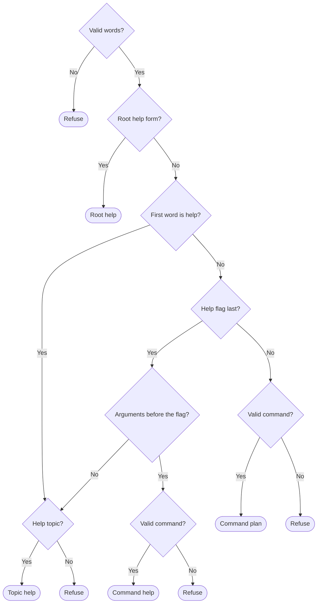

# Argument parser

Owns `src/argument-parser.mjs`. Exports the module function `parseArgv(argv)` and the class `CommandInputError`.

`parseArgv` decides whether one `pdd` command line is admitted. It reads routes only from `PUBLIC_COMMAND_ROUTES` in the [command catalog](command-catalog.prompt.md). The catalog owns route IDs, prefixes, local dispositions, workflow names and operand and option declarations. This module owns admission: how words select a route, when help wins, and what each operand type and option kind accepts. The [CLI](pdd-cli.prompt.md) calls it with the words after `pdd`, before any local read. The parser reads no file or environment variable, writes no output and starts no process.

It returns a frozen **command plan** for a matched route with valid arguments, or a frozen **help plan** for root, group or command help. Every other input throws `CommandInputError` with `exitCode` 2.

Preservation: behavioral refinement. Keep the export names and binding kinds, the plan fields and values, the exact set of admitted and refused argv, the error class with its `name` and `exitCode`, and the absence of effects. The message wording, private helpers, data structures and internal check order may vary.

## Choose help, a command or a refusal

The main question is when help wins over a command and when help is refused.

The decisions mean:

- **Valid words**: `argv` is an array of strings, and no string holds a NUL character.
- **Help flag**: the exact word `--help` or `-h`.
- **Root help form**: no words, or one help flag only.
- **First word is help**: the first word is exactly `help`. The rest is the topic.
- **Help flag last**: two or more words, and the last is a help flag. Exception: when `argv` starts with a route whose `local` is `session` and contains `--`, the help flag is request text and the line is parsed as a command.
- **Arguments before the flag**: the words before the flag start with a whole route prefix and have more words after it. Otherwise those words are the topic.
- **Help topic**: empty, exactly one route prefix, or one word that begins a longer route prefix (today only `workflow`). Any other topic refuses, such as `help session extra`.
- **Valid command**: the words start with a whole route prefix, and the rest satisfies the [argument rules](#argument-rules). Before a help flag the words must form a complete command. So `workflow run feature --help` refuses because ISSUE is missing, while `workflow run --help` gives help. Reason: help must not hide invalid or incomplete input.

`helpPrefix` is the topic for topic help, empty for root help, and the route prefix for command help, never the arguments. A help flag that is not last is an ordinary option word and refuses.

**Route match.** Prefix words match exactly and case-sensitively, with no abbreviation or alias. The longest matching prefix wins. Words that start no catalogued route refuse. This includes bare `workflow`, recipe names outside the catalog and every unknown, removed or private command.

## Argument rules

These rules apply to the words after the route prefix and use that route's declarations.

- **Option word.** Before the end-of-options marker, a word that starts with `-` is an option word. It must exactly equal a declared option name, so `--agent=claude`, `-` and `-1` refuse. An option may appear once only, even with the same value. Options may come before, between or after operands.
- **Flag option.** A `flag` option takes no value and records `true`.
- **Value option.** A `value` option takes the next word as its value, even when that word starts with `-`. The value must exactly equal one of the declared `choices`. A missing or other value refuses.
- **End-of-options marker.** Only on routes whose `local` is `session` (the session and the recipe shortcuts), the first `--` ends option parsing and is dropped. Every later word is request text, including `--`, `--help` and words that start with `-`. On other routes `--` refuses as an undeclared option. Reason: a request can quote flag-like words, but PDD never forwards flags to the native agent.
- **Operand count.** Each operand without `optional: true` is required. Extra words refuse unless the last declared operand has `repeat: true`. Then they take its type.
- **Operand type.** Each operand must satisfy its type in the table below. An unknown type refuses, so a new catalog type cannot admit unchecked words.

<strong>What each operand type accepts</strong>

| Type | Accepted word |
| --- | --- |
| `text` | Any word, including an empty word. |
| `workflow-name` | 1 to 64 characters. A lowercase ASCII letter, then lowercase ASCII letters and digits, with single hyphens between nonempty groups. No leading, trailing or double hyphen. |
| `issue` | One of three forms, where N is a positive decimal number with no sign and no leading zero: N; `OWNER/REPO#N`; or exactly `https://github.com/OWNER/REPO/issues/N` with one optional trailing `/`. OWNER is an ASCII letter or digit, then ASCII letters, digits or hyphens. REPO is one or more ASCII letters, digits, `_`, `.` or `-`. |
| `uuid` | A UUID version 4: groups of 8, 4, 4, 4 and 12 hexadecimal digits joined by hyphens. The third group starts with `4`. The fourth group starts with `8`, `9`, `a` or `b`. Hex letters may be lowercase or uppercase. |
| `choice:` values | Exactly one of the listed values, such as `bash` or `zsh`. |

These checks are syntax only. Do not check a `workflow-name` against the bundled names; the [definition loader](workflow-definition-loader.prompt.md) decides which definitions exist. The name must be safe because it names a definition folder and becomes part of a branch name. The [workflow runner](workflow-runner.prompt.md) decides whether an issue or a saved run exists.

## Plans and refusal

<strong>Plan fields, immutability and the refusal error</strong>

A **command plan** has these fields:

- `commandId`: the route `id`.
- `local`: the route's local disposition.
- `workflowName`: copied from the route. Present only on recipe shortcuts.
- `operands`: the operand words, unchanged and in input order. The end-of-options marker is not included. Request words stay separate; the CLI joins them.
- `options`: one key for each supplied option, named as declared (such as `--agent`). The value is `true` for a flag or the chosen string. An omitted option has no key. This module applies no default; the CLI supplies the default native agent `codex`.

A **help plan** is `{ commandId: 'help', local: 'help', helpPrefix }`, where `helpPrefix` is an array of words. It has no `operands` or `options`.

A plan has only these fields. It carries no argument list to forward to a native agent.

Each call returns new objects. The plan and its `operands`, `options` and `helpPrefix` are frozen. The caller's `argv` is never changed, and the plan shares no array with it.

`CommandInputError` extends `Error`. Each instance has `name` `'CommandInputError'` and `exitCode` 2. Every refusal throws one, for any input, including a non-array. Its message is a plain sentence that points to `pdd --help`. Build it without any part of `argv`. Reason: argv can hold secrets, control characters or hostile text, and the CLI prints the message.

## Dependencies

- [Prompting guide](../../docs/prompting-guide.md) — authoring and review method for this prompt.
- [public boundary](public-boundary.prompt.md) — shared command scope and exit-code policy; authoring and review. Local consequence: only catalogued local commands are admitted, a refusal is exit code 2 before any effect, and a refusal does not echo input.
- [command catalog](command-catalog.prompt.md) — owner of `PUBLIC_COMMAND_ROUTES` in `src/command-catalog.mjs`: route IDs, prefixes, local dispositions, workflow names, and operand and option declarations. Uses: generation, runtime (this module imports the frozen constant) and testing.
- No Node built-in or external tool. The module uses only JavaScript language facilities. Other links are navigation only.
