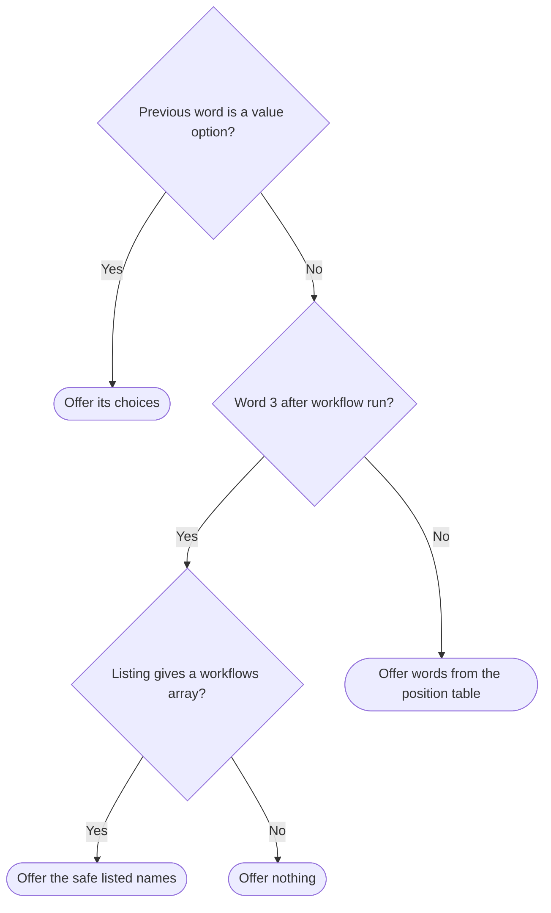

# Shell completion

Owns `src/completion.mjs`. Exports the module function `renderCompletion(shell)`.

The module renders a `pdd` completion script for bash or zsh. The person loads the script in their own shell. Then the shell completes command words, option values and workflow names. Command words come only from the [command catalog](command-catalog.prompt.md), so help, the parser and completion share one command set.

The input is one shell name. The result is the script text, which the [CLI](pdd-cli.prompt.md) prints for `pdd completion bash|zsh`. The loaded script calls a program only for the NAME after `workflow run`: it reads the local `pdd workflow list --json`.

Preservation: behavioral refinement. Keep the export and its binding kind, the accepted shell names and the `TypeError`, the final newline, the shell function and registration names, the words offered at each position, and the listing call with its safety and failure rules. The script layout, quoting, helper names, the order of offered words and the Node program text may vary.

## Render the script

`renderCompletion(shell)` accepts exactly the strings `bash` and `zsh`. Any other value throws `TypeError`, for example `Bash`, `fish`, `null` or a missing argument. The message is not part of the contract. The result is one string that ends with a newline, because the CLI writes it without adding one.

Rendering reads only the imported catalog. It reads no file, starts no process, uses no network and changes no shell configuration. The person decides where to save or load the text.

<strong>Shell interface: first line, function, registration and word variables</strong>

| | bash | zsh |
| --- | --- | --- |
| First line | free | `#compdef pdd` |
| Completion function | `_pdd_complete` | `_pdd` |
| Registration | `complete -F _pdd_complete pdd` | `compdef _pdd pdd` |
| Loading | `source` the text | `source` the text after `compinit` |
| Words read | `COMP_WORDS`, `COMP_CWORD` | `words`, `CURRENT` |
| Words returned | `COMPREPLY`, filtered by the typed part | the array `choices`, passed to `_describe` |

Keep these names. Reason: a loaded script is checked by setting the shell's word variables and calling the function directly. Loading only defines and registers the function; it runs no program.

## Choose the offered words

Words are counted after `pdd`. The last word is the one being completed. It can be empty or partial. The shell offers only the words that start with the typed part.

Completion does not validate the command line. The [argument parser](argument-parser.prompt.md) does that when the command runs. So a word can be offered in a line that the parser later refuses.

**Value option rule.** A value option is a catalog option with `choices`: `--agent` with `codex`, `claude`, and `--decision` with `approve`, `skip`. When the previous word is a value option, offer exactly its choices. This applies at every position, also after NAME, ISSUE, RUN_ID or request text, and wins over the other rules. It checks only the previous word, not whether the command takes that option.

**Position rule.** In all other cases, use this table. The text before each colon is the rule. The words after it are what the current catalog gives.

| Completing | Offered words |
| --- | --- |
| Word 1 | `--help`, `-h` and the first word of every route: `--skill`, `--version`, `completion`, `help`, `session`, `workflow` |
| Word 2 after `help` | The first word of every route that does not start with `-`: `completion`, `help`, `session`, `workflow` |
| Word 2 after `workflow` | The second word of every two-word route: `attach`, `bug`, `feature`, `list`, `resume`, `run`, `small-change` |
| Word 2 after another one-word route | Its option names and the values of its `choice:` operands: `session` gives `--agent`; `completion` gives `bash`, `zsh`; `--skill` and `--version` give nothing |
| Word 3 after `workflow run` | Listed workflow names only, by the [Workflow name rule](#workflow-name-rule) |
| Word 3 after another two-word route | Its option names and the values of its `choice:` operands: `resume` gives `--decision`; `feature`, `bug` and `small-change` give `--agent`; `list` gives `--json`; `attach` gives nothing |
| Any other word | Nothing |

So the `--agent` name of `workflow run` is never offered; the workflow names take its place. Completion reads only the route `prefix`, the option `name` and `choices`, and the operand `type`, as the catalog's record shapes declare them. Other operand types offer no words.

### Workflow name rule

For word 3 after `workflow run`, the script asks the local listing for names at that moment and offers only the safe names in the reply. Without a usable reply it offers nothing. It never falls back to the bundled names or to any other static word.

<strong>Listing call, JSON parsing, safe-name filter and failure</strong>

- **Call.** Run `pdd`, as the person's shell resolves it, with exactly the arguments `workflow list --json`, in the shell's current directory. So the reply holds the validated definitions of that project and the bundled ones. Discard the listing's error output. Run it once for each completion request at this position and at no other position. Keep no cache.
- **Parsing.** Send the listing's stdout to `node` from the person's `PATH`. Node runs a fixed program from the script and gets the reply only on standard input. It parses the reply as JSON and reads only `workflows[].name`. Reason: the shell cannot parse JSON reliably, and listing text must never become shell source.
- **Safe-name rule.** Offer a name only if it is a string of at most 64 characters that matches `^[a-z][a-z0-9]*(?:-[a-z0-9]+)*$`: a lowercase letter first, then lowercase letters and digits, with single hyphens only between nonempty groups. The parser applies the same rule to NAME, so every offered name is one that `workflow run` accepts. Reason: bash `compgen -W` expands the words it receives, so a name with `$`, quotes, spaces or glob characters could run code or change the word list. The shell uses the names only as plain words. It never evaluates, sources or expands listing text.
- **Failure.** Offer no names when the listing cannot run or does not print valid JSON with a `workflows` array. Examples: `pdd` or `node` is missing, or the listing refuses an invalid project definition. A malformed entry can only remove names. It never adds a word.

## Effects

The loaded script is local discovery. Only the Workflow name rule starts programs: the listing and the `node` process that reads its reply. The script starts no other `pdd` command, no workflow `run`, `resume` or `attach`, no native agent and no Herdr, Git or GitHub tool. It makes no network request and writes no file.

## Dependencies

- [Prompting guide](../../docs/prompting-guide.md) — authoring and review method for this prompt.
- [public boundary](public-boundary.prompt.md) — shared [command scope](public-boundary.prompt.md#command-scope) and [exit codes and output](public-boundary.prompt.md#exit-codes-and-output). Local consequence: completion offers only catalog commands, and rendering keeps the discovery effects limits. The parser refuses other shell names with exit code 2 before this module runs. The CLI prints the text unchanged to stdout and exits with code 0.
- [command catalog](command-catalog.prompt.md) — `PUBLIC_COMMAND_ROUTES` from `src/command-catalog.mjs`. Generation and runtime (imported when rendering).
- [argument parser](argument-parser.prompt.md) — the NAME rule that the safe-name filter matches. Authoring and testing.
- [workflow list](workflow-list.prompt.md) — the `pdd workflow list --json` reply `{ "workflows": [{ "name", "source" }], "default": null }`. Runtime through the `pdd` command, and testing.
- `bash` and `zsh` — the person's shells. They load and run the script with the names in the shell interface table. Runtime and testing.
- `node` — parses the listing reply inside the loaded script. Runtime.
- Rendering uses JavaScript language facilities only.
