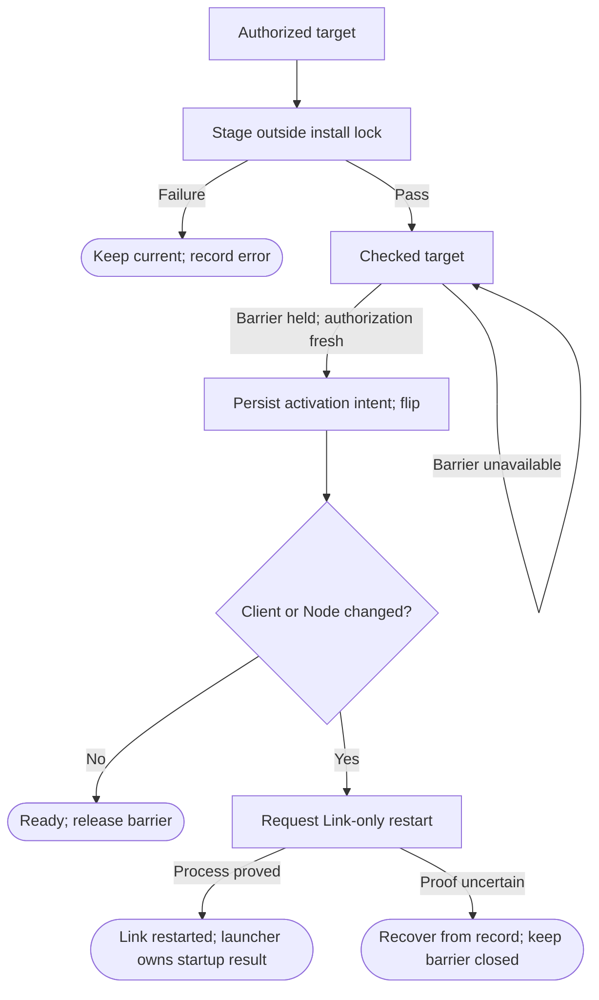

# Detached install and activation

Own `src/detached-updater.mjs`. Draft for review; new work, behavioral refinement.
Stage a verified machine release and activate it without ending the invoking
terminal, Herdr, controllers or agents. Own install effects and recovery; release
selection, modes, pins, channel, signature policy and report transport are inputs.
Private mechanisms may vary; the durable phases and process-survival promise may not.

Module functions `startUpdate({target, requestId}, ports)` → `{transactionId, state}`,
`runUpdate({transactionId}, ports)` and `recoverUpdate({home}, ports)` →
`{transactionId, phase, code}`. The CLI only requests and follows progress; an
accepted job runs independently of the caller's terminal, SSH connection and Link.
The record's staging map tracks concurrent jobs independently of the one active
activation transaction. The same requestId rejoins its existing job; an uncertain launch is
reconciled from the record and process proof, never blindly launched twice.

The diagram owns normal activation routes. Crashes in any phase enter recovery.
The exec launcher owns startup recovery; its ten-minute definition of failed
start is the only startup deadline. This updater adds no timer or probation.

<strong>Required target, ports and stage checks</strong>

`target = {releaseId, manifestSeq, artifacts, runtime, authorization}`. Artifacts
include immutable identities, URLs and integrity for Alpha, optional client and
Node; Runtime is the final resolved descriptor. `authorization` is an opaque
selector-issued input bound to those exact identities, operation and requestId.
Required ports: filesystem, detached service launch/proof, install lock, record,
`authorizeTarget(target)`, `checkCompatibility(target, retainedRuntimes)`,
`acquireActivationBarrier(transactionId)` and `restartLink(runtime, attemptId)`.
Authorization must be revalidated in the detached process and before flipping;
stale/blocked/ineligible targets cannot activate. Hint seq and unsigned CLI paths
are insufficient. The selector's production binding is required integration
context; its absence gives `authorization_unavailable` with no active mutation.

Download outside update.lock into unique transaction-owned temporary storage.
Check signed npm artifact identity, integrity and Alpha provenance. The client
artifact is the public proprietary @promptdriven/pdd-fleet package; require no
user npm token. Leave at least 1 GB free after the download; otherwise return
`disk_low` and retain current. Invoke the candidate's `doctor --check-only` under
its owned Node: import modules and open real journals, ledger, vault, cache and
launch records read-only. With no client, skip only client-owned checks. Run the
candidate and current version-specific `pdd-cred codex-token` and
`pdd-cred claude-token <account>` against the same read-only live cache/vault snapshot and fixed
clock as current, without printing tokens. With no current helper, use the owned
helper's accepted fixtures. Any output mismatch against the same snapshot and
clock fails staging; a concurrently arriving cache generation is not a mismatch.
Candidate checks never write or refresh real credentials. Compatibility must
cover every retained consumer and fallback. Failure gives `stage_failed`, retains
current and reports release.block; it is not a failed Link start. Delete only the
transaction's unreferenced failed staging files. Run the candidate's self-test
from its verified temporary package/Node paths before publication; commit the final
absolute Runtime paths only when publishing under the activation lease. No GC
may collect a live transaction's staging files.

<strong>Activation barrier, flip and crash recovery</strong>

The barrier rejects new Link actions and coordinates stage starts/controller
relaunches. Drain existing actions or durably record their uncertain effects;
ACK only after the recovery state is durable. Normal quiet conditions also exclude
join, person check, scratch-home sign-in, open keeper pull, and the first 3 min
after wake. Retry every 5 min. After 24 h stop waiting for joins and sign-ins,
but still drain their actions or durably record their uncertain effects; never
bypass durability, the barrier or an active person check. A check followed
by an unguarded gap is not a barrier. If no safe acknowledgment arrives, stay
checked and report waiting; do not kill work to force activation.

Under the activation lease revalidate and publish the checked immutable artifacts
and final Runtime; never overwrite conflicting bytes. Persist `activating` with
from/to and barrier identity before touching pointers.
For a normal activation, set previous to the old current, then atomically replace
current with the complete target and persist `flipped`. First install has no
previous. Compare the target client digest and Node with the running Link runtime,
not merely the prior current: a CLI-only update may have left Link on an older
folder. Equal values mean no restart. With no installed Link, no Link is started.
For a changed installed Link, use its stable service entry and record
`link_restarted` only after process-instance proof. Release the install lock after
the durable transition; do not hold it for an unbounded readiness wait. Keep
activation exclusion until the successor can serve actions or recovery releases
it safely. Never stop Herdr, signal a pane, rerun a stage or rewrite a run runtime.

Recovery holds the install lock, checks recorded from/to against actual pointers
and verifies complete artifacts. Before flip: resume safe idempotent staging or
leave current. After flip: finish the recorded restart decision, joining a proved
live successor rather than starting another. Recovery never double-flips or swaps
previous because its phase write was interrupted. An unprovable process/pointer
state gives `recovery_required`; preserve evidence. Startup failures use the
launcher's durable count. Artifact/record I/O errors alone cannot invent one.

## Dependencies

- [Prompting guide](../../docs/prompting-guide.md): authoring.
- [Versions](versions.prompt.md), [owned Node](owned-node.prompt.md),
  [install record](install-record.prompt.md), [install lock](update-lock.prompt.md):
  required for generation/runtime; layout, runtime, phase persistence and exclusion.
- [Public doctor](doctor.prompt.md): required for generation/runtime;
  Alpha-only read-only candidate self-check, with explicit skips for absent client.
- [Story](../../story/cli/DETACHED-UPDATER.md) and
  [cases](../../vectors/cli/detached-updater.json): verification.
- Runtime: independent user service/unit on Linux (`systemd-run --user --collect`
  with a unique owned unit), separate launch context on Mac. A plain detached
  child still inside Link's systemd cgroup is forbidden. Failure to detach gives
  `detach_failed`; it does not run inline. Manifest-selector, barrier, read-only
  doctor and compatibility bindings are required caller integration inputs.
