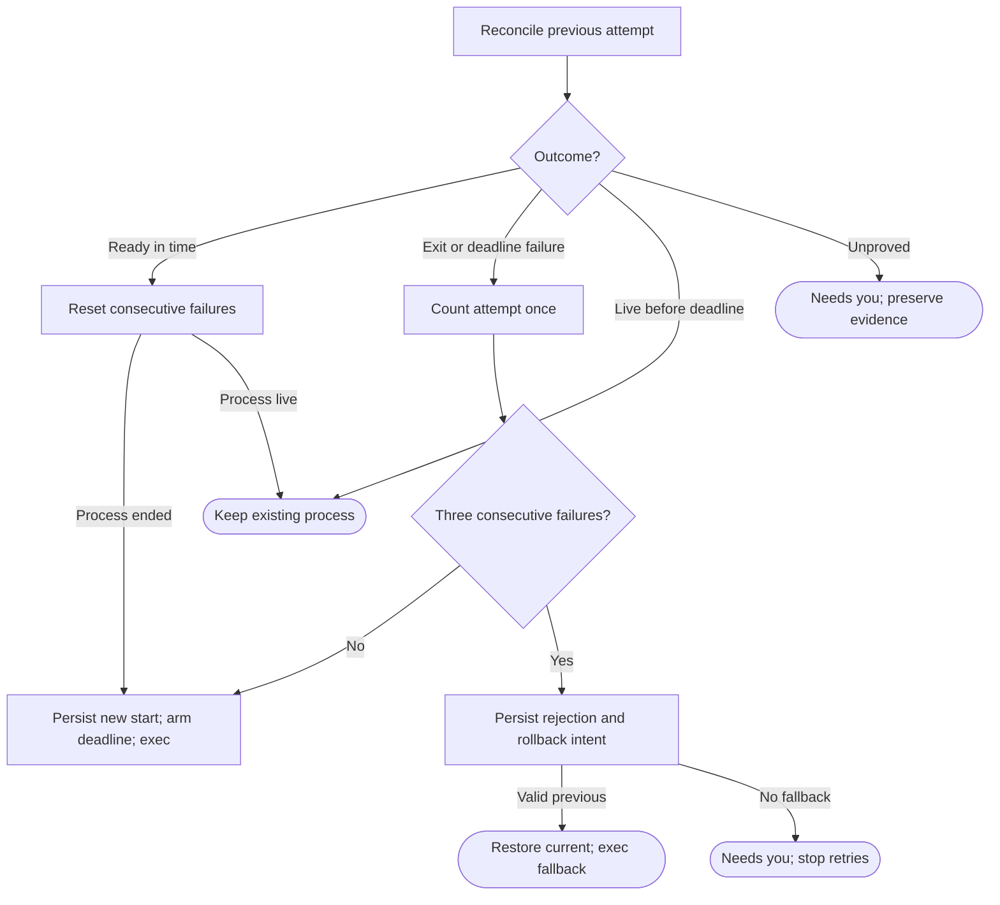

# Stable machine launcher

Own the stable `launcher/pdd-launch` executable and its self-contained support
closure. Draft for review; new work, behavioral refinement. This is an exec shim:
reconcile durable install/start attempts, select one runtime, then exec Link.
The service manager restarts exited Links. No parent supervisor or independent
launcher update-polling loop remains alive after exec.

Public executable bindings: `~/.pdd/launcher/pdd-launch link`, `pdd-launch recover`
and `pdd-launch cli [arguments]`. Recover returns the reconciled phase or error;
cli recovers first, then execs the selected Alpha entry under its absolute owned
Node, preserving cwd, argv, environment, stdio and exit/signal behavior.
`~/.pdd/bin/pdd` enters cli. The stable support closure is independent of candidate
code/Node; never use PATH Node or import mutable current for recovery.
A duplicate service invocation cannot exec a second Link for a live attempt.

A first start has no old attempt and enters A. Process death, reboot, duplicate
notifications and deadline delivery all reconcile through S; they cannot count
one attempt twice. Local success and deadline arbitration use the rules below.

<strong>Attempt identity, ten-minute deadline and startup success</strong>

Before exec, hold the install lock for a short record update: persist the exact
release, unique attemptId, boot/process-instance proof and start/deadline times.
Clear stale `~/.pdd/link/ready`. Arm one startup deadline for 600000 ms after this
attempt starts, then release the lock and exec its owned Node/Link. Exec preserves
the proved process identity. An exec error is a failed start; reconcile it before
the next exec. Record/scheduling failure stops before exec with an actionable
error; it does not fabricate a candidate failure.

Link writes atomic ready JSON `{attemptId, releaseId, bootId, processProof,
readyAt}`; `processProof` is the same process-instance identity the install
record binds, never a reusable PID alone. It writes it only after owned state
opens, the local control endpoint answers and Herdr inventory has been
inspected (including a proved absent server). Then, through the install
record owner under its lease, Link removes that unresolved start and commits
startup success. A durable matching ready marker recovers a crash between those
writes. No hosted service is a success gate.

A start fails if it exits before valid ready, or still lacks valid ready when
600000 ms elapses. Ready must be durably recorded before the deadline; at the
deadline with no prior ready the attempt fails. Record the outcome once. A late
ready cannot undo an accepted failure. Use local elapsed time and boot identity,
not hosted clocks; readyAt, startedAt and deadlineAt share that boot's elapsed-clock
origin and millisecond units. Preserve the deadline across launcher/helper restart.
A reboot ends the old process; an expired deadline does not need another ten
minutes on the next start. This deadline applies to a Link start only. It is
never a stage, agent or controller timeout.

Required platform port `armStartupDeadline(attempt)` arranges a service-manager-
owned one-shot deadline, independent of Link's event loop. It invokes the stable
`pdd-launch check-start <attemptId>` binding at the deadline; that check verifies
boot/process identity and the ready record under the lock, commits failure, and
terminates only the still-matching failed Link so its service manager can restart.
It exits after that attempt; it is not a continuous supervisor or update checker.
A stale/cancelled callback cannot kill a successor or count twice. A matching
success disarms or renders the one-shot harmless. The platform binding must work
for a hung startup and prove it on Mac/Linux before release; no Link-only JS timer
may stand in for it. Missing binding gives `startup_deadline_unavailable`.

<strong>Rollback, reporting and stable service boundaries</strong>

Reset the consecutive count only on valid local startup success. After the third
failure persist rejection, release.block and rolling_back, then restore current
to the recorded verified previous. Leave previous unchanged. This automatic
recovery never consults minDowngrade or release-selection pins; fallback state
compatibility was checked before activation. With no valid fallback stop with
Needs you; never loop on the rejected release. Persist rolled_back before execing
the fallback, which uses the same startup rules.

A failed release remains rejected across reboot, manifest seq edits, repeated
hints and pin changes; automatic retry needs a different published release.
The old Link delivers the same redacted queued report id when the network permits.
One machine's failure never blocks another machine. There is no probation timer
or relay-health trigger. Every Link start checks the manifest; Link owns its normal
5–7 h safety check. The launcher has no independent release check.

The Linux service retains its existing identity and shim path. Its [Unit] has
StartLimitIntervalSec=0 from first installation; keep Restart=always, RestartSec=2
and normal cgroup kill behavior. Herdr has its own user service/scope, including
boot recovery; the updater runs outside both. On Mac preserve separate Herdr and
updater launch contexts and AbandonProcessGroup=true for Link. Service files have
no release-specific paths; equal text is not rewritten. No launcher/deadline action
signals Herdr, a controller or an agent pane.

Atomic launcher replacement preserves record, rejection set and the complete
known-working support closure until no process references it. Alpha alone uses
local recover/cli without Link; public setup also installs Alpha's own runs-keeper
and generic claims, rather than relying on private Link for controller recovery.

## Dependencies

- [Prompting guide](../../docs/prompting-guide.md): authoring.
- [Install record](install-record.prompt.md), [install lock](update-lock.prompt.md),
  [versions](versions.prompt.md), [owned Node](owned-node.prompt.md) and
  [detached updater](detached-updater.prompt.md): generation/runtime; durable
  attempts, exclusion, identity and install recovery. Retain this support closure
  outside the candidate's version folder.
- [Story](../../story/cli/PDD-LAUNCH.md) and [cases](../../vectors/cli/pdd-launch.json):
  verification.
- Runtime: service manager, process/boot proof, local ready handshake, one-shot
  startup-deadline port and queued report transport. The exact platform deadline
  binding is required integration context, not a supplied or tested implementation.
