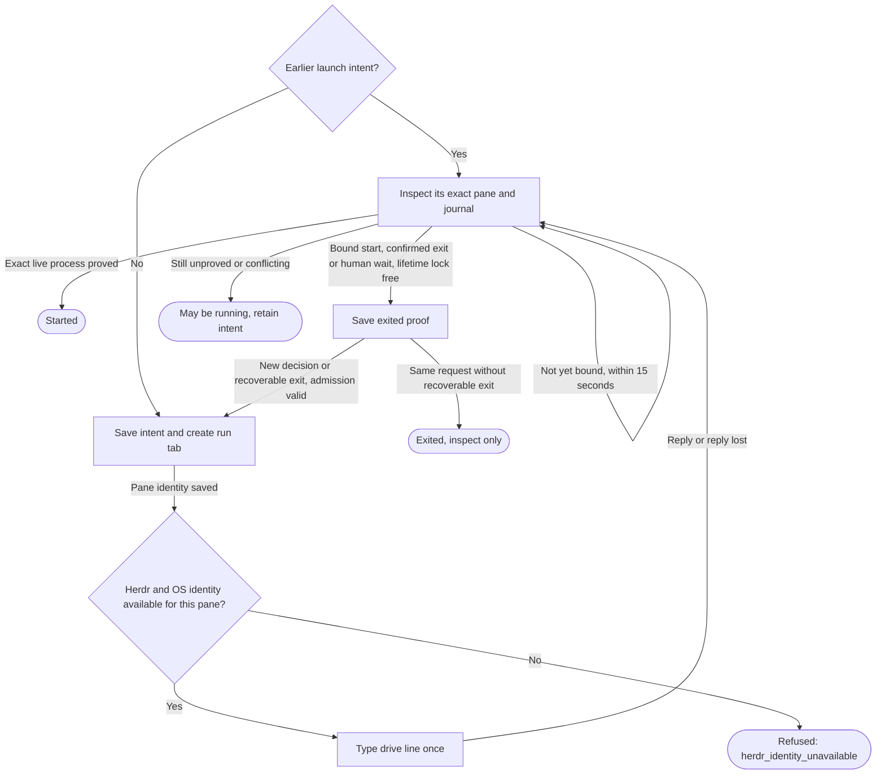

# Controller launch in a Herdr pane

Own `src/workflow-controller.mjs`. Draft for review. The module function
`startWorkflowController({runId, runDir, root, workflow, issueNumber, runtime,
decision = null}, ports)` starts the saved controller in the default Herdr
session. It returns `{state, code, controller}` (plus a safe `message` on refusal or uncertain proof), state `started`, `refused`,
`failed` or `uncertain`. Preservation: new local launch interface; retain actual
run identity, no repeated unknown effects and the person's panes and focus.

A controller is Herdr's pane process. It is never a child of Link or the short
`run`, `resume` or `decide` command. The caller has already made the initial
journal durable. Starting the pane does not mean a decision or stage passed.

Launch identity, line and proof

Create a fresh tab `run #<issueNumber> <workflow>` without focus in Herdr
`default`. On relaunch after a durably exited controller, prefer that launch's
saved workspace when its run, root and runtime match the current admitted run
and exactly one current listing entry has its workspace id. A missing/null cwd
in that entry is valid: Herdr workspace listings need not disclose cwd. An
explicitly different cwd disqualifies reuse. This grouping choice grants no
process or launch authority. If the saved workspace is absent or ineligible,
select a workspace whose cwd matches the assigned root, or create one if none
matches; never recreate or close the missing workspace. Duplicate workspace ids
make the listing ambiguous: return `uncertain / workspace_unknown` before any
workspace/tab creation or command. Save the selected workspace id before tab
creation. A prior launch reconciled to a durably exited phase during this same
request supplies the same workspace provenance; use that saved exit result,
not its earlier unresolved phase. An overdue proof never authorizes a new tab
or workspace selection. Never reuse an existing controller or stage pane for
the new launch.
Keep the assigned worktree cwd in the controller pane. Stage agents use panes
in this run tab. Never type into a person's existing pane. No hidden run server.

Hold the separate kernel `<runDir>/controller-start.lock` across prior-intent
inspection, strict state/revision recheck, durable admission and launch proof.
This is not the controller.lock that drive acquires. Before admission, briefly
hold the stable commonDir lifecycle guard, verify the run is not removing or
archived and durably save the launch intent. Release lifecycle before waiting
for drive's process/lock proof. Cleanup treats any unresolved admitted launch as
an active effect and retains the run. Drive uses lifecycle when acquiring its
own controller.lock. All run/resume/decide/keeper
starts share this gate; concurrent callers cannot launch two controllers.
Count only unplanned recovery admissions against a rolling three-per-hour crash
budget, durably in launch-intent records, not the index. The initial run start
and a newly accepted human decision are planned launches and neither consume nor
are blocked by this budget. A repeated decision binding is not new authority.
Save immutable `launchKind` (`initial`, `decision`, `recovery`) at admission;
all checkpoints retain it. For old records without this field, exempt a proven
first admission (admission 1 with no decision) and the first occurrence of each
valid decision binding; conservatively count any other unclassified record.
Never rewrite history to migrate accounting. An uncertain recovery admission
already consumes one slot, and inspection of it never consumes another.

Export pure module function `controllerLaunchBudget(launches, now)` for keeper
and controller to share accounting: return `{used, resetAt, message}`. Count
recovery timestamps strictly newer than `now - 3600000`; at the exact expiry
boundary the slot is available. With three or more counted entries, `resetAt`
is the earliest epoch-millisecond time when fewer than three remain (otherwise
null). The fixed safe message gives that UTC time and asks the user to inspect
`pdd workflow status` / `pdd doctor` and resume the saved run after that time;
never advise deleting history or starting a duplicate run. Refuse a recovery
admission with `launch_budget`, `resetAt` and this message before effects.
When keeper inspects an original decision launch and positive bound exit evidence
proves it died after that decision was consumed (journal no longer in human wait),
a same-request recovery starts the drive without repeating that decision. Its new
intent has no decision and is an unplanned recovery; the original decision binding
is immutable. A human wait or unproved exit never permits this conversion.
The controller rechecks this budget under its existing admission locks; keeper
prechecks grant no authority. All prior identity, revision and no-repeat guards
retain precedence.
Save launch intent under `<runDir>/controller-launch/` with a unique launch id,
run, recorded runtime, decision binding if present and phase before tab/create
or `pane run`. Save returned workspace/tab/pane/terminal ids before probing or typing.
After `tab.create` and its durable `tab.created` record, call the real Herdr
connection's `supportsProcessIdentity({session:'default',paneId})` on this new
pane, before any `pane.run`. An empty or fresh Herdr is valid: no existing pane
is a prerequisite. False or thrown capability reads return `refused` with code
`herdr_identity_unavailable` and fixed message `Herdr process identity is unavailable for the new controller pane. No controller command was sent.`
Save the refusal phase durably, retaining known pane identities. Subsequent
calls return that refusal without another probe, tab creation or command; if
saving the refusal fails, keep the existing uncertain/inspect-only behavior.
Never close the pane or bypass the OS identity requirement to recover.
The line uses absolute saved Node and bin followed by `workflow drive RUN_ID --launch-id LAUNCH_ID`. The internal launch id is a lowercase UUIDv4 and binds drive's `controller.started` journal record to this intent.
A decision adds `--decision D --id ID --rev N`, and legacy expected stage/seq
when supplied. Use one `herdr pane run` call with the whole line as one argv
argument. Quote absolute paths with single quotes; reject paths containing
single quote, backslash, control characters or nonabsolute text as `unsupported`
before effects. Other values must pass the CLI's UUID/enum/integer patterns.
Do not serialize the environment, except an allowlisted diagnostic `PDD_TRACE`
assignment for this one drive command. Read the explicit port selector or, when
missing, `process.env.PDD_TRACE`; project only known comma-separated `herdr` and
`git` tokens into canonical `herdr`, `git` or `herdr,git`. Save that optional
selector and the exact line with the intent before delivery. Never include any
other variable or unknown text. The assignment changes no drive argv, runtime,
authority or surrounding shell configuration. It allows a drive in an already
running Herdr session to inherit the requested tracing. Later inspection uses
the saved line and selector unchanged and never repeats delivery.

**Started proof:** a fresh `pane.process_info` for the saved pane must show the
recorded Node controller process, its run-specific drive invocation and current
process identity. Bind PID to process start identity, pane and launch id; a PID
alone or an unrelated Node is insufficient. The strict journal must also hold
controller.started for this launch with the new `controller.generation`, actual
process/start identity and pane. Increment controller generation for each new
controller process (initial generation is 1); it is separate from a stage attempt's backendGen. A live
process before its generation record is durable remains pending/uncertain,
never started. Persist both the process and journal proof. A typed-line
acknowledgement is insufficient. If the controller already exited, a validated
journal record for this launch/decision can prove it ran, but not that it is live.
Poll fresh journal and process evidence for up to 15 seconds after delivery or inspection, allowing controller.started to become durable after the process begins. Each read remains bound to the same saved pane/launch; never redeliver during polling. Recheck the monotonic deadline after awaited observations and lifetime-lock results and before accepting or persisting either live or exited proof: an elapsed time greater than 15000 ms returns `uncertain` without proof persistence or replacement admission, even if an overdue timer callback has not run. Evidence completed at exactly 15000 ms remains eligible for the same strict proof checks. Missing or conflicting proof at the deadline gives `uncertain`, even after an ok type reply. Its message says `Workflow controller may be running; check pdd workflow status RUN_ID.` rather than asserting it did not start.
Before comparing a new decision with a prior non-exited launch, reconcile that prior launch against its own saved argv and decision. A matching live process remains owned: a different request refuses controller_busy, while the same request returns its proof. A strict journal controller.started for that prior launch, together with a free controller lifetime lock and either confirmed original-process exit or the journal's current human wait, permits a durable exited phase before admitting a new current decision. Unknown lock, unbound journal, changed frozen proof or runtime/run conflict never authorizes replacement. A human wait does not override positive matching live process evidence. Recheck current revision, accepted artifacts, assignment, runtime and free lifetime lock through the existing admission authority for the new launch. Unknown same-decision retries remain inspect-only. A recoverable exit means positive exit-observer evidence in a non-human wait.
For that exit, the same request may admit one fresh launch immediately after
saving the exited proof; this is a new launch/generation, never re-delivery of the
old intent. A human wait still needs its current accepted decision.

Confirmed exit accepts the existing exact stopped-process proof, or the public
Herdr client's optional instance method `inspectProcessExit` bound to this
journal's `{pid,startIdentity,paneId}` and default session. Its positive exit
reasons are `pid_gone`, `identity_changed` or `pane_shell`; validate its returned
PID/start/pane against the saved start before using it. The client owns fresh OS
absence/reuse and repeated own-shell observations. A generic null identity,
missing foreground row, unrelated process, transport failure or unknown observer
is not exit evidence. A matching live process wins. Changed frozen journal proof,
unknown/busy lifetime lock and an expired proof deadline still refuse replacement.
Bound this additional awaited observation by the same deadline and recheck after
it. Persist the exit evidence with the original controller proof before admission.

An uncertain launch is inspect-only until journal/process evidence settles it;
absence from one foreground read is not permission to type again.

Every tab/pane mutation follows its own durable intent. A failed pre-effect
check gives `refused`; an explicit creation refusal gives `failed`; missing,
malformed or lost post-effect replies give `uncertain`. Retain all known ids.
Never close a pane to resolve uncertainty. The helper starts no Herdr server;
the local boot owner must supply a ready, separately managed default server.

The real Herdr connection binds the PID actually reported by
`pane.process_info` to OS process start evidence. Linux uses boot ID plus
`/proc/<pid>/stat` field 22; macOS uses `ps -o lstart= -p <pid>` or sysctl
start time. Read around the Herdr observation to reject reuse or conflicting
processes. Its targeted `supportsProcessIdentity({session,paneId})` must reflect genuine Herdr and OS
evidence for the newly created pane, never a constant assertion. The normalized process result supplies
the same `startIdentity` bytes drive durably journals. The recorded real
Herdr foreground-process schema has PID/argv/cwd but no start-identity field;
the OS binding supplies that missing fact. Idle status, terminal text, shell
presence and PID alone remain insufficient. Missing capability evidence refuses before controller command delivery while retaining the admitted pane effect; missing started proof remains uncertain.

Export async module function `createLocalWorkflowControllerPorts(ports={})`:
fill missing runner authority bindings from
`createWorkflowControllerAuthorityPorts(ports)`, and a strict `validateLocator`
bridge for the keeper, and missing transport bindings through the public
Herdr owner's async module function `createWorkflowHerdrPorts(ports)`.
Retain every supplied port, runtime object and callback
by reference with supplied values winning. The locator bridge compares the
entry's run/root/commonDir to a fresh strict journal, then asks the same runner
authority to validate the complete saved canonical spec and state. It returns
false on missing, changed or unreadable identity. Compose without creating or
typing into panes. If the caller supplies its own controller-start function
and inventory observer, do not construct unused transport for that path.
Readiness is not identity or launch authority.

## Recorded transport executable

The runtime in the canonical launch spec selects the real Herdr executable,
including when the caller's current runtime or setup binding differs. The local
factory remembers which transport bindings it supplied; when starting a different
saved Runtime, compose those missing bindings against that exact Runtime while
retaining explicitly supplied references. Do not replace an injected Herdr port.
The transport owner checks the selected absolute path for each real request;
a recorded missing executable never falls back to PATH. A known pre-effect
`herdr_not_found` returns `refused` with its safe path reason. After an admitted
native effect it remains `uncertain` with that code/reason and retained intent;
never retry or remove the pane. Existing PID/start/argv/launch/generation proof,
durable admission, no-repeat and lock policy remain unchanged.

## Opt-in transport tracing

When `PDD_TRACE=herdr` is selected, send actual Herdr requests and their replies
or failures through the shared trace owner's redacted request/reply/timing
logging. With tracing absent, no trace file is created. Tracing is diagnostic
only: preserve each invocation's arguments, receiver, result/error and call
count, all durable ordering and every identity/lifecycle/refusal gate. Never
retry a request or infer capability, delivery or acceptance from a trace.
Prompts, pane command text, paths, environment and arbitrary error text must not
enter the log; the trace owner defines positive projection and secure bounds.

## Dependencies

- [Herdr trace](herdr-trace.prompt.md): required generation/runtime for the module function `traceHerdrRequest`, opt-in redaction and bounded diagnostics; it grants no transport or controller authority.

- [Story](../../story/cli/WORKFLOW-CONTROLLER.md) and [cases](../../vectors/cli/workflow-controller.json): verification; expected outcomes, not observed results.
- [Claims](workflow-claims.prompt.md): required generation/runtime nonblocking
  controller-start exclusion, distinct from drive's lifetime controller lock.
- [Runner authority](workflow-runner.prompt.md#public-controller-authority-composition):
  required generation/runtime for the strict four-binding authority factory.
- [Public Herdr connection](workflow-herdr-client.prompt.md): required
  generation/runtime for actual transport and shared OS process identity.

- [Frozen runtime](workflow-runtime.prompt.md): required generation/runtime
  input for immutable executable paths and source of the caller's runtime.
- Node filesystem durability and `execFile` with argv arrays, no shell: runtime.
  `ports` supplies Herdr calls, fs and time; commands use the documented
  installed Herdr schema. No private client or phone dependency.
