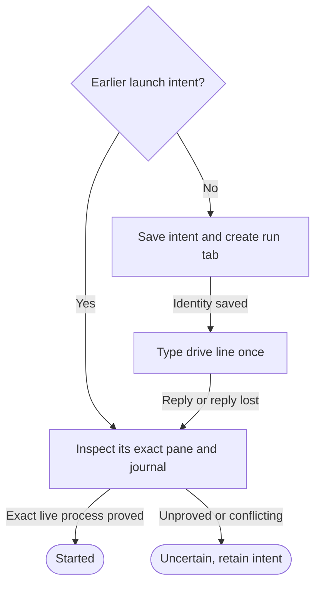

# Controller launch in a Herdr pane

Own `src/workflow-controller.mjs`. Draft for review. The module function
`startWorkflowController({runId, runDir, root, workflow, issueNumber, runtime,
decision = null}, ports)` starts the saved controller in the default Herdr
session. It returns `{state, code, controller}`, state `started`, `refused`,
`failed` or `uncertain`. Preservation: new local launch interface; retain actual
run identity, no repeated unknown effects and the person's panes and focus.

A controller is Herdr's pane process. It is never a child of Link or the short
`run`, `resume` or `decide` command. The caller has already made the initial
journal durable. Starting the pane does not mean a decision or stage passed.

Launch identity, line and proof

Create a tab `run #<issueNumber> <workflow>` without focus in the repository's
workspace of Herdr `default`; create that workspace only if none matches.
Keep the assigned worktree cwd in the controller pane. Stage agents use panes
in this run tab. Never type into a person's existing pane. No hidden run server.

Hold the separate kernel `<runDir>/controller-start.lock` across prior-intent
inspection, strict state/revision recheck, durable admission and launch proof.
This is not the controller.lock that drive acquires. Before admission, briefly
hold the stable commonDir lifecycle guard, verify the run is not removing or
archived and durably save the launch intent. Release lifecycle before waiting
for drive's process/lock proof. Cleanup treats any unresolved admitted launch as
an active effect and retains the run. Drive uses lifecycle when acquiring its
own controller.lock. All run/resume/decide/keeper
starts share this gate; concurrent callers cannot launch two controllers.
Count relaunch admissions durably in the launch-intent records, not the index.
Save launch intent under `<runDir>/controller-launch/` with a unique launch id,
run, recorded runtime, decision binding if present and phase before tab/create
or `pane run`. Save returned workspace/tab/pane/terminal ids before typing.
The line uses absolute saved Node and bin followed by `workflow drive RUN_ID --launch-id LAUNCH_ID`. The internal launch id is a lowercase UUIDv4 and binds drive's `controller.started` journal record to this intent.
A decision adds `--decision D --id ID --rev N`, and legacy expected stage/seq
when supplied. Use one `herdr pane run` call with the whole line as one argv
argument. Quote absolute paths with single quotes; reject paths containing
single quote, backslash, control characters or nonabsolute text as `unsupported`
before effects. Other values must pass the CLI's UUID/enum/integer patterns.
Do not serialize the environment. Do not type a second time after an unknown reply.

**Started proof:** a fresh `pane.process_info` for the saved pane must show the
recorded Node controller process, its run-specific drive invocation and current
process identity. Bind PID to process start identity, pane and launch id; a PID
alone or an unrelated Node is insufficient. The strict journal must also hold
controller.started for this launch with the new `controller.generation`, actual
process/start identity and pane. Increment controller generation for each new
controller process (initial generation is 1); it is separate from a stage attempt's backendGen. A live
process before its generation record is durable remains pending/uncertain,
never started. Persist both the process and journal proof. A typed-line
acknowledgement is insufficient. If the controller already exited, a validated
journal record for this launch/decision can prove it ran, but not that it is live.
Missing or conflicting proof gives `uncertain`, even after an ok type reply.
An uncertain launch is inspect-only until journal/process evidence settles it;
absence from one read is not permission to type again.

Every tab/pane mutation follows its own durable intent. A failed pre-effect
check gives `refused`; an explicit creation refusal gives `failed`; missing,
malformed or lost post-effect replies give `uncertain`. Retain all known ids.
Never close a pane to resolve uncertainty. The helper starts no Herdr server;
the local boot owner must supply a ready, separately managed default server.

The exact installed Herdr command/schema for process start identity and pane
creation/close remains to be proved by the transport spike. If unavailable,
return `unsupported`; never replace it with idle status, terminal text or `ps`.

## Dependencies

- [Story](../../story/cli/WORKFLOW-CONTROLLER.md) and [cases](../../vectors/cli/workflow-controller.json): verification; expected outcomes, not observed results.
- [Claims](workflow-claims.prompt.md): required generation/runtime nonblocking
  controller-start exclusion, distinct from drive's lifetime controller lock.

- [Frozen runtime](workflow-runtime.prompt.md): required generation/runtime
  input for immutable executable paths and source of the caller's runtime.
- Node filesystem durability and `execFile` with argv arrays, no shell: runtime.
  `ports` supplies Herdr calls, fs and time; commands use the documented
  installed Herdr schema. No private client or phone dependency.
