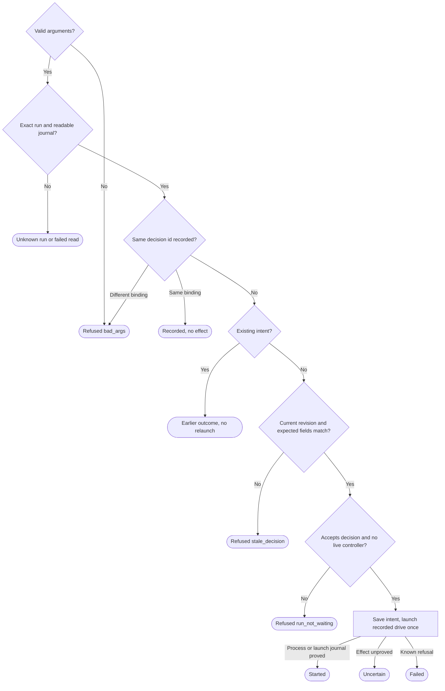

# Give a waiting run one decision

Own `src/workflow-decide.mjs`. Draft for review. This command carries a person's
approve/skip decision to the saved run once. The controller stays in a normal
Herdr pane, independent of Link and the short command. Preservation: retain
`decideWorkflow`, the result/JSON fields, legacy stage/seq options, actual run
identity and refusal/no-repeat behavior. Add current human-wait `--rev` and
recorded-runtime process proof. Internals are free.

Module function `decideWorkflow({runId,decision,decisionId,expectedRev?,
expectStage?,expectSeq?,cwd,packageRoot},ports)` never throws and returns
`{exitCode,state,code,runId,decisionId,decision,stage,journalSeq,controller,
message}`. CLI: `pdd workflow decide RUN_ID --decision approve|skip --id UUID
--rev N [--json]`. Retain `--expect-stage STAGE --expect-seq N`; either the
revision or the complete legacy pair is required. If both are supplied, both
must match. A revised P1 human wait requires its current rev; legacy pair-only
requests must identify that wait's exact journal sequence.

**Decision authority:** the complete validated journal, not status or index.
Read-only locator lookup uses the actual worktree assignment. A missing run is
`unknown_run`; a found run with damaged/unreadable history is failed. Legacy
unadopted runs cannot be driven. No derived view can grant approval.

**Expected revision:** `waitingPerson.rev` is the journal seq that created the
current human request. Heartbeats/status writes leave it unchanged. Match its
stage, inputRevision and accepted artifact hashes again under the controller's
kernel lock before `decision.received`. Current revision is necessary, not
sufficient. Changed accepted files or workflow input refuse. A completed run or
changed request is stale; check stale before run-not-waiting. A held or unknown
controller lock refuses run-not-waiting. Human waits normally have no controller.

Input domain, idempotency and launch intent

Run and decision ids are lowercase UUIDv4. Decision is exactly approve or skip.
Stage is 1–64 lowercase letters/digits with a letter first and single separating
hyphens. Revision/seq is an integer 1..2^53-1; CLI decimal has no sign or leading
zero. Missing, repeated, unknown or incomplete options are parser exit 2.
Invalid module arguments return refused/bad_args/2 before any read and never
echo rejected values. Both expected fields are supplied together.

Search the complete validated decision history for this id before stale checks.
Same id and decision/expected binding gives recorded/0 without writes or Herdr
calls, even after progress. Same id with changed payload is bad_args; unknown
historical binding cannot be guessed. An incomplete bounded read without a match
is failed, not proof of absence. `decision.received` admits the decision; later
semantic records preserve its id. Admission does not certify a stage or PR.

Before any tab/typing effect, exclusively create and fsync
`<runDir>/decide/<decisionId>.json` with `{v:1,runId,decisionId,decision,
expect:{rev,stage,seq},phase:"intent",controller:null,at}`. Unused expected
fields are null. Same-binding earlier intent returns its outcome: started
(with saved proof) -> started; failed -> failed; intent, unreadable or uncertain
-> uncertain. It never relaunches. Preserve unknown fields in atomic updates.
Failed initial durability makes no Herdr effect.

Call `startWorkflowController` with the run's saved runtime and decision binding;
that helper owns safe path quoting, new tab, one `pane run` and actual process
proof. It starts no server and uses Herdr default. Missing Herdr gives
herdr_not_running; timeout/bad pre-effect reply gives herdr_not_answering; unsafe
paths or missing required capability gives unsupported. Saved Node/bin come
from the run, never current or Link's runtime. Persist returned ids and proof.
A typed-line acknowledgement alone is uncertain. Unknown final intent durability
makes a retry inspect-only; never repeat a launch to repair a file.

| Result state | Meaning | Exit |
|---|---|---|
| recorded | Same bound id is in the journal; no effect | 0 |
| started | Exact drive process or its launch-specific durable journal evidence proved | 0 |
| refused | No effect; code explains check | 1, bad_args 2 |
| uncertain | Effect may have happened; inspect original | 1 |
| failed | Read failure or explicit launch refusal | 1 |

`code` is null or bad_args, unknown_run, stale_decision, run_not_waiting,
herdr_not_running, herdr_not_answering, unsupported. `stage` and `journalSeq`
are current values or null. `controller` is null or actual `{herdrSession,
workspaceId,tabId,paneId}` plus additive proof fields. `message` is one finite
line naming known run/stage; no rejected input or credentials.
With `--json`, one stdout line has `v:1` and all result fields except exitCode;
without it, print message once. The journal's actual decision record completes
the decision; started only reports controller launch, never stage completion.

## Dependencies

- [Story](../../story/cli/WORKFLOW-DECIDE.md) and [cases](../../vectors/cli/workflow-decide.json): verification; expected outcomes, not observed results.
- [Runner journal reader](workflow-runner.prompt.md): required generation/runtime
  `readWorkflowJournal`, the strict complete history/path validator. This reader
  authorizes no effects; the controller rechecks under its lock.

- [Controller launch](workflow-controller.prompt.md): required generation/runtime
  launch intent and process proof, including typed-line quoting rules.
- [Run records](workflow-run-records.prompt.md): required generation/runtime
  bounded journal reads. Strict complete validation precedes effects.
- [Worktree assignment](workflow-worktree.prompt.md): required generation/runtime
  lookup from either related checkout; the index is not authorization.
- [Claims](workflow-claims.prompt.md): required generation/runtime read-only
  lock inspection. Held or unknown counts as live for refusal purposes.
- Saved human wait, runtime and validated complete journal: runtime inputs.
  The runner owns the journal; no private phone module is required.
