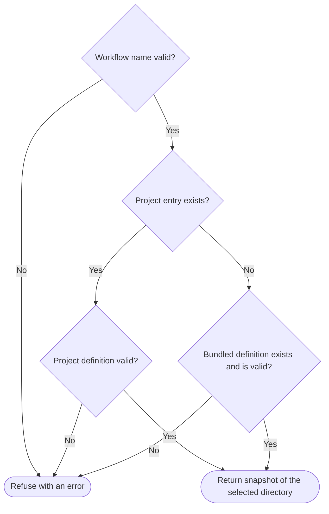

# Workflow definition loader

Owns `src/workflow-definition-loader.mjs`. Exports synchronous module functions `loadWorkflowDefinition({ name, cwd, packageRoot })` and `listWorkflowDefinitions({ cwd, packageRoot })`.

The loader selects a workflow definition by name, validates it, and returns an immutable snapshot of its exact bytes. So a user can add or change a workflow without a change to PDD code. `cwd` is the project root and `packageRoot` is the PDD package root; every call needs both. The loader only reads files. It writes nothing and starts no Git, native agent, network or child process.

This prompt owns the schema and validation of every definition, project or bundled. [Bundled workflows](bundled-workflows.prompt.md) owns what the bundled definitions contain. The [runner](workflow-runner.prompt.md) owns how stages execute, and saves the snapshot before it assigns an issue worktree. [CLI dispatch](pdd-cli.prompt.md) prints `workflow list` from the listing. [Stage definitions](workflow-definitions.prompt.md) load the bundled definitions for a compatibility export.

Preservation: behavioral refinement. Keep both exports and their binding kind, the argument objects, the result shapes, the selection rule, the schema, the stage-order rules, the limits and every refusal. A refusal throws an error and returns nothing. The error class and wording may vary, but the message identifies the faulty definition, stage or file. Private helpers, check order and the way a change during a read is detected may vary.

## Select one definition

A **workflow name** has 1 to 64 characters. It starts with a lowercase letter and has only lowercase letters, digits and single hyphens between groups, so `a--b`, `a-` and `Bad` are invalid. Stage IDs use the same syntax. An invalid requested name refuses before any file read.

A **project entry** is anything at `<cwd>/.pdd/workflows/NAME`: a directory, a file or a symbolic link. It claims the whole name, even when its `workflow.json` is missing or malformed. Never fall back to `<packageRoot>/.pdd/workflows/NAME` and never mix project and bundled files. Reason: a broken edit must stay visible, not be quietly replaced by instructions that the user did not choose. A project `.pdd` or `.pdd/workflows` that is missing means no project entry; one that exists but is not a real directory refuses.

**Valid** means that the path and file rules, the closed schema and the stage-order rules all hold.

## Return an immutable snapshot

`loadWorkflowDefinition` returns `{ name, version, root, stages, files, digest }`:

- `name` is the requested name, `version` is `1`, and `root` is the canonical absolute path of the selected directory.
- `stages` are the validated stages in declared order, with schema defaults added.
- `files` has one `{ path, sha256, content }` entry each for `workflow.json`, the overview and the stage files, without duplicates. They are sorted by `path` in English locale order, where letter case only breaks ties (`edit.md` before `WORKFLOW.md`). `sha256` is the lowercase hexadecimal SHA-256 of the exact bytes read. `content` is their UTF-8 text.
- `digest` is a lowercase hexadecimal SHA-256 over `name`, `version`, `stages` and the ordered `path` and `sha256` pairs, but not `root`. So a change to any byte of any snapshot file changes it.

The result is deeply frozen and holds only JSON values. A second load of unchanged files at the same location gives a deeply equal result. Reason: on resume the runner compares a fresh load with its saved JSON copy and stops on any difference, so source edits never silently replace saved instructions.

<strong>Path, file and size rules</strong>

- **Canonical roots.** `cwd` and `packageRoot` are nonblank strings that name directories. Resolve each one, relative to the process working directory, to its canonical real path. A root reached through a symbolic link is accepted.
- **Real directories.** Below each root, `.pdd`, `.pdd/workflows`, the workflow directory and each directory on an instruction path are real directories, not symbolic links.
- **Instruction path.** `overview` and each stage `file` is a relative path that ends with `.md` and uses `/` between components. Refuse an absolute path, a backslash, a NUL character, and an empty, `.`, `..` or `.git` component.
- **Ordinary file.** Each snapshot file is a regular file in the workflow directory, not a symbolic link, with exactly one hard link, at most 256 KiB (262,144 bytes) and valid UTF-8. Reason: another hard link could change the recipe from outside the directory, and the limit bounds each native agent's context.
- **Stable read.** A file stays the same, unchanged file from its check until its read ends, and its parent directories are still real directories after the read.
- **Snapshot size.** All snapshot files together are at most 2 MiB (2,097,152 bytes).
- **Declared files only.** Read no file in the workflow directory except `workflow.json` and the declared Markdown.

## List definitions

`listWorkflowDefinitions` returns `[{ name, source }]`, sorted by name in character-code order. Candidates are the entries of `<packageRoot>/.pdd/workflows` and `<cwd>/.pdd/workflows` that are directories or symbolic links with a valid workflow name. Each name appears once. A symbolic link stays a candidate so that its load refuses it instead of hiding it. Ignore other entries, such as `README.md`. A missing `.pdd/workflows` adds nothing.

Load each candidate with `loadWorkflowDefinition`; there is no second catalog or schema. `source` is `project` when the project directory was selected, otherwise `bundled`. If one candidate refuses, the whole listing refuses; never omit an invalid definition.

## Definition schema and stage order

`workflow.json` is a closed version-1 object with `version`, `name`, `overview` and an ordered `stages` array. Each stage has an `id`, a `kind` and a Markdown `file`. The kinds are `agent`, a fresh native agent conversation whose `protocol` is `report`, `proposal`, `work` or `verify`; `human`, a person's acceptance of the proposal; `pr`, a pull request publication; and `merge`, a wait for that PR's merge.

The stage-order rules make sure that work follows an accepted proposal, a verified PR follows a verify stage after the latest work, and each merge follows its own PR. Stage behavior comes from these fields, never from reserved stage IDs such as `build` or `prompt-merge`. No field holds a command, and the loader runs nothing from JSON. Test commands come from the accepted proposal handoff, which the runner owns.

<strong>Closed schema: fields, values and returned defaults</strong>

The top level has exactly `version` (the number `1`), `name` (the requested name), `overview` (an instruction path) and `stages` (an array of 1 to 64 stages).

| Stage field | Allowed on | Required | Values |
| --- | --- | --- | --- |
| `id` | every stage | yes | A workflow name, unique in the definition |
| `kind` | every stage | yes | `agent`, `human`, `pr`, `merge` |
| `file` | every stage | yes | An instruction path |
| `optional` | every stage | no | Boolean. `true` only on `pr`, or on `agent` with protocol `report` or `work` |
| `protocol` | `agent` | yes | `report`, `proposal`, `work`, `verify` |
| `requiredRoles` | `agent` | no | Distinct roles from `prompt`, `story`, `cases`, `implementation`, `tests`, `evidence`, `notes` |
| `approval` | `agent` with protocol `proposal` | yes, there | `human`, `next-advance` |
| `requiresMerge` | `pr`, and `agent` with protocol `work` | no | ID of an earlier merge stage |
| `publication` | `pr` | yes | `proposal`, `verified` |
| `prStage` | `merge` | yes | ID of an earlier PR stage |

Refuse a top level or stage that is not an object, a missing required field, an unknown field, a field not allowed on that kind or protocol, `null` in any field, and any value outside its domain. A returned stage keeps its declared fields, has `optional: false` when `optional` is absent, and, for an agent, has `requiredRoles` (empty when absent).

<strong>Stage-order rules: proposal, acceptance, verification, publication and merges</strong>

"Earlier" means listed before the stage.

- **Single proposal.** At most one agent stage has protocol `proposal`. It has a nonempty `requiredRoles` and an `approval`.
- **Proposal acceptance.** With approval `next-advance`, the proposal counts as accepted from its own stage; the runner still pauses after it until the person approves. With approval `human`, it counts as accepted from the human stage after it.
- **Human acceptance.** A human stage needs an earlier `human`-approval proposal that no earlier human stage accepted. So there is at most one human stage, and none without such a proposal.
- **Accepted before work.** Each `work` or `verify` stage and each PR stage needs an earlier accepted proposal. A `report` stage may appear anywhere, so a definition without a proposal has only report stages.
- **Current verification.** A `verify` stage makes verification current, and a later `work` stage, optional or not, makes it stale. A `verified` PR needs current verification. A `proposal` PR needs only the accepted proposal.
- **One merge per PR.** A merge stage's `prStage` names an earlier PR stage that no earlier merge names. A PR may have no merge. When the runner skips an optional PR, it also skips that PR's merge.
- **Merge dependency.** `requiresMerge` names an earlier merge stage that a work stage or PR depends on. The runner owns what that requires at run time. The field authorizes no checkout, reset or merge.

This check adds to, and never replaces, the runner's run-time check of exact outputs. For example, a report stage that edits files after verification passes here, and the runner refuses the stale verification.

## Dependencies

- [Prompting guide](../../docs/prompting-guide.md) — authoring and review method for this prompt.
- Bundled definitions in the package's `.pdd/workflows/`, owned by [bundled workflows](bundled-workflows.prompt.md) — runtime input that the loader reads and validates with these rules; in testing, each bundled definition must pass them. They supply no schema rules.
- Node built-ins `node:fs`, `node:path`, `node:crypto` and the global `TextDecoder` — runtime: canonical paths, status checks that do not follow links, opens without following a final link, reads and directory listing; path containment; SHA-256; strict UTF-8 decoding.

No package or external tool is used. The other links here, and the user guide [Edit workflows](../../docs/workflows.md#edit-workflows), are navigation only.
