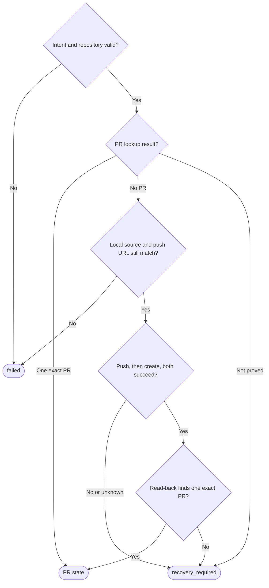

# Local workflow GitHub effects

Owns `src/workflow-github.mjs`. Exports only the async module functions
`resolveWorkflowIssue(input, ports)`, `prepareWorkflowPr(input, ports)`,
`publishWorkflowPr(input, ports)` and `reconcileWorkflowPr(input, ports)`.

The [workflow runner](workflow-runner.prompt.md) uses them to bind a run to a
real issue in the current GitHub repository and to publish one committed topic
branch as one pull request (PR), through the person's installed `git` and `gh`
and normal login. Each call takes a checkout folder `cwd` and an issue
selector, new intent fields or a saved intent. It returns an issue binding, a
prepared intent, or an outcome with state `open`, `merged`, `closed`,
`recovery_required` or `failed`. The runner owns the journal, locks, stage
state, the durable save of each intent and the decision to publish.

Preservation: behavioral refinement. Keep the export names and binding kind,
input fields, result shapes, states, refusal codes, write commands and effects
stated here. Helpers, check order unless a rule states it, and message wording
may vary. Callers other than the runner are not known.

## Rules for every function

- Run each command as an executable name with an argument array, never through
  a shell, in the supplied `cwd` with the inherited environment unchanged.
- Copy the input before the first await, so later changes to the caller's
  object do not change the call. Reason: the runner saved this exact intent.
- Never launch an agent, fetch, switch accounts, copy credentials, merge, retry
  a write or advance a workflow. Use only the `origin` remote.
- `resolveWorkflowIssue` and `prepareWorkflowPr` reject with an `Error` whose
  `message` and `code` are both `workflow_github_<reason>`, with the reasons
  named below. The error never contains command output, remote data or
  credentials. A body-file filesystem failure, such as a missing parent
  folder, may reject with the underlying error.
- `publishWorkflowPr` and `reconcileWorkflowPr` never reject. They return an
  [outcome](#outcomes).

**Repository check.** Every function establishes the repository first:

- `cwd_required`: `cwd` is empty, not a string, or contains control
  characters.
- `origin_invalid`: `git remote get-url origin` is not
  `git@github.com:owner/repo`, `https://github.com/owner/repo` or
  `ssh://git@github.com/owner/repo`, each with an optional `.git`. Any other
  host, a port, query, fragment or password, or a user name other than `git`
  in an `ssh://` URL is refused. So a token in the URL is refused.
- `repository_mismatch`: `gh repo view owner/repo --json
  nameWithOwner,defaultBranchRef,url` does not report the same repository
  (letter case may differ), a nonempty default branch and `url` equal to
  `https://github.com/<nameWithOwner>`.

The checked repository is GitHub's `nameWithOwner`. Owner and repository names
start with a letter or digit and contain only letters, digits, `.`, `_` and
`-`.

## Resolve an issue

`resolveWorkflowIssue({ cwd, issue }, ports)` checks the selector before any
command, makes the Repository check, then reads
`gh api repos/<repository>/issues/<number>`. It returns
`{ repository, defaultBranch, issue: { number, url, title, body } }` with the
actual `html_url`, `title` and `body`; a `null` body becomes `''`.

- `issue_invalid`: `issue` is not a positive safe integer, a decimal string
  without a leading zero, `owner/repo#number`, or exactly
  `https://github.com/owner/repo/issues/number` with no query, fragment or
  trailing slash. So a PR URL refuses.
- `issue_foreign`: the selector names another repository (letter case ignored).
- `issue_mismatch`: the data has a `pull_request` key (the number is a PR), a
  different `number`, an `html_url` that is not this repository's canonical
  issue URL for that number, a non-string `title`, or a `body` that is neither
  a string nor `null`.

## Prepare a PR intent

`prepareWorkflowPr({ cwd, runId, stageId, repository, baseBranch, bodyFile },
ports)` returns exactly `{ repository, runId, stageId, headBranch, baseBranch,
headSha, marker, title, bodyFile }`. Its only effect is the body-file write; it
pushes nothing and writes nothing to GitHub. The runner saves this intent
durably before it calls `publishWorkflowPr`.

**Checkout checks.** Each of these refuses and leaves the body file unwritten:

- `intent_invalid`: `runId` or `stageId` is not 1 to 160 ASCII characters that
  start with a letter or digit and contain only letters, digits, `.`, `_` and
  `-` (so the marker is unambiguous); `repository` is not an `owner/repo`
  name; or `bodyFile` is empty or not a string.
- `repository_mismatch`: `repository` differs from the Repository check result.
- `topic_invalid`: `baseBranch` is empty or not a string.
- `body_unsafe`: the path breaks the Body file rule.
- `root_invalid`: `git rev-parse --show-toplevel` is not an absolute path.
- `body_must_be_untracked`: the body file is inside that worktree and
  `git ls-files --error-unmatch -- <path>` does not exit with code 1.
- `worktree_dirty`: `git status --porcelain=v1 -z --untracked-files=all` lists
  anything except the untracked body file. Ignored files do not count.
- `command_failed`: `git check-ref-format --branch` refuses `baseBranch` or the
  HEAD branch, HEAD is detached, or `refs/remotes/origin/<baseBranch>` is not a
  commit. This module does not fetch that ref.
- `topic_required`: the HEAD branch is empty or equals `baseBranch`.
- `head_invalid`: `git rev-parse --verify HEAD` (the `headSha`) is not 40
  lowercase hexadecimal characters.
- `topic_has_no_commits`: no commit is in `refs/remotes/origin/<baseBranch>..HEAD`.
- `title_invalid`: the trimmed latest commit subject (the `title`) is empty,
  contains control characters or is longer than 256 characters.
- `marker_mismatch`: an existing body breaks the Marker rule.

**Body file rule.** Resolve `bodyFile` against `cwd`; the intent holds the
absolute path. Its parent folder must exist (the caller creates it) and equal
its own real path, so no ancestor is a symbolic link. An existing file must be
a regular file with one hard link. Check again at write time, and write only
into the checked file: do not follow a final link or truncate first. A
supplied `ports.writeFile` does not skip these checks. Reason: an alias must
not redirect this untracked metadata write into source.

**Marker rule.** The marker `M` is `pdd-workflow:<runId>:<stageId>`. A body
satisfies the rule when `pdd-workflow:` occurs exactly once and exactly one
line, split at LF or CRLF, is exactly `<!-- M -->`. A different, duplicate or
partial workflow marker breaks it. Reason: one body names one intent, and
another run's marker is never replaced.

**Body text.** Keep an existing authored body; for a missing file, start with
the title and a newline. If the body has no `pdd-workflow:` text, end its last
line if needed, then add one empty line, the line `<!-- M -->` and a newline.
A body that satisfies the Marker rule is written back unchanged, so repeating
prepare returns the same intent and bytes.

## Publish once, then reconcile read-only

`publishWorkflowPr({ cwd, intent }, ports)` follows the whole figure.
`reconcileWorkflowPr({ cwd, intent }, ports)` follows only the lookup: one
exact PR gives its PR state, and every other answer, including an invalid
intent or Repository check, gives `recovery_required`. Reconcile never returns
`failed`. PR state is `open`, `merged` or `closed` from the
[state mapping](#outcomes).

- **Valid intent** has exactly the nine prepared fields: prepare's identifier
  and repository forms, `marker` equal to `M`, a 40-character lowercase
  hexadecimal `headSha`, two different nonempty branches, a nonempty `title`
  and an absolute `bodyFile`. The Repository check must name the intent's
  repository.
- **Lookup first.** Publish looks up the PR before it checks local source, so
  an existing exact PR is reported even if the checkout changed, without body
  I/O or writes. "Not proved" is a failed or full lookup, more than one
  candidate, a candidate that changed between reads, or any difference from
  the [exact PR match](#exact-pr-match). A similar PR is never adopted.
- **Local source still matches** when the checkout checks pass again for the
  saved `baseBranch` and `bodyFile`, HEAD is still the saved `headBranch` and
  `headSha`, the body file satisfies the Marker rule, and
  `git remote get-url --push --all origin` prints exactly one accepted GitHub
  URL for the intent's repository.
- **Writes.** Run `git push origin <headSha>:refs/heads/<headBranch>` once,
  without force. Only after it succeeds, run `gh pr create --repo <repository>
  --head <headBranch> --base <baseBranch> --title <title> --body-file
  <bodyFile>` once. These are the module's only Git and GitHub writes.
- **Uncertain writes.** Once the push starts, a nonzero exit, rejection,
  timeout or exception gives `recovery_required`. Repeat neither command, and
  never create after an uncertain push.
- **Read-back.** The output of `gh pr create`, including a printed URL, is not
  evidence. After both writes, return the result of the same lookup.
- **No resend.** This module keeps no journal and cannot prove the caller's
  save. After `recovery_required`, the caller uses only `reconcileWorkflowPr`
  with the same saved intent. A missing PR after an uncertain write is not
  permission to publish again.
- Reconcile runs only Git and `gh` reads. It never reads or writes the body
  file, pushes, creates or merges.

Exact PR match, state mapping and outcome shape

### Exact PR match

Run `gh pr list --repo <repository> --state all --limit 100 --json
number,url,state,headRefName,baseRefName,headRefOid,mergeCommit,body,isCrossRepository,headRepository,headRepositoryOwner`
twice: once with `--search` and the argument `"<marker>" in:body`, and once
with `--head <headBranch>`.
Reason: a PR whose branch or marker changed must not be missed.

- Each answer must be a JSON array of fewer than 100 rows. A full page can hide
  candidates.
- Join the answers by PR number. The same number with different data is a
  changed candidate. No rows means no PR; two or more numbers are not proved.
- The one candidate matches when `number` is a positive safe integer; `url` is
  exactly `https://github.com/<repository>/pull/<number>` (letter case of the
  repository may differ); `isCrossRepository` is `false` and
  `headRepositoryOwner.login`/`headRepository.name` is the intent's
  repository, so the head is not a fork; `headRefName`, `baseRefName` and
  `headRefOid` equal the saved `headBranch`, `baseBranch` and `headSha`; `body`
  satisfies the Marker rule; and `state` has a row below.

### Outcomes

Publish and reconcile return `{ state, pr, message }`.

| GitHub `state` | Outcome `state` | `pr.mergeCommit` |
| --- | --- | --- |
| `OPEN` | `open` | `null` |
| `MERGED` with a 40-character lowercase hexadecimal `mergeCommit.oid` | `merged` | that `oid` |
| `MERGED` without that `oid` | `recovery_required` | none; `pr` is `null` |
| `CLOSED` | `closed` | `null`, even if GitHub gives one |
| Any other value | `recovery_required` | none; `pr` is `null` |

A closed PR is not merged. For `open`, `merged` and `closed`, `pr` is
`{ repository, number, url, headBranch, baseBranch, headSha, mergeCommit }`:
the intent's repository and the verified GitHub values. Otherwise `pr` is
`null`. `message` is short fixed actionable text, never command output. Never
build a PR URL or infer a merge.

Ports and command results

`ports` is optional. Each port replaces one default for stand-in tests; it is
not another authority or transport.

- `ports.execFile(file, args, { cwd })` returns or resolves
  `{ stdout, stderr?, code? }`; the options hold only `cwd`, and a missing
  `code` means 0. The default is Node `execFile` with `shell: false`, UTF-8, a
  60-second timeout, an 8 MiB output limit and the inherited environment.
- A rejection with a numeric nonzero `code` counts as that exit, with its
  `stdout` if any. Any other rejection, including code 0, is
  `command_unavailable`, never success.
- A result without string `stdout`, or with a non-integer `code`, is
  `command_invalid`. A nonzero exit is `command_failed`, except in the
  `git ls-files` check. Output that must be JSON and is not is `json_invalid`.
- `ports.readFile(path, 'utf8')` and `ports.writeFile(path, text, 'utf8')`
  replace only body-file I/O. The defaults are Node filesystem calls that do
  not follow a final symbolic link.

## Dependencies

- [Prompting guide](../../docs/prompting-guide.md) — authoring and review
  method for this prompt.
- [Public boundary](public-boundary.prompt.md) — shared command scope, for
  authoring and generation. Local consequence: these calls are the ordinary
  authenticated Git and `gh` use that `workflow run` and `workflow resume` may
  make; no private service, account change or other network call.
- Node built-ins — runtime: `node:child_process` and `node:util` for the
  default command port; `node:fs`, `node:fs/promises` and `node:path` for
  body-file checks, I/O and worktree containment.
- `git`, the person's installed Git — runtime: reads with
  `remote get-url`, `rev-parse`, `symbolic-ref`, `check-ref-format`, `status`,
  `ls-files`, `rev-list` and `log`; the one write is `push` to `origin`.
- `gh`, the GitHub CLI with the person's login — runtime: reads with
  `repo view`, `api` and `pr list`; the one write is `pr create`.
