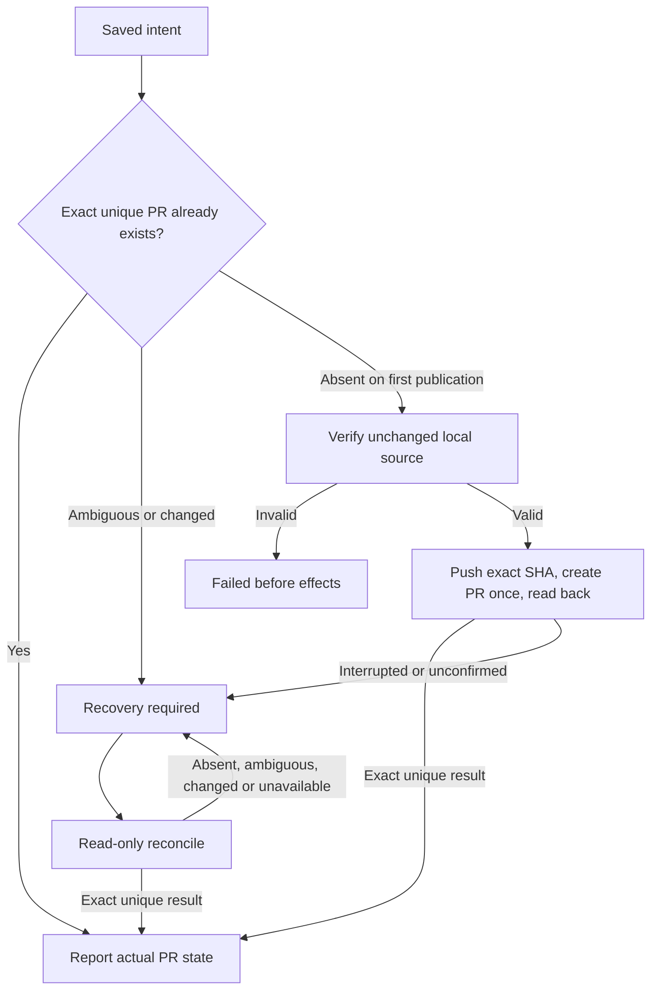

# Local workflow GitHub effects

Own `src/workflow-github.mjs`, exporting only the five module functions below. Help the local runner associate an actual issue and publish one committed topic branch through the person's normal Git and `gh` login. The runner owns durable intent, locks, stage state and the decision to publish; this helper owns repository/PR identity and finite effect results. Preserve cwd and environment, use executable names with argv arrays and no shell, and never launch an agent, switch accounts, copy credentials, merge, automatically retry or advance a workflow.

## Resolve an actual issue in this checkout

`resolveWorkflowIssue({cwd,issue},ports)` returns `{repository,defaultBranch,issue:{number,url,title,body}}`, using the checkout's GitHub `origin` and its actual repository/default branch. Accept a positive issue number, `owner/repo#number` or canonical `https://github.com/owner/repo/issues/number`; canonicalize against the actual repository and reject foreign repositories, malformed URLs and pull-request selectors. GitHub issue API data containing `pull_request` is a PR, even when supplied as a number: refuse it. Verify actual returned number/repository/URL and preserve title/body (null body becomes empty). Invalid input, unavailable commands and missing/malformed remote data throw a finite error without echoing command output or credentials.

## Commit the accepted proposal artifacts before publication

`commitWorkflowArtifacts({cwd,runId,stageId,headBranch,baseBranch,expectedHead,files},ports)`
returns `{previousHead,headSha,committedPaths}`. The runner supplies only its pinned,
accepted proposal handoff files (prompt, story and cases), never a directory or a
wildcard. The runner must durably record this local commit intent before calling;
this helper owns no journal or approval decision. Preserve all unrelated files,
index entries, branch identity and history; never reset, stash, delete, force or
amend. This is a local artifact checkpoint, not permission to push or create a PR.

Validate every contained regular file and its SHA256 through the artifact owner.
Require the exact expected HEAD on the named non-base branch. Refuse any staged,
unstaged, untracked, rename-source or rename-destination path outside the accepted
set before staging or committing; report the affected paths as escaped text and
ask the person to commit or move unrelated changes before advancing. A dirty
accepted path may be committed only with its accepted bytes. Use literal pathspecs,
including for names with spaces, leading dashes or pathspec punctuation. Already
committed accepted files cause no commit. Never commit implementations, incidental
reports or other files merely because an agent wrote them.

Preserve an accepted path's independently staged contents too: if its staged bytes
differ from the accepted bytes, including a change observed at the final status
boundary, refuse rather than replacing that index entry. Exclude other ordinary
Git index writers during final validation and checkpoint publication; an occupied
index lock refuses without removing it. Prepare checkpoint staging privately, so
refusal leaves the person's real index intact. A staged-change refusal plainly
explains that the staged version was preserved and asks the person to commit or
move those changes before advancing.
Recheck hashes, branch, HEAD and the exact staged file set before the single commit.
Verify staged Git blobs match the accepted file bytes without content conversion,
and verify the resulting commit has exactly the previous HEAD as its sole parent,
changes only the selected accepted paths, and contains their exact bytes. Recheck
all accepted files and require a clean worktree after the commit. A command failure,
changed input or unconfirmed commit refuses publication without automatically
repeating a commit or undoing the person's index/work. The caller retains the
original verification evidence and records the successful old/new source binding;
an interrupted or unexpected source change still requires inspection.

## Prepare before the runner saves intent

`prepareWorkflowPr({cwd,runId,stageId,repository,baseBranch,bodyFile,description?},ports)` returns exactly `{repository,runId,stageId,headBranch,baseBranch,headSha,marker,title,bodyFile}`. Run/stage identifiers are nonempty ASCII letters/digits/dot/underscore/hyphen, at most160 characters, so the marker is unambiguous. Verify repository matches origin, HEAD is a committed named topic branch different from base, the selected remote base ref exists, and at least one committed change is ahead of it. Refuse staged/unstaged changes and unrelated untracked files. The declared PR body file may itself be untracked metadata; never overwrite a tracked file. Refuse a body path with a symlink at the file or any ancestor, a nonregular file, or a multiply linked file; metadata aliases must not redirect body writes into source. Preserve existing regular authored body files, and leave parent creation to the caller. Preserve an existing authored body and write one own-line `<!-- pdd-workflow:<runId>:<stageId> -->` marker. An existing different/duplicate workflow marker refuses rather than replacing another intent. Return its absolute body file path. No push or PR write occurs here.

### Issue-facing title and description

When the runner supplies `description:{issue:{number,url,title},summary,checks}`, use
that saved same-repository issue title, trimmed, as the PR title. Validate its
positive issue number and canonical issue URL; a malformed supplied description
refuses before body writes. The title must be nonempty, single-line and at most256
characters. Never substitute an internal artifact checkpoint subject for this title.
For compatible callers without description, retain the actual latest commit subject.

Append a deterministic description block to an authored body if it is not already
present; when no body exists, use that block alone. It contains `Closes #<number>`,
a short summary from the accepted work handoff (proposal handoff before a work
stage), and a test result. Collapse summary whitespace and limit it to500 characters
with an ellipsis when shortened. `checks` is the actual accepted list of
`{argv,exitCode}`: render each argv as a JSON array and its integer exit status,
labeling zero PASS and nonzero FAIL. Empty checks says `Not run for this publication.`
Never invent a pass or publish raw stdout/stderr. Require dense checks and argv
arrays: an absent element is malformed evidence, not an omitted test or argument.
Reject malformed checks or a summary containing a workflow marker before changing
authored text; summary and test text cannot introduce a
second marker. Preserve authored text and exactly one original hidden marker on
repeat preparation. These fields describe already accepted evidence; they grant
no publication authority and add no fields to the saved intent.

## Advisory secret scan

Before `publishWorkflowPr`, the runner requests an advisory scan of the exact
publication input. Findings add a redacted warning note to the authored PR body
and raise Needs you. Never include a matched secret. This warning does not
block an otherwise authorized publication or authorize publishing failed tests.
Unavailable scanning is reported as unverified. No new strict publication gate.

## One publication and read-only recovery

The runner must durably save the exact prepared intent BEFORE calling `publishWorkflowPr({cwd,intent},ports)` once. The helper has no journal and cannot certify that save; unknown effects normally use only `reconcileWorkflowPr({cwd,intent},ports)`. Missing PR alone never permits another publication. The explicit absence-checked recovery below is the only exception.

Publication verifies that origin has exactly one push URL naming the same GitHub repository, and verifies the current repository, named branch, clean worktree, exact saved HEAD and body marker before effects. Push the saved SHA to the saved branch without force, then use explicit repository/head/base/title/body-file for `gh pr create`. Its stdout/URL is not completion evidence: read the actual PR back. Nonzero/throw/timeout after either write starts is recovery_required; do not repeat a command or automatically create after an uncertain push. An already exact PR is reported without push/create. A failed pre-effect local/input check returns failed. Reconcile issues only Git/gh reads and never writes a file or pushes/creates/merges.

### Explicit recovery only when both original effects are absent

`publishWorkflowPr({cwd,intent,unpublishedOnly:true},ports)` is a bounded exception selected only by the runner after a fresh explicit person approval of the same pending PR intent. Ordinary resume without that decision remains read-only. The runner owns durable admission of this one attempt; the flag is a request for stricter absence checks, not evidence of a prior failure or permission to bypass them. The existing saved intent has no push/create phase receipt: never infer one. Missing/false unpublishedOnly preserves first-publication behavior; other nonboolean values refuse. Do not add fields to the saved intent or alter its original repository, run, stage, marker, branch, SHA, base, title or body path.

Both bounded all-state original marker and head PR lookups must succeed and return no candidates. Any existing PR, malformed/ambiguous/saturated result or unavailable lookup returns recovery_required with no effects, even when an existing PR matches. Revalidate the original clean committed topic, exact saved HEAD, canonical repository and single same-repository origin push URL, and the safe body path with its exact original marker. Then issue `git ls-remote --exit-code --refs origin refs/heads/<savedHeadBranch>`: only its normal no-match exit2 with completely empty stdout proves absence. Any present head, including the exact saved SHA, malformed output, nonzero operational failure or unreadable result stays recovery_required without push/create. Recheck body path/content and local topic after the remote await; a body or source changed during this attempt refuses. The legacy intent stores no body bytes/digest, so body validation proves its current safe file and original marker, not unknowable historical text.

After those checks the existing ordinary nonforce push/create/readback runs once with the same intent. A rejected, timed-out or lost push never proceeds to create; any unconfirmed write stays recovery_required. Later inspection/reconciliation remains read-only. This mode neither replays native stages nor automatically authorizes another attempt. Repeated invocation after a real push is refused by the remote-head check. The absence reads describe actual observations before publication, not an atomic guarantee against another external writer.

Exact reconciliation, outcomes and ports

Look up all-state PR candidates using both the exact marker and the saved head branch, so a changed branch/marker is not silently ignored. Refuse a saturated bounded result rather than assume uniqueness. Require exactly one candidate, exactly one own-line marker, no competing workflow marker, canonical same-repository PR URL/number, same-repository head (no fork), exact head/base branch and exact saved head SHA. Missing, multiple or any mismatched candidate gives recovery_required with pr:null. Do not select newest, adopt a similar PR or treat absence as success. OPEN maps to open, MERGED to merged with its real merge commit, CLOSED to closed; merged requires an actual merge commit. A closed PR is not merged.

Every effect/reconciliation outcome is `{state,pr,message}`, where state is open|merged|closed|recovery_required|failed and pr is null or `{repository,number,url,headBranch,baseBranch,headSha,mergeCommit}`. Nonmerged mergeCommit is null. Messages are finite actionable text, not raw subprocess errors. Returned identities come from verified actual data, never a generated PR URL or inferred merge.

Optional `ports.execFile(file,args,{cwd,env?})` returns or resolves `{stdout,stderr?,code?}` (missing code means successful execFile-style completion). Nonzero code or rejection fails the command. A rejection carrying numeric code zero is still failure, never successful completion; genuine nonzero process exits remain available for the untracked-file check. Production uses Node execFile with shell:false, unchanged environment except the checkpoint's private `GIT_INDEX_FILE`, bounded output and finite timeout. A supplied execution
port must preserve that explicit environment when present. Optional `ports.readFile(path,'utf8')` and `ports.writeFile(path,text,'utf8')` replace only body-file I/O for stand-in controls; normal defaults are Node filesystem APIs. These are test seams, not alternate authorization or transport. Inputs are captured before the first await to preserve the supplied intent. No caller journal, callbacks or serialized flag can substitute for the runner's durable-save obligation.

## Dependencies

- [Story](../../story/cli/WORKFLOW-GITHUB.md) and [cases](../../vectors/cli/workflow-github.json):
  verification inputs with independent expected outcomes.

- Load the entire [Prompting guide](../../docs/prompting-guide.md) for authoring and generation; it owns module contracts and preservation. The helper owns local-runner GitHub effects, not CLI dispatch.
- [Artifact validation](workflow-artifacts.prompt.md): required contained regular-file and SHA256 checks for accepted proposal checkpoint files.
- Runtime: Node `child_process.execFile`, `fs/promises`, `path` and `util`; installed normal Git and GitHub CLI (`git remote/status/symbolic-ref/rev-parse/rev-list/log/check-ref-format/push/ls-files/ls-remote`, `gh repo view`, `gh api`, `gh pr list/create`). Use their normal login/environment. No private modules or service dependencies.
