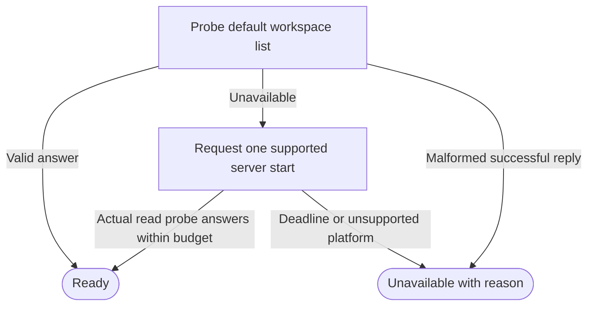

# Public Herdr installation and default-session readiness

Own `src/workflow-herdr-boot.mjs`. Export async module functions
`ensureHerdrInstalled(ports={})` for public setup and
`ensureDefaultHerdr(ports={})` for a prepared local workflow run/resume.
Both return `{state,code,message,executable,installed}`: state is `ready` or
`unavailable`; successful code/message are null. `installed` reports installation
by this call, not existing installation. Preserve the caller's environment,
native login, existing binaries, sessions and work. No private client dependency.

Readiness is only a live read response from Herdr `default`, never a controller
PID, stage acceptance or process capability. Existing controller identity,
generation, lifecycle/start/lifetime locks and uncertain-delivery rules remain
with their owners. This helper starts no controller, creates no tab/pane and
never repeats a native workflow request. It never stops/restarts an existing
server, changes shared configuration or copies credentials.

## Executable and setup behavior

`ensureHerdrInstalled` checks the invocation's PATH for an executable regular
Herdr binary, resolves its physical path and requires a successful nonempty
`herdr --help` reply as an executable smoke check, not feature acceptance. An unusable existing binary is reported, not overwritten.
Existing usable Herdr needs no download or upgrade. This installation helper
starts no server; setup's separate service/readiness phase owns activation.

When absent on Linux/macOS, first reuse a usable existing
`<home>/.local/bin/herdr`. Otherwise obtain the publisher's latest stable release
from `https://api.github.com/repos/herdrdev/herdr/releases/latest`. Do not pin a
tool version, minimum version, protocol version or release digest in PDD. Existing
executables are not upgraded by this helper. CLI capability checking owns whether
the features actually called are available; neither a version string nor this
installation smoke check establishes that result.

Select exactly one asset for the host: linux-x64 `herdr-linux-x86_64`,
linux-arm64 `herdr-linux-aarch64`, darwin-arm64 `herdr-macos-aarch64`, or
darwin-x64 `herdr-macos-x86_64`. Reject unsupported hosts before download.
Metadata must identify a published non-draft, non-prerelease release, a nonempty
safe tag and the exact publisher release URL. Require one matching asset with
positive bounded integer size and a `sha256:` digest of 64 hexadecimal digits.
Its download URL must be the canonical HTTPS URL under the same publisher,
release tag and asset name. Missing/ambiguous assets, missing digest, foreign
URLs or malformed metadata refuse; there is no fixed-release or unverified fallback.

Use HTTPS-only curl with 30-second time bounds, a 64-KiB metadata/output bound,
and a 32-MiB artifact bound. Keep the selected metadata stable throughout this
attempt even if publisher latest changes during download. Verify the exact
metadata size and SHA256 before chmod or execution. Require a single-link regular
file in private staging, preserve no-clobber publication, and require a successful
nonempty help reply. Recheck staged bytes before publication. A different version
label never causes rejection. Partial output, digest/size mismatch or download
failure refuses without publishing or executing unverified bytes. Publisher,
asset mapping and trust checks cannot be overridden by project/environment input.
No downloaded shell installer, sudo, profile/hook edits, privileged package
installation or PDD runtime replacement. Remove only this invocation's temporary
files afterward.

Install into an existing canonical, current-user-owned, non-group/world-writable
directory on PATH beneath home when available; validate every ancestor between
home and that directory by the same rules. Otherwise use the upstream
default `<home>/.local/bin`, validating/creating its owned canonical directories
without traversing symlinks. Never install into shared/system directories.
An occupied destination, including a broken symlink or nonexecutable file, is
not permission to replace it. Stage the verified binary in a private directory
on the destination filesystem, help-probe its regular executable, then
publish with a no-replace atomic link. Concurrent destination creation must
retain that file, not overwrite it. After publication, resolve and help-probe
the actual executable again.
An installer exit of zero alone is insufficient. Ready requires Herdr on the
original invocation PATH. If installed/reused in `.local/bin` outside PATH,
return `herdr_not_on_path` with the next step
`export PATH="$HOME/.local/bin:$PATH"` and rerun setup; never claim PATH was fixed
or silently edit a shell profile. Failed download/install/readback returns a
plain safe reason, with no arbitrary subprocess output.

## Starting the default server

`ensureDefaultHerdr` never downloads/installs. Resolve the executable from PATH
or explicit absolute `ports.herdrExecutable`. If an existing default installation
is outside inherited PATH, return `herdr_not_on_path` with the setup/PATH repair;
do not use a different binary silently while later transport still uses PATH.
Then probe
`herdr --session default workspace list`. A successful reply must be JSON with
`result.workspaces` an array and no error. A malformed successful reply is
unavailable, not permission to start another server. A failed read first asks the persistent service owner `startInstalledHerdr(p,
absoluteHerdr,remainingMs)` to start the matching installed service. A mismatched
or unsafe service refuses without PATH or unmanaged fallback. If no definition
exists, retain one headless startup request: Linux
`systemd-run --user --collect --unit=herdr-default <absolute-herdr> server`,
or macOS detached `<absolute-herdr> server` with ignored stdio and `unref` after
spawn. Use the supplied home/environment without global mutation. Unsupported
platforms perform no startup.

Wait for a fresh valid default workspace-list reply, including after a lost or
failed startup acknowledgement (another caller may already have started it).
Never infer readiness from a service/spawn acknowledgement. Recheck the monotonic
deadline after each awaited probe; a late valid reply cannot establish readiness. Bound reads,
startup request and polling by one monotonic startup budget, default 5000 ms;
`ports.herdrStartupTimeoutMs` may select an integer 1..30000 for the caller.
No workflow clock (`ports.now`) supplies this deadline. One failed caller never
issues a second server start. Timeouts/manager/permission/connection failures
return `Herdr is not running and could not be started: <fixed safe reason>`.
Missing PATH executable instead explains that setup must install Herdr.

## Ports, outcomes and diagnostics

Honor `ports.env` (otherwise process.env), `home` (otherwise OS home), `arch` (otherwise process.arch), `platform`
(otherwise process.platform), promise-style `execFile`, `spawn`, optional
`herdrExecutable` for boot, and optional `herdrWait(ms)` for bounded polling.
The execFile port receives ordinary argv/options including timeout, shell:false,
encoding, cwd, env and bounded output; returned exit status may be `code` or
`exitCode`, or an error may reject. Keep callback references and input objects
unchanged. Installation and boot are explicit calls, never import-time effects.

Codes are `herdr_not_installed`, `herdr_not_on_path`, `herdr_install_failed`,
`herdr_unusable`, `herdr_not_running` and `unsupported_platform`. Reasons are
fixed public text plus a numeric exit code or known OS error classification;
never expose raw stderr, commands, URLs with credentials or arbitrary error messages.
The specific missing recorded executable refusal below includes its absolute
local path so the person can repair that installation.

Trace every actual Herdr read and startup request through the shared trace
function, operations `workspace.list`, `server.start` and `other` for the setup
help smoke check. Failed calls must reach that wrapper before classification.
Tracing never changes result, error, startup count or readiness. The trace owner
owns opt-in selection, safe projection, bounds and sink behavior.

### Bound executable

Prepared readiness uses the executable owner's resolver with `runtime.herdr`
precedence, so a pane PATH without Herdr cannot change the selected binary. A
missing explicit recorded target returns unavailable/herdr_not_found with
`Herdr not found at <path>` and no startup or PATH fallback. Setup returns the
physical absolute executable for durable binding. Existing setup invocation-PATH
installation requirements remain unchanged.

## Dependencies

- [Persistent Herdr service](workflow-herdr-service.prompt.md): required generation/runtime for exact installed startup; no provisioning during run/resume/recovery.

- [Absolute executable](workflow-herdr-executable.prompt.md): required generation/runtime for saved Herdr selection and missing-path refusal.

- [Herdr trace](herdr-trace.prompt.md): required generation/runtime for
  `traceHerdrRequest`; diagnostics grant no authority or capability.
- [Controller](workflow-controller.prompt.md) and [CLI](pdd-cli.prompt.md):
  navigation-only caller/authority context, not required generation/runtime
  dependencies. Setup owns installation, prepared workflow run/resume owns boot;
  rejected/duplicate requests do not boot.
- Runtime: Node filesystem, child_process argv execution, OS home/temp paths,
  monotonic performance clock; Linux user systemd or macOS detached processes;
  curl and publisher latest-release metadata/artifacts for explicitly invoked setup only.
