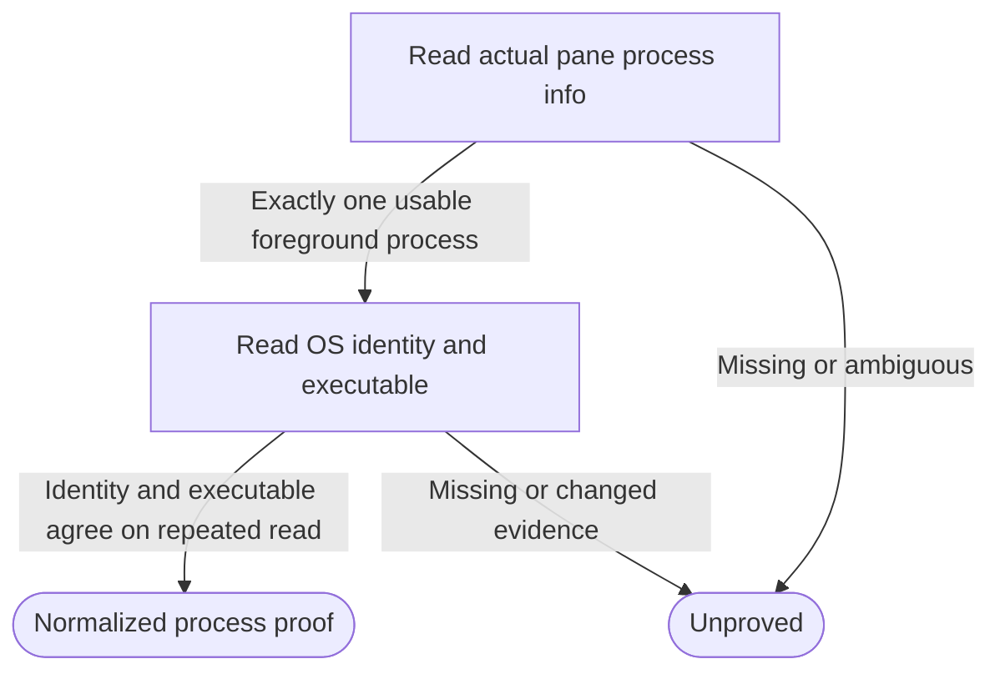

# Real local Herdr controller transport and process identity

Own `src/workflow-herdr-client.mjs`. Export async module functions
`readProcessStartIdentity({pid}, ports={})` and
`createWorkflowHerdrPorts(ports={})`. The first returns a nonempty OS identity
string or null when evidence is unavailable, invalid, inconsistent or unsupported.
The second returns `{herdr,processStartIdentity,observeHerdr}`, supplying missing
bindings and preserving explicitly supplied bindings by reference. Complete
caller ports remain available to bound functions. Import and factory creation
perform no process, service, filesystem or Herdr operation.

This public adapter owns transport normalization, never workflow admission,
claims, frozen runtime validation, lifecycle locks or journal acceptance. A
default-session answer is readiness, not proof of a controller. No private
dependency, configuration change, startup, cleanup, credentials or retry of a
mutating request belongs here. Unknown evidence must remain unknown.

## OS identity shared with workflow drive

Only positive safe-integer PIDs are accepted. On Linux use that PID's
`/proc/<pid>/stat` field 22 together with `/proc/sys/kernel/random/boot_id`.
Parse after the final parenthesized command name; require the stat PID to match,
a positive decimal start tick and a canonical UUID boot ID. Read both twice and
return null if either changes. Encode `linux:<boot-id>:<start-tick>`; a start tick
alone never suffices. On macOS execute `ps -o lstart= -p <pid>` with fixed C locale,
bounded output and timeout; two nonempty equal valid calendar-time replies yield
`darwin:<lstart>`. No PID-only, timestamp-now, raw-stat or unsupported-platform
fallback. Permission, missing process and malformed replies return null without
arbitrary diagnostics. Launcher and drive must use this same exported reader or
the exact same explicit callback, so a durable identity can be compared.

## Actual default-session operations

`herdr` exposes async methods `supportsProcessIdentity({session,paneId}?)`,
`listWorkspaces({session})`, `createWorkspace({session,cwd,focus})`,
`createTab({session,workspaceId,cwd,label,focus})`,
`paneRun({session,paneId,command})`, and `processInfo({session,paneId})`.
Only `default` is accepted. Validate identities and argv operands before sending
one bounded shell:false promise-style execFile call per transport request.
Herdr handles are opaque: accept bounded ASCII alphanumeric suffixes in
`w<suffix>`, `w<suffix>:t<suffix>` and `w<suffix>:p<suffix>`, including `w1:pA`.
Do not restrict them to decimal counters, decode their order or synthesize IDs;
retain exact spelling and compare exact workspace/tab/pane bindings.
Use the bound absolute executable below, supplied env/home/cwd,
UTF-8, 1 MiB output limit and a 5000ms timeout. Never interpolate a shell command
around the transport. `pane run` receives the caller's already-owned controller
command as one positional operand, unmodified. Rejected or nonzero calls and
JSON errors/malformed envelopes throw fixed safe errors after tracing; never
automatically issue another create/tab/run call.

Normalize `result.workspaces` to `{workspaceId,cwd}` rows from actual
`workspace_id`/`cwd`; Herdr 0.9.1 lists omit cwd, which stays null and cannot
establish checkout equality. Creation replies use `result.workspace.workspace_id`,
`result.tab.tab_id` and `result.root_pane.{pane_id,terminal_id}`; never synthesize
missing identities or derive pane IDs from tab IDs. These bindings come from
the installed public Herdr CLI contract; captured operational rows are not public
fixtures.
Creation requests use explicit `--no-focus` unless focus is true. Process-info
reads use `pane process-info --pane <id>` and require
`result.process_info.pane_id` to equal that operand. Preserve full foreground
argv; paths/argv remain local authority inputs, not public diagnostics.

`processInfo` returns `{pid,startIdentity,paneId,executable,argv}` only when one
foreground process has a positive PID and nonempty absolute executable argv[0],
the OS identity is present and unchanged, and a second actual Herdr read has the
same PID/full argv. Resolve the OS executable (`/proc/<pid>/exe` on Linux;
the absolute argv[0] on macOS) against argv[0] without replacing its public path
spelling. Ambiguity, disappearance, mismatch or unreadability throws a fixed
unproved error; absence is not a stopped-process proof. This never asserts
launch ID, generation or durable journal state: the controller must match those.

## Read-only capability and keeper observation

`supportsProcessIdentity({session:'default',paneId})` probes that exact pane,
including a controller-owned pane just returned by `tab.create`, without
requiring any pre-existing pane inventory. It reads actual process-info and
obtains consistent OS start identity for at least one foreground PID or reported
shell_pid, rechecking the same pane and PID around the OS observations. Invalid
session/pane, unsupported OS, missing or changed PID/identity, and failed reads
return false. It never creates a workspace/tab/pane or runs a process as a probe.
The no-argument compatibility form still examines existing pane inventory and
returns false for an empty inventory. Capability is neither unconditional nor a
version/help assertion and cannot replace fresh controller `processInfo` proof.

`observeHerdr()` returns `{complete,upSince,stableSince}` from actual successful
default pane inventory and process identity observations. Times mean first
observed continuous availability and unchanged inventory, not inferred server
boot time. Start from the first successful observation; reset on failure,
backward time or a gap over 60 seconds; inventory change resets stableSince.
Use retained local observations and real wall time (optional
`ports.herdrObservationNow` for isolated tests), never invent a historical uptime.
Incomplete observation returns complete:false with null times. Keeper still
owns its 30s/5s stability and repeated-free-lock gates.

## Ports, tracing and dependencies

Honor `env`, `home`, `cwd`, `platform`, promise-style `execFile`, async `fs`
(`readFile`/`realpath`) and optional `herdrExecutable`. OS probes use bounded
fixed argv, not shells; no arbitrary OS data is included in errors. Missing
`processStartIdentity` binds the shared export over complete ports. Supplied
`herdr`, `processStartIdentity` and `observeHerdr` are preserved by reference.

Trace actual transport requests, including failed calls, through the canonical
trace wrapper with static operations workspace.list/create, tab.create,
pane.list/process_info/run. OS observations are not Herdr commands. The trace
owner controls enablement/redaction/bounds; never expose raw argv, stderr or OS
records in user-facing errors. Tracing does not authorize a repeat or affect
the original command's delivery.

### Bound executable

Every request resolves the absolute executable through the executable owner
before transport. A present `ports.runtime.herdr` wins over an explicit
`herdrExecutable`; absence alone permits legacy discovery. Propagate
`herdr_not_found` and its `Herdr not found at <path>` message unchanged, instead of
projecting it to command uncertainty. No bare-name Herdr execution is allowed. Keep a successful legacy discovery
bound to that factory. Missing-path observations return complete:false with the
known code/message, and processInfo preserves that error instead of generic proof
failure. The capability probe also propagates a known missing executable error,
so a disappeared binary cannot be misreported as missing identity evidence.

## Dependencies

- [Absolute executable](workflow-herdr-executable.prompt.md): required generation/runtime for saved Herdr selection and missing-path refusal.

- [Herdr trace](herdr-trace.prompt.md): required generation/runtime for the
  best-effort actual transport wrapper and its privacy rules.
- Runtime: Node child_process promise argv execution, filesystem reads/realpath,
  OS home/platform, C-locale macOS ps or Linux procfs and boot ID; installed Herdr.
- [Controller](workflow-controller.prompt.md), [runner](workflow-runner.prompt.md)
  and [keeper](workflow-keeper.prompt.md) are navigation-only consumers, not
  required context; they own the admission, journal, locks and generation guards.
