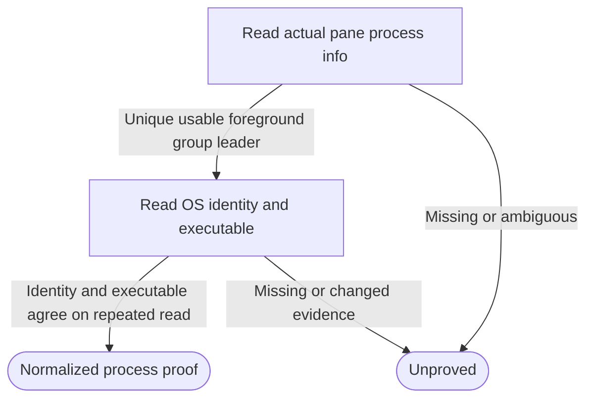

# Real local Herdr controller transport and process identity

Own `src/workflow-herdr-client.mjs`. Export async module functions
`readProcessStartIdentity({pid}, ports={})` and
`createWorkflowHerdrPorts(ports={})`. The first returns a nonempty OS identity
string or null when evidence is unavailable, invalid, inconsistent or unsupported.
The second returns `{herdr,processStartIdentity,observeHerdr}`, supplying missing
bindings and preserving explicitly supplied bindings by reference. Complete
caller ports remain available to bound functions. Import and factory creation
perform no process, service, filesystem or Herdr operation.

This public adapter owns transport normalization, never workflow admission,
claims, frozen runtime validation, lifecycle locks or journal acceptance. A
default-session answer is readiness, not proof of a controller. No private
dependency, configuration change, startup, cleanup, credentials or retry of a
mutating request belongs here. Unknown evidence must remain unknown.

## OS identity shared with workflow drive

Only positive safe-integer PIDs are accepted. On Linux use that PID's
`/proc/<pid>/stat` field 22 together with `/proc/sys/kernel/random/boot_id`.
Parse after the final parenthesized command name; require the stat PID to match,
a positive decimal start tick and a canonical UUID boot ID. Read both twice and
return null if either changes. Encode `linux:<boot-id>:<start-tick>`; a start tick
alone never suffices. On macOS execute `ps -o lstart= -p <pid>` with fixed C locale,
bounded output and timeout; two nonempty equal valid calendar-time replies yield
`darwin:<lstart>`. No PID-only, timestamp-now, raw-stat or unsupported-platform
fallback. Permission, missing process and malformed replies return null without
arbitrary diagnostics. Launcher and drive must use this same exported reader or
the exact same explicit callback, so a durable identity can be compared.

## Actual default-session operations

`herdr` exposes async methods `supportsProcessIdentity({session,paneId}?)`,
`listWorkspaces({session})`, `createWorkspace({session,cwd,focus})`,
`createTab({session,workspaceId,cwd,label,focus})`,
`paneRun({session,paneId,command})`, and `processInfo({session,paneId})`.
Only `default` is accepted. Validate identities and argv operands before sending
one bounded shell:false promise-style execFile call per transport request.
Herdr handles are opaque: accept bounded ASCII alphanumeric suffixes in
`w<suffix>`, `w<suffix>:t<suffix>` and `w<suffix>:p<suffix>`, including `w1:pA`.
Do not restrict them to decimal counters, decode their order or synthesize IDs;
retain exact spelling and compare exact workspace/tab/pane bindings.
Use the bound absolute executable below, supplied env/home/cwd,
UTF-8, 1 MiB output limit and a 5000ms timeout. Never interpolate a shell command
around the transport. `pane run` receives the caller's already-owned controller
command as one positional operand, unmodified. For `paneRun` only, a successful
exit with exactly empty stdout acknowledges delivery and returns `{}`: Herdr
0.9.1 does not print a JSON reply for this operation. This acknowledgment is not
controller start, process identity or journal proof. Nonempty stdout still
requires a valid JSON envelope; empty replies for other operations remain invalid.
Rejected or nonzero calls and JSON errors/malformed envelopes throw fixed safe
errors after tracing; never automatically issue another create/tab/run call.

Normalize `result.workspaces` to `{workspaceId,cwd}` rows from actual
`workspace_id`/`cwd`; Herdr 0.9.1 lists omit cwd, which stays null and cannot
establish checkout equality. Creation replies use `result.workspace.workspace_id`,
`result.tab.tab_id` and `result.root_pane.{pane_id,terminal_id}`; never synthesize
missing identities or derive pane IDs from tab IDs. These bindings come from
the installed public Herdr CLI contract; captured operational rows are not public
fixtures.
Creation requests use explicit `--no-focus` unless focus is true. Process-info
reads use `pane process-info --pane <id>` and require
`result.process_info.pane_id` to equal that operand. Preserve full foreground
argv; paths/argv remain local authority inputs, not public diagnostics.

`processInfo` selects the unique foreground row whose positive PID equals the
positive `foreground_process_group_id`. Other group members may be present and
may change order or disappear; they supply no controller authority. A missing,
duplicate or unusable leader is unproved, with no child/name fallback. For legacy
replies that omit the group-id field entirely, retain the single-foreground-row
compatibility rule; a present malformed group id never enables that fallback.

Return `{pid,startIdentity,paneId,executable,argv}` only when the selected row has
nonempty full argv with an absolute executable argv[0], the OS identity is
present and unchanged, and a second actual Herdr read selects the same leader
with the same group id, PID and full argv. Resolve the OS executable (`/proc/<pid>/exe` on Linux;
the absolute argv[0] on macOS) against argv[0] without replacing its public path
spelling. Ambiguity, disappearance, mismatch or unreadability throws a fixed
unproved error; absence is not a stopped-process proof. This never asserts
launch ID, generation or durable journal state: the controller must match those.

## Saved controller exit observation

The returned `herdr` also exposes async instance method
`inspectProcessExit({session,paneId,pid,startIdentity})`. It observes the original
positive PID and nonempty saved OS start identity; it never treats a generic
identity-read failure as absence. Return `{exited:false}` for unknown evidence.
Positive replies are `{exited:true,pid,startIdentity,paneId,reason}` with optional
observed identity or shell identity evidence. These are local proof inputs, never
public diagnostics or permission to relaunch by themselves.

Accept `pid_gone` only when two OS presence checks explicitly report absence;
the default uses signal zero and recognizes only ESRCH. EPERM, EACCES and other
errors remain unknown. Accept `identity_changed` only when two nonempty OS start
identities agree with each other and differ from the saved identity. The normal
shared identity reader still owns platform identity semantics. Optional
`ports.processExists({pid})` supplies true, false or null for isolated adapters;
only false proves absence, and explicit supplied references remain authoritative.

Accept `pane_shell` only from two successful reads of the exact saved pane whose
positive shell_pid equals foreground_process_group_id and uniquely identifies a
usable foreground row. That shell's PID/full argv and nonempty OS identity must
remain unchanged around the repeated pane read. No name/idle-text heuristic,
unrelated foreground process or empty list proves exit. Missing-path errors
retain their known Herdr code/message; other failed reads remain unknown. Perform
no mutation, cleanup, login or retries of Herdr effects. The controller still
requires the bound journal, deadline, frozen proof and free lifetime lock.

## Read-only capability and keeper observation

`supportsProcessIdentity({session:'default',paneId})` probes that exact pane,
including a controller-owned pane just returned by `tab.create`, without
requiring any pre-existing pane inventory. It reads actual process-info and
obtains consistent OS start identity for at least one foreground PID or reported
shell_pid, rechecking the same pane and PID around the OS observations. Invalid
session/pane, unsupported OS, missing or changed PID/identity, and failed reads
return false. It never creates a workspace/tab/pane or runs a process as a probe.
The no-argument compatibility form still examines existing pane inventory and
returns false for an empty inventory. Capability is neither unconditional nor a
version/help assertion and cannot replace fresh controller `processInfo` proof.

`observeHerdr()` returns `{complete,upSince,stableSince,server}` after successful
read-only default-session status replies and OS proof of the answering server.
`server` is `{pid,startIdentity}`: the unique owner of the reported listening
Unix socket and its shared OS start identity, confirmed around a second status
reply and socket-owner observation. Use `--session default status --json` and
its `server.running`, `server.status`, `server.session` (null or default), and
absolute `server.socket`; missing, ambiguous or changed proof stays unknown.
On Linux bind the listening inode from `/proc/net/unix` to its unique
`/proc/<pid>/fd` socket owner. On busy hosts, independent process-descriptor
reads must be able to overlap with a finite concurrency bound. Still finish
the candidate-process scan before proving uniqueness; finding one matching
owner cannot hide a later second owner. On macOS use bounded `/usr/sbin/lsof`
Unix-socket ownership reads; unavailable OS evidence never permits a fallback
to pane contents, a PID alone or a guessed server.

Times mean first observed continuous availability of that exact server, not
inferred boot time. Both times reset on server PID/start identity or socket
change, failed proof, backward time or a gap over 60 seconds. Pane inventory,
agent status, foreground children and working content do not reset either time.
Use retained observations and wall time (`ports.herdrObservationNow` may supply
isolated test time), never historical uptime. Incomplete observations return
complete:false with null times and no server proof. Keeper owns the 30s server
stability gate and repeated-free-lock checks; this observation grants no
controller exit or stage acceptance authority.

## Ports, tracing and dependencies

Honor `env`, `home`, `cwd`, `platform`, promise-style `execFile`, async `fs`
(`readFile`/`realpath`/`readdir`/`readlink`) and optional `herdrExecutable`. OS probes use bounded
fixed argv, not shells; no arbitrary OS data is included in errors. Missing
`processStartIdentity` binds the shared export over complete ports. Supplied
`herdr`, `processStartIdentity` and `observeHerdr` are preserved by reference.

Trace actual transport requests, including failed calls, through the canonical
trace wrapper with static operations workspace.list/create, tab.create,
pane.list/process_info/run and server.status (trace owner may classify it as other). OS observations are not Herdr commands. The trace
owner controls enablement/redaction/bounds; never expose raw argv, stderr or OS
records in user-facing errors. Tracing does not authorize a repeat or affect
the original command's delivery.

### Bound executable

Every request resolves the absolute executable through the executable owner
before transport. A present `ports.runtime.herdr` wins over an explicit
`herdrExecutable`; absence alone permits legacy discovery. Propagate
`herdr_not_found` and its `Herdr not found at <path>` message unchanged, instead of
projecting it to command uncertainty. No bare-name Herdr execution is allowed. Keep a successful legacy discovery
bound to that factory. Missing-path observations return complete:false with the
known code/message, and processInfo preserves that error instead of generic proof
failure. The capability probe also propagates a known missing executable error,
so a disappeared binary cannot be misreported as missing identity evidence.

## Dependencies

- [Absolute executable](workflow-herdr-executable.prompt.md): required generation/runtime for saved Herdr selection and missing-path refusal.

- [Herdr trace](herdr-trace.prompt.md): required generation/runtime for the
  best-effort actual transport wrapper and its privacy rules.
- Runtime: Node child_process promise argv execution, filesystem reads/realpath,
  OS home/platform, C-locale macOS ps or Linux procfs and boot ID; installed Herdr.
- [Controller](workflow-controller.prompt.md), [runner](workflow-runner.prompt.md)
  and [keeper](workflow-keeper.prompt.md) are navigation-only consumers, not
  required context; they own the admission, journal, locks and generation guards.
