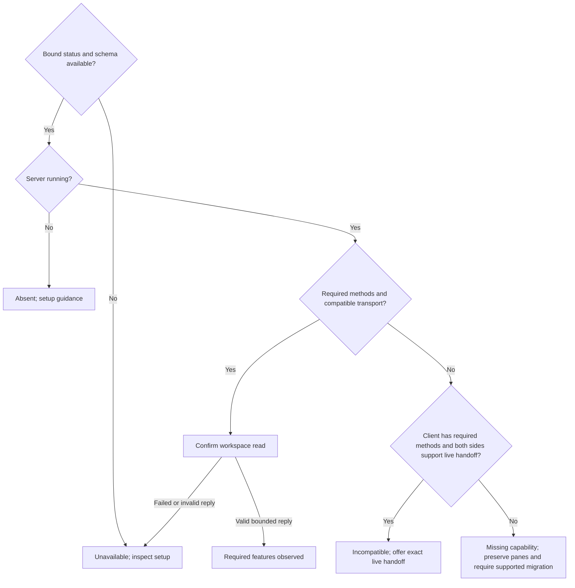

# Herdr features without losing open panes

Own `src/workflow-herdr-version.mjs`. Async module function
`inspectHerdrVersion({session='default'}={},ports={})` observes the exact selected
Herdr client's declared API and that named running server. Return finite feature
diagnostics and, when supported, a pane-preserving repair command for the person.
Never execute the repair, start/stop a server, close a pane, install an executable
or change controller/process proof. Preserve frozen executable identity, native
sessions, credentials and C19 service/startup behavior. Any installed version is
eligible: versions and protocol numbers are display facts, never an allowlist,
minimum, maximum or equality gate. Missing tools use the installation owner's
publisher-latest flow; this read-only module downloads nothing.

## Bounded observations

Use the absolute-executable owner: explicit runtime.herdr then herdrExecutable
wins without fallback. Otherwise enrich an empty Runtime from the saved install
record; only genuinely absent saved binding permits legacy PATH discovery.
Invalid saved state refuses. Select once and use only that absolute executable.
Session names match `[A-Za-z0-9][A-Za-z0-9._-]{0,63}`. Invalid arguments refuse
before process execution. Use shell:false, the invocation's home/environment and
one monotonic budget (default five seconds, integer timeoutMs 1..30000).
Recheck after each await and physical executable identity readback.

Read `--session SESSION status --json` (at most64KiB). A numeric nonzero exit may
carry valid incompatible status JSON; timeout, signal or launch failure cannot.
Require client.session and running server.session to match, client.binary to
resolve to the selected physical executable, explicit server.running and running
server.compatible Booleans. A present endpoint_compatible must be Boolean.
Running status is running; positive absence is running:false/status:not_running
with no conflicting session. Missing evidence is unavailable, not absent.
Project bounded printable client/server version strings when supplied; missing
or unfamiliar version syntax does not prevent feature assessment. Discard all
other output, including sockets, endpoints, update metadata and stderr.

Read that same client's `api schema --json` (at most1MiB). Require successful
JSON with `schemas.request.oneOf` declaring method names via
`properties.method.const`; do not interpret comments/descriptions as support.
The public workflow consumers require workspace.list, workspace.create,
tab.create, pane.list, pane.process_info, pane.send_text, pane.send_keys, pane.read, agent.get and
agent.prompt. Extra methods are harmless. The controller uses the CLI convenience command
`pane run`, not a socket method of that name: additionally read `pane run --help`
and require a usage declaration with pane run, PANE_ID and COMMAND operands.
This help query must succeed; never run a command in a pane as a probe. Preserve those consumers' own argument,
response, ownership, process, deadline and no-repeat guards: a method declaration
is not execution success or permission to send a prompt.

Compatible transport means server.compatible true and endpoint_compatible not
false, not matching a hardcoded protocol. Confirm it with one read-only
`--session SESSION workspace list`, requiring successful JSON result.workspaces
array. Never create workspaces/panes or test effectful methods. An unfamiliar
schema is unavailable; an understood schema missing named methods is incompatible.
Neither status nor a feature pass proves controller/native readiness.

Offer live-handoff only for a bound running incompatible server, a client schema
containing all required methods plus server.live_handoff, and an explicit true
server.capabilities.live_handoff. POSIX-quote every word of SELECTED --session
SESSION server live-handoff --import-exe SELECTED. Never substitute a bare
executable, reported foreign binary or PATH replacement. Otherwise explain that
a publisher-latest client and supported live migration must be checked while
keeping panes open; never recommend stop/kill/restart. Guidance is not a repair
success and doctor never executes it.

Return `{state,code,client,server,compatible,missingFeatures,detail,next,handoff}`.
State is compatible, incompatible, absent or unavailable. client/server are
projected version strings or null. compatible is true/false only for complete
running capability evidence, null otherwise. code is null, herdr_incompatible,
herdr_not_running or herdr_features_unavailable respectively. missingFeatures
lists only absent required method names from a valid schema. detail/next use
local vocabulary; compatible has next null. handoff is null or
`{executable,args,command}`, bound to exact session and executable. Unavailable
has no partially trusted metadata or repair command.

The export is a consumer seam for doctor and private Link ownership, not a wire
schema or new launch authority. Doctor adds a herdr-version pass/fail row outside
--check-only; candidate self-check never probes machine Herdr. Redacted support
reports omit paths and repair argv under doctor's existing projection.

## Dependencies

- [Absolute executable](workflow-herdr-executable.prompt.md): required generation/runtime for selection and saved Runtime enrichment; strict missing-path/no-fallback behavior remains owned there.
- [Install record](install-record.prompt.md): required generation/runtime through the absolute-executable owner; malformed saved state refuses.
- [Workflow client](workflow-herdr-client.prompt.md) and [stage](workflow-stage-herdr.prompt.md): required generation/verification for the named public operations and their retained strict proof guards.
- [Doctor](doctor.prompt.md): navigation-only consumer and redaction owner.
- Node filesystem physical identity, child_process argv execution, OS home and monotonic clock. Optional ports: home, env, runtime, herdrExecutable, timeoutMs and promise execFile. No network, model turn, install or service mutation.
