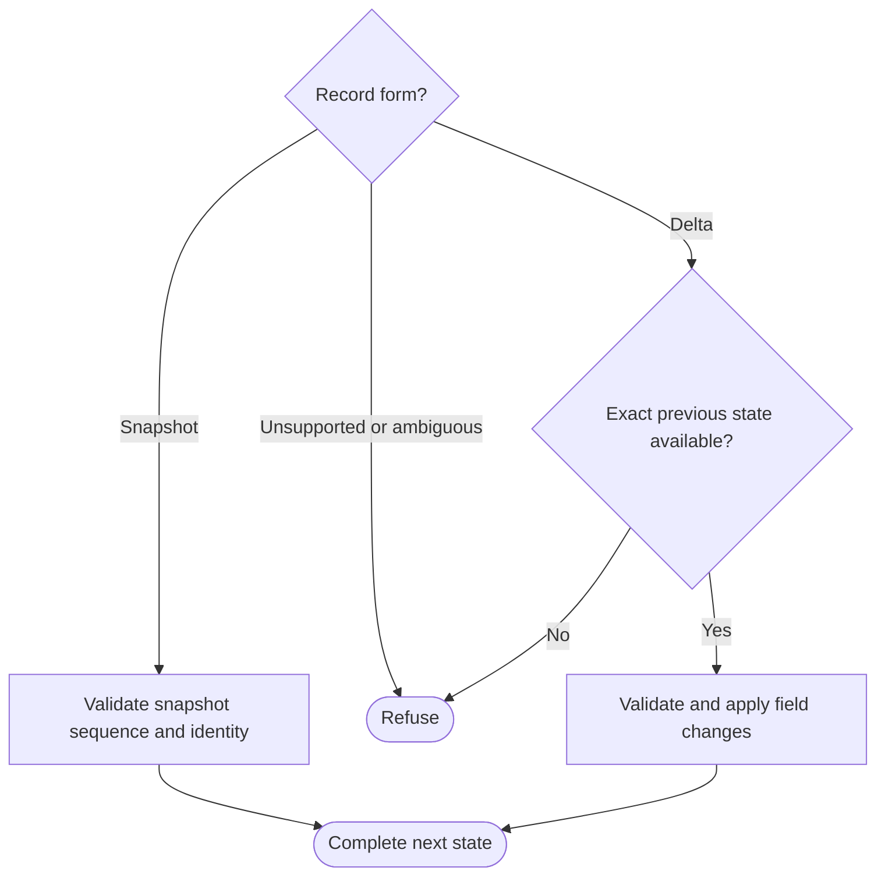

# Workflow journal records

Own `src/workflow-journal.mjs`, the JSON record codec shared by the authoritative
runner and the read-only display reader. Keep saved workflow state recoverable
without repeating frozen guide, workflow and context bytes on every observation.
This authorized format refinement preserves legacy full-state records and all
state values, including unknown fields, explicit nulls, arrays and removals.
It does not authorize effects, choose run progress or bypass the runner's strict
history, physical identity and locking checks.

Module function `encodeWorkflowJournalRecord(previous, state, metadata)` returns
one JSON-compatible record. `state.seq` is the next committed sequence;
`metadata` carries the existing event and optional decision binding. First records
and every 128th committed sequence carry a complete `state` snapshot. Other
records carry a recursive object-field delta against exactly `previous.seq`;
arrays are whole values. A delta at least as large as its snapshot may use the
snapshot instead. No snapshot rewrites or discards prior records. Every new
record identifies its format version, sequence and run; unchanged context must
be absent from ordinary deltas. Delta operations distinguish replacing a value
from removing a field and must preserve JSON keys safely, including names that
coincide with object prototype properties.

Module function `replayWorkflowJournalRecord(previous, record)` returns the
complete next state or throws on invalid representation. Accept legacy
`{seq,event,state}` snapshots. New records must have supported format version,
matching run identity, contiguous sequence and exact delta predecessor. Refuse
missing bases, malformed/overlapping operations, invalid paths and ambiguous
snapshot-plus-delta records. Never invent missing state or mutate a previously
returned state. The authoritative caller still validates every reconstructed
historical state's run, assignment, definition and immutable selection.

The reader question is whether the next line can restore state:

Display-tail readers may stop at a valid snapshot and replay its subsequent
contiguous deltas; this is not full-history validation or launch authority.
Strict recovery must read and validate all records, including history before a
periodic snapshot. A torn final line never authorizes authoritative recovery.

## Dependencies

- [Prompting guide](../../docs/prompting-guide.md): authoring.
- Runtime: Node built-ins and JSON serialization; no services or private imports.
- [Workflow runner](workflow-runner.prompt.md) and
  [display records](workflow-run-records.prompt.md): navigation only; callers own
  journal I/O, sequence admission, filesystem guards and state-specific validation.
