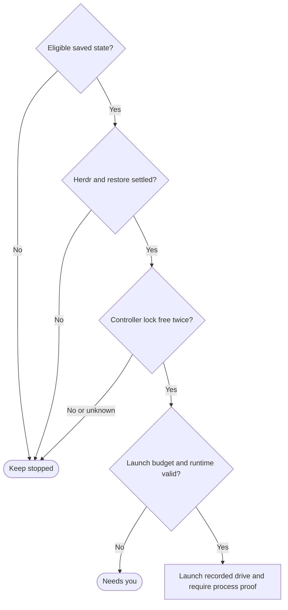

# Local controller recovery

Own `src/workflow-keeper.mjs`. Draft for review. The module function
`reconcileWorkflowControllers({entries, now}, ports)` checks known local runs
and returns per-run `{runId, state, code}` with an optional safe `message`. It never accepts a stage, answers a
question or selects an account. Preservation: new public recovery contract;
retain saved attempts and never turn restart into renewed human authority.

The boot/login owner enumerates `~/.pdd/runs/registry/*.json` and the display
index, union by runId, every 30 s. `entries` is that union. Validate each locator
against its actual common-directory assignment; never trust index/registry as
state. A failed display index append cannot hide a registered run. Corrupt or
missing registry files produce warnings and no speculative repo scan or launch.
Run every 30 seconds. Read and validate the journal before any launch; index and
status are locators/views only. Eligible durable states are `running`,
`waiting_agent`, `quota_wait`, and due quota `WAIT`. Never restart
`waiting_person`, `question_lost`, completed, failed, damaged, unknown or
unadopted legacy runs. A blocked agent question is a human wait, even if a
stale view says running. WAIT checking is observation only, not another send.

**Restore settled:** the same Herdr server PID and OS start identity has
answered continuously for at least 30 s. Working agents, pane changes and
foreground child activity do not restart this interval. Check the controller
lock free on two checks at least 30 s apart. A `herdr_unsettled` pass cannot
launch, but retains the first free-lock observation when complete evidence
still identifies the same server, run directory and availability interval and
a fresh controller-lock inspection proves it free on that pass. A held or
unknown lock, or failed inspection, clears the observation. Unknown/failed server
evidence, a server restart or backward time also invalidates it. Explicit supplied legacy observers without a
server field retain their timestamp binding but cannot retain a memo through
an unsettled pass. A fresh locked recheck immediately precedes launch admission;
concurrent keepers cannot both create a launch intent. Use the controller owner’s durable crash-budget accounting: initial starts and
new human decisions are exempt; three unplanned recovery admissions in the
preceding hour suppress another recovery. Return `needs_you / launch_budget`
with the controller’s safe reset-time message and `resetAt`, including when
prior-intent reconciliation reaches this refusal. If uncertainty remains from an earlier launch, reconcile its exact
process/journal first; an unplanned admission consumes one slot and cannot cause another blind start.
When observations are available, recover a killed controller within 90 s.
Unknown Herdr state never proves an agent or controller stopped.

Module function `createWorkflowKeeperPorts(ports={})` asynchronously returns a
composed copy, retaining all supplied values and references. Inside its lifetime
lock, the public keeper uses that factory before scheduling reconciliation. It
fills missing runner authority and locator bindings through
`createLocalWorkflowControllerPorts(ports)`. The controller factory obtains missing real Herdr,
shared `processStartIdentity` and continuous server identity bindings from their
public owner. It creates no pane and grants no launch authority by itself.
Explicit test/owner ports win.
The public keeper uses the same real Herdr/OS identity composition as direct
controller launch. PID comes from the exact pane's `pane.process_info`; Linux
start identity includes boot ID and process start ticks, and macOS uses the OS
process start time. Match the complete durable controller generation, launch,
pane, argv and runtime proof. A running default server or shell cannot stand
in for that proof. Fill only missing transport/runner authority bindings;
explicit supplied callbacks remain intact. Validate registry/index locators
through the strict journal and physical assignment before effects. Unknown OS
identity, locator, lock or inventory retains the original run without a new
start, prompt or reset.

A restarted drive inspects the original stage and claim. Live matching stage:
reattach without prompt. Absent process with saved native id: drive uses the stage adapter's explicit
history-only resume intent with stopped proof and new generation; it never
resends the first stage request. Prove that request in history and reconcile
known/uncertain effects before any gated recovery continuation.
Unproved prompt/effect: inspect only. New turn authority never comes from a
heartbeat age. Use frozen bytes and recorded runtime even after `current` flips.

## Runtime-bound recovery transport

For factory-composed recovery, bind each eligible run's real Herdr transport to
its strict journal Runtime, not the keeper's current release/setup descriptor.
Keep independent observation continuity per run and full Runtime; a changed
Runtime discards that transport's continuity. Preserve explicit owner transport
and callback references. The saved `runtime.herdr`, when present, wins over
current invocation PATH or executable hints. The executable owner checks it on
each request. Missing recorded Herdr yields `needs_you`, `herdr_not_found` and
the safe path reason, before new launch effects; report that reason from the
running service. Keep absent legacy bindings compatible without inventing a
recorded path. Preserve a controller's known `herdr_not_found` message for both
an original unresolved launch intent and a newly admitted launch. Keep the
controller's state/code and `inspectOriginal` indication unchanged: a missing
executable after an admitted effect remains uncertain and grants no retry.
Other arbitrary controller error text is not a diagnostic contract.
None of this changes eligibility, quota/fleet prerequisites,
restore provider refusal, physical authority, lock observations or launch proof.

A confirmed absent default server returns `needs_you / herdr_not_found`,
`reason: server_absent`, and `Herdr is not running. Run pdd setup to start the
Herdr service, then inspect pdd workflow status before resuming the saved run.`
Clear observation continuity and launch nothing. Unknown or malformed server
observations remain `herdr_unsettled`; they do not establish absence. Preserve
missing-executable path diagnostics separately. For factory-composed keeper recovery, after this explicit absence and a valid
saved runtime, call the boot owner's `ensureDefaultHerdr(ports)` with that strict
journal Runtime, preserving explicit supplied callback references. Never call it
for a missing executable, an unknown/malformed observation, or an ineligible run.
It owns the single bounded startup request, including selecting the installed
service; keeper never installs, stops or restarts a service itself.

Within this keeper lifetime, fence one startup attempt per home/full saved
Runtime and continuous absence episode before awaiting the helper. Share that
fence across entries and passes, including concurrent callers, helper errors and
lost replies. Only a fresh complete PID/start-bound server observation ends the
episode; unknown observations cannot reset it. Explicit absent-server evidence
after a later proved running server can authorize one new attempt. Changed
runtime bindings are independent, never substituted for a previous one.
A ready helper result is only transport readiness: report stopped/herdr_unsettled
for this pass, leave the free-lock memo empty, and require later fresh C18 server
settling and two free-lock observations before a controller launch. A failed or
uncertain startup retains the actionable C20 absence diagnostic and gives no
retry/launch authority; a known missing executable retains its exact path reason.
An explicit reconciliation caller without a startup binding remains observation-only;
the production factory supplies the default. Service startup is not permission
to bypass observation, runtime, eligibility or controller identity.

## Explain every recovery decision

Every reconciliation pass records one bounded JSONL decision for each supplied run
through `appendKeeperDecision` in `~/.pdd/logs/keeper.jsonl`: runId, decision,
code, timestamp, observed journal sequence and whether its controller lock was
positively free. Include stopped, skipped, refused, uncertain and started outcomes;
errors also produce one decision. A free lock is an observation, never permission
to skip the existing two-observation, lifecycle, runtime or process proof gates.
Optional `reason: server_absent` and budget `resetAt` retain actionable diagnostics
for status without arbitrary text. No arbitrary controller message, pane text, paths, context or credentials enter
this log. Recording failure warns safely and cannot alter recovery or repeat an
effect. `PDD_TRACE=herdr` additionally uses the existing redacted trace facility.
The log is diagnostic only and never read as launch authority.

## Public recovery service and restore scope

Alpha owns the boot/login recovery service `pdd runs-keeper`, installed by
`pdd setup`, independent of Link, accounts and fleet sign-in. Module function
`runWorkflowKeeper({home},ports)` runs the discovery/reconciliation pass every
30 s without overlapping passes. It holds `~/.pdd/runs/keeper.lock` for its
lifetime; a competing service/Link owner exits with a finite busy result and
launches nothing. A stop signal ends scheduling, releases its own lock and
returns exitCode 0. Link reuses this public implementation when installed;
it does not install a second recovery policy. The installer owns service files.
On Mac the owner starts at login; Linux boot recovery needs user linger.

The public restore shim restores only a durable managed launch record. Check
its saved owner, current generation/successor, native claim, recorded runtime
and flags before restore; stage restore belongs to its controller. A managed
account restore also re-reads the current machine/tool policy and reconciles the
shared transition through its adapter. Saved actual account/model observations
remain evidence, not account preferences; a fixed-account quota question stays
stopped. Recovery never answers it or independently selects another account. The optional
account adapter follows the [managed invocation boundary](../accounts/wrapper.prompt.md).
The generic restore/claim path remains available without that adapter.

### Production bindings and conditional recovery

The keeper factory supplies every recovery provider it consumes; absence is
never evidence of retirement, available quota or safe restore. The public Herdr
observer and strict locator/journal/lifecycle/lock bindings come from the shared
Rule 11 controller factory. They are usable without fleet sign-in and retain
the same PID plus OS start identity in controller and drive.

There is no public quota-provider or durable managed-launch-store contract.
Until its owner supplies those bindings, `observeQuota` returns
`{fresh:false, room:false, code:'fleet_client_required', message}`; the default
`readManagedLaunch`, `validateManagedRuntime`, `validateManagedFlags`,
`validateOwner`, `restoreNative` and account-restore adapter refuse with that
same code. Their fixed, safe message contains **`this needs the fleet client`**.
Do not invent a record location/schema, use today's runtime or flags, infer
quota from a renewal time, read credentials or import private client files.
Only missing bindings are filled; explicit owner providers remain responsible
for their durable proof and policy.

For a due WAIT, an unavailable quota provider retains WAIT and emits that
actionable reason with `retryObservation:true`; it cannot inspect/start a new
controller or send a prompt. The running service writes this conditional reason
to its warning output when encountered, never merely discards reconciliation
results. No conditional warning is required for unused paths. Managed restore
reports `{state:'refused', code:'fleet_client_required', message}` before claims
or native effects when a required binding is unavailable. Other inspection
errors remain uncertain. Unmanaged commands and malformed identities still
return before factory construction. A real record belonging to a workflow
controller is still refused by `controller_owns_restore`; a stale or retired
record remains retired. Never relabel these outcomes as missing fleet support.

Explicit provider values are retained, not coerced or replaced. A configured
managed-launch reader, runtime/flags validators, owner validator and native
restore provider must be callable; a managed account's configured adapter must
have a callable `reconcileRestore`. Refuse malformed explicit values (including
null, objects and false) with `state:'refused', code:'unsupported'` and a safe
callable-provider diagnostic before acquiring a native claim. Missing default
bindings still report `fleet_client_required`. For a valid returned record,
retirement and controller ownership checks keep precedence; actual callable
provider failures remain uncertain, without replaying a restore.

Herdr startup follows the [launcher process-ownership contract](pdd-launch.prompt.md);
recovery must preserve its separate service/context, including when initially absent. Test Alpha alone through controller death, reboot and
update, with one current stage process and no repeated first prompt.

## Dependencies

- [Default Herdr readiness](workflow-herdr-boot.prompt.md): required generation/runtime for the bounded `ensureDefaultHerdr` module function; installed-service selection belongs to its service dependency. Factory fills only a missing callback.

- [Keeper decisions](workflow-keeper-log.prompt.md): required generation/runtime for bounded per-pass diagnostics; no launch authority.

- [Story](../../story/cli/WORKFLOW-KEEPER.md) and [cases](../../vectors/cli/workflow-keeper.json): verification; expected outcomes, not observed results.
- [Runner journal reader](workflow-runner.prompt.md): required generation/runtime
  `readWorkflowJournal`, the strict complete history/path validator. This reader
  authorizes no effects; the controller rechecks under its lock.

- [Controller launch](workflow-controller.prompt.md): required generation/runtime
  for durable launch admission and actual process proof.
- [Claims](workflow-claims.prompt.md): required generation/runtime for kernel
  locks and current-generation exclusion.
- [Run records](workflow-run-records.prompt.md): required generation/runtime
  for locating runs and bounded read-only journal inspection.
- [Frozen runtime](workflow-runtime.prompt.md): required generation/runtime
  validation; missing versions stop recovery.
- Supplied fs, monotonic/time observations, stop signal and diagnostic output:
  runtime inputs. The default diagnostic writer uses stderr; failure to write
  diagnostics never grants recovery authority or changes a saved run.
  Strict runner journal validation precedes effects; lenient display
  readers alone cannot authorize recovery.

[Managed invocation boundary](../accounts/wrapper.prompt.md) is navigation-only
for the optional adapter. [Launcher process ownership](pdd-launch.prompt.md) is
required generation/runtime context for service startup; recovery never owns a
second service policy.
