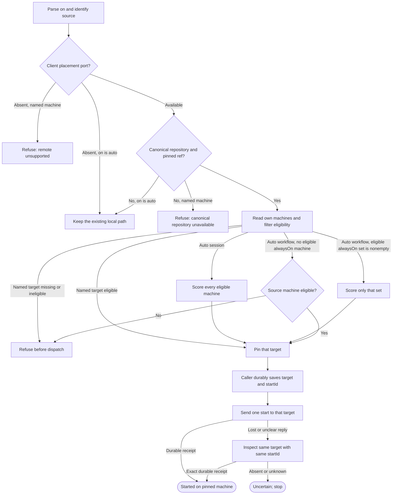

# Machine placement and remote starts

Draft for review. Own the public Alpha module `src/workflow-placement.mjs`. It selects a start machine for `pdd session` and `pdd workflow run`, then hands a remote start to an optional local Client port. It does not own workflow stages, native-session behavior, account choice, fleet membership, or remote transport. The selected machine owns the whole run or session.

Preserve the local Alpha path when no Client port is supplied. Remote placement is an optional integration, never a required private import or hosted service. The proposed port below is a draft local interface; no deployed adapter is implied.

## Public behavior

`--on` accepts `auto` or one exact, unique machine name from the caller's own fleet. Omitting it means `auto`. A missing value, unknown name or ambiguous name is a finite refusal before any start. The current machine is a valid target when it appears in the own-machine list.

Export module functions `selectStartTarget(input, ports)` and `dispatchStart(input, ports)`. Selection only reads the optional inventory; it never launches a process. Its input is `{kind, on, sourceMachineId, agent, repository, project?}`, where `kind` is `session` or `workflow`, `agent` is `codex` or `claude`, and `repository` is null or `{url, ref}`. Optional `project` is a caller-resolved `{id,name}`; it never resolves as a folder path. It returns `{state, target, code, message}`; `state` is `local`, `selected` or `refused`. A local result means the existing caller owns the normal local start.

After the caller durably saves the selected target, task binding and stable `startId` in `~/.pdd/runs/starts/<startId>.json` (or the managed session launch record), `dispatchStart({kind,target,startId,agent,repository,project?,selectionOverrides?,requestText?,workflow?}, ports)` may start remotely. Workflow `startId` is a preallocated lowercase UUIDv4 that becomes its target-owned run id; the source creates no worktree, journal or freeze. The target start adapter calls the runner's proposed prepareWorkflow with this supplied runId under its original durable request binding; session `startId` is a durable session-launch UUID. It returns `{state,targetMachineId,startId,runId?,sessionId?,project?,launchSelection?,code,message}`, where `state` is `started`, `refused` or `uncertain`. Only a durable target receipt for the same `startId` counts as `started`. The caller owns persistence and any later status display; this module owns selection and one remote dispatch.

`dispatchStart` also requires a canonical repository URL and pinned, remotely reachable ref; missing repository identity returns `repository_unavailable` before any port effect. Canonical repositories accept credential-free HTTPS and ordinary Git SSH (`ssh://git@HOST/OWNER/REPO.git` or `git@HOST:OWNER/REPO.git`). SSH permits only the transport user `git`, with no password, query, fragment or custom port. Repository paths contain two nonempty owner/name components, never dot/traversal components.

## Placement and return

The key question is whether this command can safely stay local, select a remote machine, or must stop after a remote start becomes uncertain.

The diagram owns the routes. The following rules own eligibility, scoring, the target identity and the effects.

### Eligibility and automatic choice

In Client mode, a machine is eligible only when all are true: it belongs to the current user's own fleet; it is online; Herdr is ready; the requested native tool is installed; the machine/tool Settings policy reports usable room rather than `OUT` for this tool and need; and free disk is strictly greater than 5 GB. Unknown or malformed facts make the machine ineligible. `need` is 3 for an interactive session and 10 for a workflow stage. A Herdr `idle` label alone is not readiness proof.

For `session --on auto`, score all eligible machines. For `workflow run --on auto`, if any eligible machine has the `alwaysOn` tag, score only eligible `alwaysOn` machines. Otherwise use the source machine only when it is eligible; do not fall through to another untagged machine. If the source is ineligible, refuse.

Remote placement requires a canonical repository URL and pinned, remotely reachable ref. If either is unavailable, `auto` preserves the local path and does not score remote candidates; an explicit machine name is refused with `repository_unavailable` before effects.

`score = 20 × hasCleanCanonicalClone − 5 × workingAgentCount − 50 × hasLaptopTag`. `hasCleanCanonicalClone` is true only for the same canonical repository and ref in a clean reusable clone. A clone with local changes does not earn the bonus and is never reused or altered. The `laptop` deduction is applied once. Higher score wins; ties go by ascending machine name, then stable machine id if names match. No score overrides eligibility or the workflow `alwaysOn` choice.

An explicit machine name is never a preference. If that machine is absent, ambiguous, or ineligible, refuse with no start and no alternate target. A later loss of the selected machine does not trigger a new selection.

### The optional local Client port

`ports.machinePlacement` is supplied only by an installed Client integration. Alpha must not import, discover, install or require that package. With no port, `--on auto` preserves the existing local start; a named machine returns `remote_unsupported` before effects. If a port is present but unavailable, malformed or unable to provide a complete inventory, fail closed with `placement_unavailable`; do not assume the source is safe or fall back locally.

The proposed port has exactly these methods:

- `listOwnMachines({sourceMachineId,kind,agent,need,repository})` returns `{machines}`. Each machine has `{id,name,ownMachine,online,herdrReady,installedAgents,accountPick,freeDiskGB,hasCleanCanonicalClone,workingAgentCount,tags}`. `accountPick` is `available` or `OUT` under that machine/tool policy; it reveals no account id or credential and accepts no per-start account preference. The Client verifies own-fleet membership and supplies current observations. Missing observations do not default to available, online, zero agents or free disk.
- `start({targetMachineId,startId,kind,agent,repository,project?,selectionOverrides?,requestText?,workflow?})` returns a durable `started` receipt, a proven pre-effect `refused` result, or `uncertain`. It rechecks that exact target's eligibility before effects and never changes the target. For workflows the returned `runId` equals `startId`.
- `inspect({targetMachineId,startId})` is read-only and returns `started` only with the same durable receipt, `absent` only when no start was accepted, else `unknown`.

This is a proposed in-process adapter shape between public Alpha and the optional private Client. It defines no network endpoint, daemon, credential exchange or new service. The CLI and workflow runner pass the optional port when an installed Client supplies it. Without the port, remote `--on` remains unsupported.

### Remote source and ownership

A remote start requires a canonical repository URL and a remotely reachable pinned ref. The target machine clones only that repository and ref into its own run/session area. It never receives the source working directory, dirty or untracked files, local-only commits, patches, ignored files, transcripts, environment, HOME, native login, provider tokens or other credentials. Existing dirty target checkouts stay untouched; create an isolated clone or worktree. The task payload contains the session request text or workflow name/issue, optional project id/name and explicit model/effort overrides. No account preference is sent. A source project id is descriptive task binding, not
permission to use a target path: resolve the canonical repository to the target
project/isolated checkout and save its actual local id/name before launch.

The target resolves model/effort defaults from its own CLI catalog and Settings, validates overrides, and durably binds the effective pair before launch. Lost-reply inspection returns that original binding; a retry does not pick new defaults.

The selected target must be one of the user's own machines in the verified fleet. The target uses its own installed tool, account access, credentials and Herdr. No PDD-owned host runs an agent. The person-facing result uses the project name and repository/ref as context; physical target folders remain internal. It names the canonical repository and ref used, so local-only changes are not implied to be present.

The caller durably binds `startId` to one target before dispatch. The target port records that identity and immutable task/target binding before it starts work and must map repeated reads of that id to the same start. If the start reply is lost or unclear, inspect only that machine and id. If inspection cannot prove the original start, return `uncertain` and stop. Never send a second start, choose another machine, or move the run. A workflow's controller, stages, journal and worktree stay on the selected machine. A sleeping machine pauses its run as `paused (machine asleep)`; resume remains on that machine.

### Project clone location

A new user-visible project clone uses the Settings project base (default `~/pdd`)
and repository name; the phone's explicit GitHub clone action owns that effect.
Placement reuses its canonical identity or creates an isolated issue/session area;
it never silently replaces a dirty checkout or turns a project-name match into an
unreviewed clone. Workflow worktrees retain their separate assignment contract.

### Open design detail

The design says free disk must exceed 5 GB but does not say whether GB means decimal GB or GiB. This draft makes the port report `freeDiskGB` in GB and uses the strict `> 5` boundary; confirm the unit before implementation. Workflow run/status records persist the selected machine and `startId`. Alpha still lacks a durable session-launch record for its `startId`; define that owner before implementing remote sessions.

## Dependencies

- [Story](../../story/cli/WORKFLOW-PLACEMENT.md) and [cases](../../vectors/cli/workflow-placement.json): verification; expected outcomes, not observed results.
- Read the complete [Prompting guide](../../docs/prompting-guide.md) before authoring or generating this module.
- Runtime has no required package or service dependencies. The optional `ports.machinePlacement` contract above is the only remote seam; local behavior uses existing caller paths. Workflow runner and CLI are navigation-only caller references.
