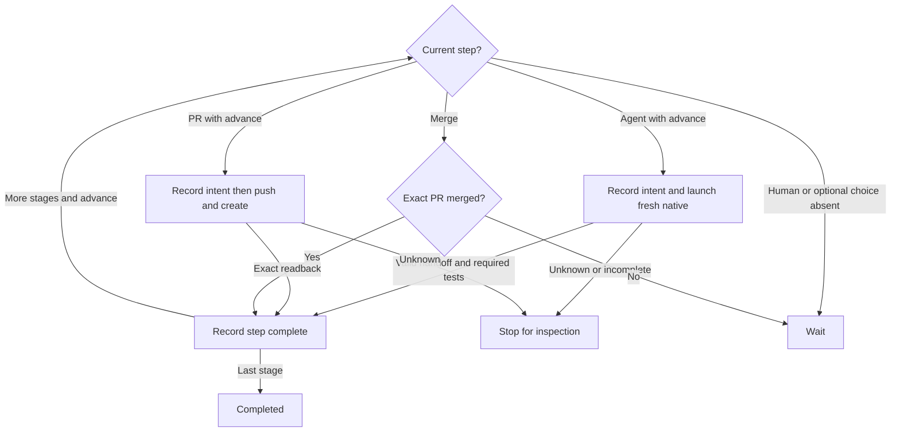

# Local workflow runner

Draft for review: P1 controller and recovery contract. Preserve existing stage,
handoff and GitHub behavior except for the explicit changes below.

`src/workflow-runner.mjs` owns sequential local workflows for the user's current Git project. It resolves a real same-repository GitHub issue, starts a fresh native coding-agent conversation for each agent stage, preserves observable file handoffs, asks for human choices, creates actual PRs and observes their merge. The supplied background stage adapter owns the assigned issue worktree and full-access native launch policy, preserving native login without global configuration writes. Do not merge automatically or embed credentials.

## Public module functions and ports

Export `WORKFLOW_STAGES` from the definitions module. Export async module functions:

- `runWorkflow({name,issue,agent,cwd,packageRoot,project?,launchSelection?}, ports)` begins any validated editable workflow with codex or claude. A still-active same-repo/name/issue run is reported rather than duplicated.
- `resumeWorkflow({runId,cwd,packageRoot,decision}, ports)` loads a UUIDv4 run, retaining its saved workflow, provider, repository and issue. `decision` is absent, `approve` or `skip` for ordinary workflow choices.
The quota-only continue/wait domain is defined below; neither domain is a new
provider or arbitrary input.

Return `{exitCode,state,runId,stage,message}`. `state` is completed, waiting, failed or recovery_required. Exit zero for completed, two for an ordinary wait, and one for failure or uncertain effect. The CLI prints the single message including actual run/stage identity. Missing/malformed inputs fail before effects. Preserve this result envelope for the controller. Public launch/status routing belongs to the CLI.

Background agent stages use the [Herdr stage port](workflow-stage-herdr.prompt.md); ordinary pdd session remains unchanged.

Canonical base guidance uses `loadGuidance({packageRoot,cwd,workflows:false}) -> string`; append the actual docs/workflows.md overview and the exact saved resolved definition/Markdown, keeping the full canonical guide first. Snapshot the complete canonical base guidance and resolved recipe from the original source project before worktree allocation. After assignment, compose and save the exact stage context with its actual worktree cwd and SHA256 before a native effect. Recompute against the immutable frozen bytes before progress. Original guide/recipe edits do not replace or invalidate the saved inputs; changed frozen bytes refuse. Never request a hardcoded bundled workflow name for custom workflows.

Native ports are
`runHerdrStage({runId,stageId,attemptId,agent,cwd,context,instructions,launchSelection,backend?,checkpoint})`,
read-only `inspectHerdrStage({backend,cwd})`, active `attachHerdrStage({backend})`, and
`closeHerdrStage({backend,acceptance})`. The native owner alone defines actual backend
fields and Herdr operations. Awaited checkpoint snapshots are durably journaled before
create/start/prompt and record returned actual backend IDs before stage delivery.

A local UUID attempt identifies the runner attempt, never an invented native turn
receipt. Submit one full guide-first current-stage request to a fresh owned ready native
conversation with no prior prompt. Same-agent observed working to ready/settled is a
transport candidate only. Main also requires the exact caller-bound closed handoff,
unchanged input/currentness and pinned files, actual output hashes/ancestry and required
real argv test results before acceptance.

Idle alone, prose, a completed model turn or native lifecycle never certifies the stage.

Record acceptance with the exact backend/evidence and handoff digest before requesting
owned settled-pane cleanup; fresh identity/quiescence must be checked by the native
owner. Never close blocked, working, unknown or unrelated panes. Cleanup uncertainty
retains the original accepted stage and stops before a new stage; it never resubmits a
prompt. Interrupted/unknown delivery is inspection only and never automatically launches
again.

An explicit approve may continue the SAME original first dispatch only when the saved
agent backend phase is start_intent or ready. Pass runHerdrStage the exact original
run/stage/attempt/provider/cwd/context/instructions/launchSelection/backend/checkpoint; never allocate
or start another agent. New intents retain instruction bytes; older intents may
reconstruct only from saved fields and must match the original full prompt digest before
this call.

The native adapter owns proof of the exact existing workspace/tab/pane/terminal, only
pre-prompt ready evidence, current server/agent/cwd identity and actual readiness under
the shared guard. Blocked setup remains blocked with the original attach guidance;
actual ready may checkpoint its first actual nativeSession and ready sequence, then
durable prompt_intent before its ONE first prompt.

Any prompt_intent, submitted, candidate or later backend stays inspection-only and never
resends. Legacy no-decision reconciliation remains read-only. It may be hosted in a
pane, but it grants no new effect. Snapshot/source/currentness and all established
checkpoint identity pins remain unchanged. A blocked stage pauses with its existing
identity.

The person may attach the exact active conversation; archived completed stages return
finite archive information, never a new native conversation. The controller is `pdd
workflow drive RUN_ID` in its own Herdr pane. Short run/resume commands hand off to that
pane. After controller exit, only the guarded local recovery contract can restart it; a
human wait stays stopped.

Stage requests carry exact run/stage/attempt, assigned cwd, issue, starting HEAD/fingerprint, unique absolute handoff path, accepted prior artifacts and reports, and current instructions. The agent must read the full guide before Story, complete real files, write the closed handoff and report the result. It must not launch future stages, terminate the controller, push/PR/merge, change permissions/login or overwrite unrelated work. Main owns progression. No foreground-native-exit action is required for background stage completion. Optional execFile uses argv arrays, no shell; preserve defaults of helper modules unless an executor was explicitly injected.

## Identity and local records

Accept ISSUE as a positive decimal, owner/repo#number or HTTPS
github.com/owner/repo/issues/number. Reject PR URLs, ambiguous paths, cross-repo issues
and an issue number that is actually a PR. Resolve the current repo through normal
Git/gh reads and bind its canonical owner/name to the actual origin. Use the normal
GitHub user's `gh` authorization.

Save canonical issue URL/number/title/body, repository, default branch, original source
root, assigned worktree cwd, workflow, provider, resolved definition and UUIDv4
identity.

Use [worktree assignment](workflow-worktree.prompt.md):
allocateIssueWorktree({cwd,repository,issueNumber,runId,workflowName,baseRef},ports)
returns ready/conflict/recovery_required and a real assignment;
lookupIssueWorktree({cwd,runId},ports) finds that assignment read-only from either
original or assigned checkout. A common-repo issue claim applies across workflow names.
An allocation conflict may return no assignment.

For an existing issue, read only the documented common-directory issue claim to discover
its original run UUID, then use lookupIssueWorktree to validate that exact saved
physical assignment. Claim discovery requires canonical ordinary metadata and never
trusts the claim as a ready assignment or repairs/replays allocation.

Check canonical repository/issue/commonDir and load the original journal under its
controller lock before reporting that saved run; no second provider or workflow replaces
it. Main never chooses another existing checkout, creates/deletes worktrees itself or
touches the original working files.

Validate actual assignment run/repo/issue/commonDir/root/gitDir/branch, execute every
stage/check/artifact/PR in its immutable assigned worktree, and keep its journal in that
worktree gitDir. Missing/ambiguous assignments or incomplete post-allocation journals
refuse, never allocate another attempt automatically.

Keep append-only durable journal events, periodic snapshots and artifacts under the actual absolute Git
directory's `pdd/workflows/<UUID>/`, never a tracked product file or global config.
Metadata directories and journal files must be canonical ordinary paths, never symlink
redirects or multiply linked journal files; refuse before writing through an alias.
Serialize active drive commands with kernel `flock(<runDir>/controller.lock)`; a
concurrent holder refuses.

Resume acquires the assigned controller lock before reading its journal snapshot,
checking the saved assignment or selecting progress; never act on a snapshot read before
exclusion was acquired. Kernel exit releases the lock. Never unlink a lock inode, remove
an alleged stale owner or use PID liveness as exclusion. Unknown lock status refuses.
Bind every snapshot to the saved repository/worktree, stage and current expected HEAD.

Refuse changed frozen context, and retain exact saved definition/Markdown/context
snapshots. The current source guide is not a resume input. New runs use loader selection
from the original project root before allocation; a complete local recipe overrides the
bundle, including for arbitrary safe workflow names. Read durable JSONL incrementally
with memory bounded by the reconstructed state and current record rather than total journal size.

Validate every historical sequence and run binding in order before returning the
complete latest state; a large valid journal must not require one whole-file string.
Preserve append-only bytes, terminal-newline completeness, malformed-history refusal and
controller-lock ordering; do not compact, drop records or replace saved context. A
malformed or torn journal refuses rather than inventing state.

The [journal codec](workflow-journal.prompt.md) owns the backward-compatible
snapshot/delta representation. Append changes against the last durable state,
with a full snapshot on the first record and every 128th committed sequence.
Never rewrite existing journals to adopt the format. Replay every delta before
applying the same historical identity and definition checks as legacy snapshots.
`readWorkflowJournal` and its `onRecord` callback continue to expose complete
reconstructed states, not storage deltas. Each callback record is a complete
snapshot consumable by the public journal codec: retain event, decision and other
record metadata, but omit storage-only `delta` and `baseSeq` fields. Reading or
replaying these observations grants no effects or replacement launch authority.

A repeated, identical `agent.backend` observation does not create an event,
advance sequence or rewrite derived status. Check identity and transition guards
before treating the checkpoint as unchanged. Changed observations and all effect
intents remain durable before callers proceed; timestamps alone must not force
backend checkpoints. Recovery after a process restart must recover the same
backend, request, evidence and native identity without delivery or retry.
At four identical observations per second, a one-hour idle stage with roughly
77 KB state including 57 KB context keeps its journal below 5 MB. Periodic
snapshots count committed changes, not polling attempts or elapsed idle time.

Before any native launch, push or PR create, flush its specific intent. After crash or unknown delivery, reconcile existing state; never blindly replay a native session, push or PR create. No-decision resume may inspect journal/artifacts and read existing PR/merge state, but cannot launch a new agent, push, create a PR or automatically advance into an effect. Explicit approve permits ordinary next progress, with the same guards; skip is confined to optional steps.

## Stage progression

Optional steps wait before execution. A flushed optional decision governs recovery even
if interruption occurs before its stage completion record. Revalidate its saved input,
apply a saved skip before any native/PR effect, and skip a matching merge; a later
approve cannot resurrect that skipped step. A saved approval does not authorize effects
on an inspection-only resume. Approve chooses the optional step; skip records its
omission and continues under that explicit command.

Human Story approval is a current decision, bound to the actual HEAD and independently
authored prompt/Story/cases/test-plan file hashes. A skipped optional prompt PR causes
its matching merge step to skip. Rejection or missing approval never becomes approval.
Human/optional decisions made after input changes refuse.

Only after an actual prompt PR merge may explicit approve at the following build
boundary accept a clean user-prepared branch containing that exact merged commit, with
all pinned contract artifacts unchanged. Record the old/new input binding; never
checkout, reset or rewrite the base automatically.

## Agent handoff and verification

Before launch, supply an absolute handoff path under the run artifact directory. The
agent writes a regular JSON file with exactly `version:1`, `runId`, `stageId`,
`issueUrl`, `inputRevision`, a nonempty `summary`, and `files:[{path,sha256,role}]`;
optional `testCommands` is an array of argument arrays. Allowed roles are prompt, story,
cases, implementation, tests, evidence and notes. Paths name regular files within the
current project, not `.git`, symlinks or traversal.

Verify their actual SHA256, not just reported names. Reject extra/malformed identity,
duplicates, stale input or missing artifacts. Verify actual output HEAD and retain file
hashes as a real handoff. Uncertain native delivery or exceptions cannot trigger a new
launch. A saved attempt is inspected under its original identity; only an explicit
advance may accept a fresh valid candidate for that same attempt. Unknown transport
never becomes pass, and no resume resends its prompt.

Report protocol stages may retain their substantive handoff summary in the journal
artifact without claiming executable evidence. Work stages still require project files.
A proposal supplies its declared contract/independent-case roles plus the project's
concrete native test argv plan. Every proposal, including small-change and custom recipes, requires prompt, Story and
cases before implementation work. Human approval (or explicit
optional/advance decision for small changes) pins that input.

Implementation stages generate code from the accepted Story, prompt and independent
cases. Generated code and its observed results never replace that source contract.
Preserve pinned prompt/Story/cases through implementation. Reject output history that
abandons the starting commit. After real tests, re-read and compare the exact closed
handoff, recheck the pinned and output file hashes, and require unchanged test input
HEAD/worktree fingerprint and retained starting ancestry. A test that mutates the
execution input or handoff cannot certify that changed result.

After a separate prompt PR merge, require the subsequent code branch to contain the
exact recorded merged commit before further code PR publication, without forced checkout
or silently changing bases. The verify stage runs that exact test plan with ordinary
execFile and records actual command exit status. A missing command, nonzero exit or
changed expectations refuses completion; neither an agent's prose nor native transport
settlement stands in for running tests.

Passing finite tests is not formal proof or prompt execution.

## GitHub PR effects and merge observations

PR stages require a clean committed non-default branch with commits beyond the saved
default base, unchanged accepted input files and current repository/HEAD. A verified
publication additionally requires a completed successful verify record bound to the
exact current HEAD/worktree fingerprint and accepted argv plan, with actual zero-exit
results for every command. Persist that verification binding with its accepted evidence
and carry it into completion.

Before preparing a PR, checkpoint only the pinned accepted proposal handoff files
(prompt, Story and cases) through `commitWorkflowArtifacts`. Preserve the initial
currentness/assignment/ancestry checks and, for verified publication, require the
successful verify binding before any checkpoint effect. Durably save the exact
files/hashes, branch, previous fingerprint and stage as `publication.artifacts.intent`
before the local commit. Other dirty files refuse with their paths and guidance;
never add a whole directory, include unrelated staged changes, or commit agent code.

A successful artifact-only commit changes HEAD/index bookkeeping without changing
any tested file bytes. Recheck all completed handoff files and record the previous
and current fingerprint, exact committed paths and verification evidence digest as
`publication.artifacts.committed` before preparing the remote intent. Preserve the
original test execution fingerprint and evidence; only this recorded, validated
artifact-only transition may connect it to the publication HEAD. An interrupted
checkpoint is not blanket permission to adopt a new HEAD: existing saved-input drift
checks refuse inspection/resume after an unrecorded commit, without repeating it.
No-decision inspection performs no checkpoint. A completed checkpoint is idempotent:
already committed files are not committed again and remote publication keeps its
existing durable intent, one-call and read-only recovery rules.

A later agent edit, including a report stage writing files, cannot reuse earlier test
results for changed source. Proposal publication keeps its independently accepted
proposal semantics. Save branch, base, head commit and stable
`pdd-workflow:<runId>:<stageId>` body marker before effects. Use ordinary non-force Git
push to origin and `gh pr create --repo ... --base ... --head ... --title ...
--body-file ...`.

The run command authorizes its defined real PR stages; do not imply it merely prepares
text. Do not create empty PRs, alter login/protection/config or merge.

Read back the actual PR and require exact repo, branch, base, head commit and marker.
Unknown push/create delivery remains recovery_required; on resume use read-only
remote-head/PR queries to find the same effect. Multiple matches, changed head/base/repo
or unproved state refuses.

For a saved pending PR only, explicit approve may authorize one bounded
unpublished-original attempt after read-only reconciliation fails: revalidate current
saved inputs and durably append `pr.unpublished_retry_intent` without replacing the
saved intent, then call `publishWorkflowPr({cwd,intent,unpublishedOnly:true},ports)`.

The helper must freshly prove both original PR lookups and exact saved remote head
absent and validate the original binding before effects; any present or unreadable state
refuses. A lost reply remains pending; no-decision resume only reconciles, and another
attempt requires another explicit approval and fresh absence proof. This exception
neither retries native stages nor invents historical push-phase or body-byte proof
absent from legacy intents.

Persist exact PR number/URL/head. A merge stage must compare the observed PR number and
URL exactly with its saved original PR identity in addition to the intent binding. A
replacement with the same marker/repository/head/base/SHA is not that original and
refuses. It advances only when the original is actually merged with that same head; open
remains waiting, closed unmerged refuses. Missing-decision resume may reconcile/observe
but stops before any new mutating stage.

## Run records and phone decisions

The journal stays the only owner of run state. After the `run.started` record call `appendRunIndex` once; after each durable journal record call `writeRunStatus(runDir, runStatusFromState(state, {phase: "record", now, controller}))`; when the controller returns, write it once more with `phase: "exit"` and `outcome = {state, message, decisions, what}`. All three come from [run records](workflow-run-records.prompt.md). Await each write before the next record. A failed index or status write never changes the journal, the returned state, the message or the exit code.

`resumeWorkflow` also takes optional `decisionId`, `expectedRev` and legacy
`expect:{stage,seq}`. Human decisions follow the current-wait rules below;
no-decision resume is read-only. Under the controller lock, duplicate same-bound
ids return the prior result without a write; changed payloads refuse. Fresh
current decisions append `decision.received` before any effect; all subsequent
semantic decision records carry that top-level decisionId. The saved decision
includes its original expected binding, so id reuse cannot change the answer.

Export `isControllerLive({gitDir}) → boolean` for [workflow decide](workflow-decide.prompt.md): read-only, true when this run's kernel controller lock is held or its state cannot be proved free; it never removes, repairs or waits for a lock. A PID or old heartbeat is advisory only. The controller imports every package module it needs at start and does no later `import()` of package files, so an in-place package update cannot break a running controller.

The module function `readWorkflowJournal({runDir},ports)` returns `{state,seq}`
only after strict validation of the complete journal and its run/path binding,
with the bounded incremental history rules above. It is read-only and throws a
finite damaged-journal error on missing, torn, malformed or mismatched history;
no older-record fallback or partial-scan absence proof. Decide and keeper use
this public reader before effects; display readers remain lenient. The drive
repeats it under its lock before accepting any decision or effect.

## Prepare and launch boundary

Add module function `prepareWorkflow({name,issue,agent,cwd,packageRoot,project?,launchSelection?,runId?},
ports) -> {state,runId,runDir,root,runtime,workflow,issueNumber,message}`.
Before run.started, durably register the exact run locator in
`~/.pdd/runs/registry/<runId>.json` with `{v:1,runId,commonDir,root,runDir}` plus additive archive/removal locator
fields written only by the explicit cleanup path under lifecycle exclusion.
This required recovery locator is not run state and never authorizes effects;
validate it against the actual assignment and strict journal. It is distinct
from the best-effort append-only display index. Missing/corrupt registry is a
visible discovery warning; complete registries are never replaced from guesses.

`prepared` means the assignment, initial journal, recovery locator and freeze are
durable, with zero native prompts. Journal and return the actual saved runtime
returned by `freezeWorkflowInputs`, including its canonical aliases and observed
fields; preserve the caller's descriptor without mutation. Do not invent those
fields or relax runtime validation when the freeze fails.
Failure/conflict uses the existing finite outcome
rules. An existing active issue returns its original identity, never a second run. An
optional supplied runId is accepted only from the same durable start request on the
chosen machine. Validate its lowercase UUIDv4 and original payload/target binding; a
duplicate reconciles the original.

A changed binding refuses. With no supplied id, local preparation generates and persists
its own id once. The source of a remote request allocates/persists only its start id and
selected target, never a local worktree, journal or freeze. The target's idempotent
start adapter calls prepareWorkflow with that same runId, then launches there. Short
`workflow run` uses this preparation plus the controller launcher.

Controller relaunches and stage starts acquire the installer activation barrier through
the supplied coordination port. Admission must stay closed during an activation drain;
check-and-start cannot race a Link restart. Record intent before admission release. A
missing client keeps the public local gate usable; unknown drain state starts nothing.

The updater never edits a run journal. `runWorkflow` remains the orchestration
compatibility export used inside a controller; it must not keep a controller under Link
or a short launch command. `driveWorkflow` resumes the prepared journal without
duplicate allocation.

Optional start `machinePlacement` and account-policy ports are forwarded from
the CLI. Placement completes before local preparation on the chosen machine;
the machine/tool account policy is read at admission and each safe step boundary,
not frozen as a run preference. Without these ports, public Alpha preserves the
user's native login. Unsupported policy operations refuse without a private import.

`project` is the resolved `{id,name}` from the project catalog; cwd is its actual
local checkout, never an unresolved user path. Save project identity/name in run.started.

Reject account/mode preference properties in start inputs before assignment;
legacy journal selection bytes do not authorize them.

The model owner supplies validated `launchSelection={machineId,agent,model,effort,
cliVersion,catalogRevision,source}`. Snapshot it in run.started before effects;
source is defaults, override, settings-fallback or native-defaults. Resolve through
the model owner's `resolveWorkflowLaunchModel` before assignment/freeze, passing
any supplied selection as `frozenSelection`. Compatibility entry points never
bypass identity/argument validation. Subsequent stages and recovery retain the
frozen pair or native-default policy under the model owner's rule 10; unavailable
lists do not block. Internal checks emit no duplicate warning. Revalidate known
pairs when a list is available without silently substituting a model.
A changed default affects future runs. An unsupported frozen pair becomes Needs you;
resuming does not accept a new selection. Account transitions do not grant permission
to change model/effort.

A permitted cross-tool handoff validates the target tool's
Settings defaults and records the successor selection as backend.launchSelection
alongside its new generation. The root launchSelection remains the immutable
original start selection; subsequent stages on that actual tool use its validated
saved backend selection. Never relabel one tool’s model as the other’s.

The frozen guide, Stories, prompts, independent cases and accepted real test plan
remain authoritative through every launch and handoff; building a part waits for
its completed specification and required human stage.

The caller supplies the runtime upgrade guard described by the frozen-runtime
owner. It uses these same kernel lifecycle/controller/stage guards and strict
journal reader, and its appendUpgrade callback records upgrade.intent and
upgrade.committed as controller-owned events. No upgrade callback is permitted
to start a stage or consume a human decision.

## Drive, waits and recovery

The module function `driveWorkflow({runId,cwd,packageRoot,launchId?,decision?,decisionId?,
expectedRev?,expect?}, ports)` is the pane-only controller entry. A launcher-supplied launchId binds its
`controller.started` record to the durable launch intent after acquiring
controller.lock. Record the new controller.generation and actual process/start
identity there; readiness requires that generation plus pane process proof. A manually invoked drive has no invented launch id. Existing
`runWorkflow`, `resumeWorkflow` and `attachWorkflow` retain their result envelope;
run prepares once, resume reconciles the saved run. New short CLI launch routes
use the controller helper instead of keeping orchestration under the caller.

Durable P1 state, revisions and backend generations

Add journal fields `machineId`, `startId`, `controlState`, `rev`, `runtime`,
`controller`, `machineToolPolicy`, `actualAccount`, `accountTransition`,
`project`, `launchSelection`, `backendGen`, `waitingPerson`, `quota` and `stall`.
`machineToolPolicy={machineId,tool,revision,mode,accountId,targetAccountId}` is a
non-secret observation of machine Settings: mode is auto or fixed; accountId is
null for Auto. `actualAccount` is the account used by this backend generation.
`accountTransition={revision,targetAccountId,state}` observes the machine's current
switch (pending or applied); it never creates a per-run setting. Absent observations
are null. Legacy per-run selection fields remain opaque historical bytes in the
journal and never become current policy or accepted start inputs.

`controlState` is `running`, `waiting_agent`, `waiting_person`, `quota_wait`, `WAIT`,
`question_lost`, `completed`, `failed` or `recovery_required`. `machineId`/`startId`
come from durable placement before dispatch; local-only Alpha may leave machineId null,
never infer it from a process.

Unknown control state stops effects and is shown as unknown in derived views; preserve
its original raw value and unknown fields unchanged on journal/shared-state rewrite.
`state` in the CLI result and status retains its existing V1 values.

`rev` is the journal seq that created the current `waiting_person` request;
heartbeats/status writes do not change it. `waitingPerson` holds `{rev, stage,
inputRevision, artifactHashes, decisions, what}` with `origin:"quota"` and `questionId`
on quota questions. Change any approved input or request: record a new wait and rev. A
decision must match this current revision, its stage and input hashes under the
controller lock.

Matching revision is necessary, not sufficient: all normal acceptance/permission checks
still apply. Duplicate decision id with the same binding returns its prior result before
stale checks. Reusing an id for different decision/revision refuses `bad_args`.
`decision.received` accepts `continue|wait` only when controlState is `waiting_person`
and its saved origin is quota, with the same questionId and current rev.

An ordinary workflow approval still accepts only its approve/skip domain. Refuse a
stale/missing question, mismatched origin or wrong decision before recording. Persist
admission without sending a continuation, starting a chat or changing the current
account. Only the quota flow consumes that admitted answer and reaches its existing
intent/send gate.

The dedicated accounts quota-decide command/phone action carries this answer; ordinary
workflow decide keeps its approve/skip surface. Matching duplicate ids return the same
result.

Legacy `expect:{stage,seq}` remains exact journal-seq checking; if supplied
with `expectedRev`, both must match. `decision.received` is admission, not proof
that a PR or a stage passed. No id-less resume can bypass a versioned human wait.

Heartbeat every 15 s into derived status while holding the controller lock.
Flush human wait and its status, release the lock and exit 2. A keeper never
restarts that wait. A lost native dialog becomes `question_lost`; no saved key
is sent until a newly observed question has a current binding.

The saved Codex provider identity is immutable across account changes and
resume. A failed Claude resume becomes Needs you and a separately admitted
handoff, never a blind retry. Before quitting, atomically rename the durable
launch record with the target account and current successor/generation binding;
all restore paths, including Herdr's, consult that same authority.

The current backend stores its actual tool/provider identity separately from
the run's original requested agent. Same-tool resumes preserve provider identity;
a permitted cross-tool successor records its actual tool and a new native id.
Status and attachment use the current backend, never relabel a Claude successor
as Codex because the run began with Codex.

A stage restart first checks its original pane/session and session claim. Live matching
process: observe/reattach, keep its generation. A proved new process: `backendGen + 1`,
with actual location/native id, attempt and actual account plus machine policy revision. Native ids absent before
the first turn stay null. Reconcile saved deterministic names for every `*_intent`; an
intent alone never proves safe resend.

A proved pre-prompt start may continue its one original delivery; prompt-intent or later
cannot resubmit the original stage prompt. A native process proved stopped may resume
the saved native history only after a journaled resume intent binds the same attempt,
current native id/account/provider and a new generation; restore is not stage-prompt
delivery. Before a new continuation message, reconcile the original prompt and each
known/uncertain external effect.

If delivery/history/effects cannot be proved, remain Needs you and send nothing. A limit
continuation additionally needs the existing `(attemptId, turnKey)` send gate. Use the stage
adapter's resumeHerdrStage for this history-only process restart; it sends no original
prompt. Only after the prompt is proved in native history and completed/uncertain
effects are reconciled may the controller record one recovery-continuation intent keyed
by attempt, recovered turn and generation.

Persist its sent fence before send; unknown delivery is log inspection/Needs you, never
another message. A human wait still requires its own current decision. Retire any
predecessor before a replacement process may work. Do not substitute another session or
attempt.

The controller owns quota recovery for a stage and follows the account adapter's
single durable selection for this machine and tool. Auto advances that machine's
target account once, using a policy revision shared by every managed agent/workflow
on the machine. Each agent changes after its current step/turn ends, at the proved
safe native boundary; differing in-flight actual accounts are observations, never
individual choices. No new step starts on a stale target. Concurrent limit reports
join the same transition; they cannot select a private successor or rotate twice.
A crashed controller re-reads current machine policy and reconciles its saved
transition before restoring, retaining generation/intent/uncertain-send fences.

With a fixed account exhausted, pause and show **Use Auto / Pick another account /
Wait until the renewal**. Use Auto or Pick another account opens/updates machine/tool
Settings through the account owner, affecting every managed agent there. An account
picker cannot target one run. Validate the machine policy revision as well as the
quota question/rev; a stale answer changes nothing. Wait retains fixed policy and
uses the existing quota WAIT/renewal gate. These Settings actions do not become
workflow approve/skip or quota continue/wait decisions. The latter only admits a
once-keyed continuation after current policy/room checks.

Two machines can use the
same account; shared provider usage is not duplicated into independent capacity.

A successful machine Settings action may release affected quota-origin questions
under their current question/revision and the new policy revision, through the
account owner. It grants no ordinary workflow approval. The keeper still never
answers a waiting_person itself. Recheck the latest machine revision under account
transition exclusion before saving a successor; an obsolete target cannot be
restored after a later Settings change.

The cross-tool setting remains separate and asks by default; Auto alone grants no
cross-tool permission. Journal quota_wait, switch_intent, resumed,
continuation_sent, handoff_intent, handoff_sent, waiting_person, WAIT and uncertainty.

Bind each send to `(attemptId, turnKey)`, plus the target tool for a cross-tool handoff,
and bind it to the current backend generation. Before quitting, durably update the
target account in the generation/launch record. Only a proved end-of-step/turn boundary with empty
composer and no dialog permits a swap. Cross-tool continuation needs permission and a
fresh chat.

Supply the complete frozen stage context, exact task/instructions, accepted contract
files, handoff schema/path, prior evidence, completed/uncertain effects and changes from
the saved stage input; a last-20-items summary is extra context, never the contract.
Build this without asking the exhausted model for another turn. Reconcile uncertain
effects before continuing. A persisted sent intent never blindly resends after a crash;
inspect the native log, else Needs you.

WAIT retains pane/worktree and renewal information. Failed, stale or inconclusive
renewal observations stay WAIT and retry after 5, 15, then 60 minutes, then hourly. Show
a missing renewal as "renewal time unknown". Send the one continuation only after a
fresh check shows room or a request succeeds. Only one durable continuation may become
active; observation retries do not reset its send key.

Codex selection uses keeper usage as its authoritative source; rollout rate limits are
optional evidence and never a correctness dependency. Claude usage is unknown unless a
verified session-JSONL limit/renewal observation supplies it. The account adapter owns
usage parsing and choice, never the runner.

Account selection and detailed quota policy are supplied optional client ports; Alpha
without them preserves native behavior and stops with a useful limit message, with all
work retained. No private import or reset-credit call.

**Stall alarm:** 30 min with no rollout growth while the stage is observed idle
raises Needs you once for that unchanged attempt/generation. It does not fail,
kill, clean, resend or start another attempt. Known dialogs, human waits, quota
WAIT, sleeping machines and unobservable guarded intervals are not idle-stall
samples. Finite transport checks may return uncertainty; elapsed stage duration
alone never marks failure. Real activity clears the alarm.

The module function `adoptWorkflow({runId,cwd,packageRoot,expectedRev?},ports)`
validates and records explicit adoption of an old run. Old runs remain visible
and untouched until this command. Preserve the original journal/worktree/native
identity and archive its pre-adoption bytes. Reconcile live processes, uncertain
effects and runtime before recording a compatible frozen mapping. Missing
original evidence yields recovery_required, never a guessed fresh prompt.
Adoption alone starts no controller or agent and grants no approval. If already
adopted, return the saved result without another mapping. Human waits survive.

For a managed P1 run, public `resumeWorkflow` validates the original assignment,
strict journal, frozen inputs and any supplied current decision binding, then
returns the same prepared controller-launch envelope. It records no decision and
performs no stage, cleanup, prompt or publication effect. A human wait without a
current decision stays waiting. Completed and damaged runs return finite results.
Only `driveWorkflow` consumes the prepared decision under controller ownership;
legacy compatibility resumes retain their existing behavior until adoption.

## Public integration ports

Optional `withWorkflowAdmission({runId,kind}, action)` holds installer admission
through the durable intent and stage/controller start; it must reject a drain or
unknown barrier. With no Client port the local gate remains available. This is
coordination, not a repository concurrency limit.

`startRequestBinding` is the target's durably admitted placement payload
`{targetMachineId,startId,kind,agent,repository,workflow,project?,selectionOverrides?}`.
A preallocated prepare requires the exact machine, workflow, issue, tool and
project binding. Save the complete binding with the immutable input; a retry
compares it before returning the original prepared receipt, never reallocates.

Optional `readMachineToolPolicy({machineId,tool})` reads current non-secret machine
Settings at admission and each safe boundary. `advanceQuota(event,state,quotaPorts)`
is the account owner's module function supplied by the Client; the runner supplies
its durable append and wait revision. `quotaPorts` supplies account-owned selection,
swap, log, renewal and handoff capabilities. Every returned successor must include
its actual `backend`, bound to the same attempt and next generation. No returned
state or Settings action can authorize an ordinary workflow approval. The runner
supplies frozen guide/stage context, artifacts, evidence, changes and unresolved
effects for handoff, and binds all quota records to the original attempt/turn.
Missing account capabilities preserve the pane and work with Needs you.

Optional `observeWorkflowActivity({backend})` supplies a fresh non-secret observation
`{observable,idle,rolloutBytes,sleeping,dialog}`. Only consecutive observable idle
samples with unchanged rollout bytes count toward the stall alarm; activity clears
it and unobservable/sleeping/dialog intervals reset the sample clock.

Stopped-process recovery uses optional `proveWorkflowRecovery({backend,promptDigest})`
and `reconcileWorkflowEffects({state,proof})`. A proof includes complete stopped
identity, original prompt-history confirmation and a recovered turn key; unknown
proof refuses. The runner journals the bound resume intent before calling the
stage owner's history-only resume. `sendWorkflowRecoveryContinuation` and
`inspectWorkflowRecoveryContinuation` are separate optional native ports: persist
the generation/attempt/turn sent fence first, inspect it after a crash, never resend.
A lost dialog remains question_lost. None of these ports may replace frozen inputs,
acceptance, model validation or a current human decision.

## Editable semantic protocol

Use resolved stage protocol fields, never reserved stage IDs, to decide report/proposal/work/verify behavior. Proposal roles and native argv plan come from its handoff; approval mode is human or next-advance. The latter pauses before subsequent effects until an explicit current advance. Human stages accept the one current proposal. A verify protocol executes the accepted plan. requiresMerge binds work or PR to the referenced exact observed merge; a clean explicit advance may accept a user-prepared branch containing that recorded revision with pinned artifacts unchanged, never while native intent is pending. Preserve optional-decision and exact recorded-merge refusal boundaries for every renamed optional/PR/merge stage.

Export `attachWorkflow({runId,cwd,packageRoot},ports)` for the CLI's `pdd workflow attach RUN_ID`. Resolve the original assignment/journal read-only using the common-repo run index; save no placeholder on a missing run. Attach only the current exact active saved backend after normal identity checks, not completed history or a different stage/session. Return the existing V1 result shape for finite archive/missing information; normal attach exit is not workflow success or advancement.

The loader and worktree helpers own their separate contracts; main does not duplicate their policy.

## Shared attach and acceptance exclusion

The runner supplies native `ports.withStageGuard(backend, action)` using the actual
assignment commonDir and runId. This is a shared exclusive kernel flock guard distinct
from the controller's command lock. Hold it for the whole foreground attachment or for
fresh candidate/currentness/handoff/test validation through durable acceptance and
cleanup, never throughout native polling.

Same-call nested native inspection/cleanup may reenter through async-local ownership;
concurrent processes or independent calls may not. Active guard contention pauses rather
than displacing its owner. After acquiring the guard, reload the actual journal and
revalidate assignment and saved inputs before selecting an active backend; a previously
read pending stage may already be accepted or closed.

Attach records a separate fsynced attachment epoch without racing the controller's
journal sequence. A captured candidate predating attachment cannot be accepted; preserve
and invalidate it, then require explicit fresh same-attempt inspection under the guard.
New activity/input changes invalidate prior evidence. Do not supply a no-op guard.

Public attachment supplies the stage adapter's transport/process and claim ports
with runner-owned validation, binding and checkpoint callbacks for this physical
assignment, attempt and backend generation. Never forward an unbound caller writer.
Acquire lifecycle, then nonblocking controller exclusion when available, then the
stage guard; only the exclusive journal owner may save discovered identity or claim
binding. If another controller holds its lock, attachment remains read-only: it may
reuse the same already-owned native claim, but cannot write its journal, promote
an unbound claim, steal exclusion or start a replacement. Busy/unknown claim or
durability refuses attachment. A live controller keeps polling independently of
the attachment guard; attachment exit never grants acceptance or progression.

## Independent issue stages

Do not cap active or unresolved native stages across a repository. Each running stage is a full Codex or Claude session on the person's computer. Distinct issues may retain independent unresolved stages concurrently; this does not promise tested throughput or automatic cleanup. Preserve one assigned run per issue and one active stage per run, controller and attachment exclusion, exact identity/currentness checks and uncertain-delivery refusal. Do not allocate or release repository admission slots. Historical admission metadata and claims may remain on disk; ignore them without clearing or rewriting live journals or claims.

## Public controller authority composition

Export synchronous module function `createWorkflowControllerAuthorityPorts(ports={})`
returning `readWorkflowJournal`, `withLifecycleGuard`, `validateRun` and
`inspectControllerLock`. These are real bindings to this module's strict reader,
physical assignment, frozen-input validator and lifecycle policy, not an
alternative admission policy. The reader always uses the strict complete journal.
Before deriving any lock path, verify the saved run/root/runDir, full canonical
runtime, workflow and issue against the fresh journal, original physical
assignment lookup and repository, and frozen inputs. Caller-supplied commonDir
or a plausible locator never authorizes metadata creation. A supplied stale
state makes `validateRun` false. Validation errors also return false.

`withLifecycleGuard(spec,action)` validates before acquiring the actual
common-directory lifecycle lock and again after acquisition, then releases on
every outcome. Invalid or retired identity throws before action. Controller-lock
inspection validates the same identity and reports the actual saved
`controller.lock` as free, held or unknown; unknown/errors never become free.
Explicit supplied ports are composed by the caller, not substituted inside the
strict authority reader. Preserve all existing decision, generation, runtime,
native ownership and no-repeat policies.

Drive's durable `controller.started.startIdentity` uses the supplied
`processStartIdentity({pid,paneId})` binding or the public Herdr connection's
module function `readProcessStartIdentity({pid},ports)`:
Herdr identifies the exact PID and argv,
Linux identity includes the boot ID and `/proc/<pid>/stat` field 22, and macOS
uses the exact OS start time. Missing/changed OS evidence refuses; raw PID or
Linux start ticks without boot ID cannot replace it. There is no local
raw-stat fallback when the shared reader cannot supply identity. Keep `PDD_TRACE` when
forwarding a bounded runner environment so diagnostics reach the real process.

## Saved Herdr transport binding

After loading and validating the saved assignment/input, drive uses that
journal's Runtime for its own Herdr process proof and every supplied native-stage
port invocation. Pass the exact saved Runtime as `runtime` and, when present,
its `herdr` as `herdrExecutable`; do not retain today's binding in preference to
saved evidence. An absent optional field remains compatible with old fixtures.
For drive's actual `pane process-info`, await the public executable resolver and
execute its absolute result, including when the pane PATH has no Herdr. Resolve
inside the existing traced operation so a missing explicit executable records a
failure without a subprocess or fallback. Preserve the actionable
`herdr_not_found` code and safe path message. Keep PDD_TRACE and the bounded
invocation environment when executing an absolute path. No saved Runtime,
process proof, launch/generation, lifecycle or lock guard is weakened, and no
controller.started record is written without the existing exact OS proof.

## Opt-in transport tracing

When `PDD_TRACE=herdr` is selected, send actual Herdr requests and their replies
or failures through the shared trace owner's redacted request/reply/timing
logging. With tracing absent, no trace file is created. Tracing is diagnostic
only: preserve each invocation's arguments, receiver, result/error and call
count, all durable ordering and every identity/lifecycle/refusal gate. Never
retry a request or infer capability, delivery or acceptance from a trace.
Prompts, pane command text, paths, environment and arbitrary error text must not
enter the log; the trace owner defines positive projection and secure bounds.

## Dependencies

- [Journal codec](workflow-journal.prompt.md): required generation/runtime/verification context for new storage records and legacy replay.

- [Herdr executable](workflow-herdr-executable.prompt.md): required generation/runtime
  for the absolute executable resolver and explicit missing-path refusal.

- [Public Herdr connection](workflow-herdr-client.prompt.md): required
  generation/runtime for the same OS identity reader used by the controller.

- [Herdr trace](herdr-trace.prompt.md): required generation/runtime for the module function `traceHerdrRequest`, opt-in redaction and bounded diagnostics; it grants no transport or controller authority.

- [Story](../../story/cli/WORKFLOW-RUNNER-P1.md) and [cases](../../vectors/cli/workflow-runner-p1.json): verification; expected outcomes, not observed results.
- [Artifact handoffs](workflow-artifacts.prompt.md): required helper for closed handoff validation, regular contained files/hash checks and real native test argv. Caller retains HEAD/currentness, accepted source and journal decisions.
- [GitHub effects](workflow-github.prompt.md): required helper for actual same-repository issue binding, prepared PR intent, publish and read-only original reconciliation. Caller durably saves intent before publish; helper never owns journal, stage advance or merge.
- [Stage definitions](workflow-definitions.prompt.md): required orchestration input at authoring and runtime through `src/workflow-definitions.mjs`.
- [Guidance](guidance.prompt.md): supplied loadGuidance port must actually load the full guide before Story and the selected bundled Markdown.
- [Run records](workflow-run-records.prompt.md): required writers of the runs index and the derived run status file (generation, runtime); they never own run state.
- [Background stage](workflow-stage-herdr.prompt.md): the supplied four native stage functions own transport, exact native identity and verified owned cleanup; ordinary native-session remains separate.
- [Frozen runtime](workflow-runtime.prompt.md): required generation/runtime frozen inputs and executable retention.
- [Runtime handoff cases](../../vectors/cli/bin-entry-runtime.json): verification of installed preparation and its canonical saved runtime.
- [Claims](workflow-claims.prompt.md): required generation/runtime kernel controller and stage guards, native claims and retirement checks.
- [Definition loader](workflow-definition-loader.prompt.md) and [worktree assignment](workflow-worktree.prompt.md): required generation/runtime selection and physical issue ownership.
- [Optional account quota](../accounts/quota.prompt.md), [swap](../accounts/swap.prompt.md) and [handoff](../accounts/handoff.prompt.md): required contract context when Client account ports are supplied; journal ownership stays here, account choice and native account effects stay with those ports.
- [Machine CLI models](workflow-models.prompt.md): required generation/runtime and verification for validated frozen launchSelection; project identity is a caller-supplied resolved catalog record, not a discovery dependency.
- Node built-ins provide filesystem durability, crypto UUID/hash and process argument execution; Git and gh must already be installed and signed in by the user. No dependency installation or model call is performed by unit tests.
