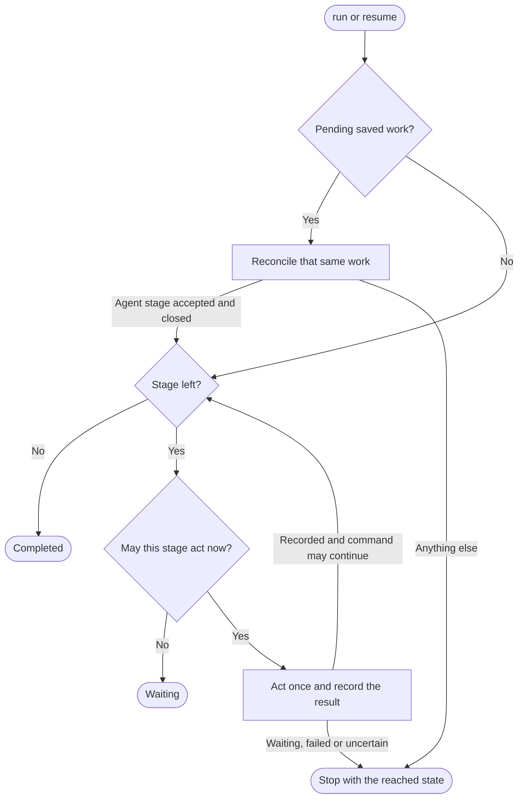

# Local workflow runner

Owns `src/workflow-runner.mjs`. Exports the async module functions `runWorkflow(options, ports)`, `resumeWorkflow(options, ports)` and `attachWorkflow(options, ports)`, and re-exports the frozen constant `WORKFLOW_STAGES` from `src/workflow-definitions.mjs` unchanged. [CLI dispatch](pdd-cli.prompt.md) calls them for `pdd workflow run|resume|attach`.

The runner takes one real GitHub issue through one workflow definition, in its own issue worktree. Each agent stage runs one fresh background native agent; the runner checks the handoff, files and tests itself before it accepts the stage. It waits for human decisions, creates real PRs and observes their merge. A local journal lets a later command continue the run. The foreground `run` or `resume` process is the **controller**: nothing advances after it exits. The runner never merges, never repeats an uncertain effect and never changes the person's login, permissions or global configuration.

Inputs:

- `runWorkflow({name, issue, agent, cwd, packageRoot}, ports)` starts a run. The [definition loader](workflow-definition-loader.prompt.md) selects `name`. The [GitHub helper](workflow-github.prompt.md) resolves `issue` in this repository and refuses PRs and other repositories. `agent` is `codex` or `claude`; absent or `null` means `codex`. `cwd` is in the source checkout.
- `resumeWorkflow({runId, decision, cwd, packageRoot}, ports)` continues a saved run. `runId` is a UUIDv4. `decision` is absent, `approve` or `skip`; other values, also `null`, refuse. `cwd` is any checkout that shares the run's common Git directory.
- `attachWorkflow({runId, cwd, packageRoot}, ports)` connects the terminal to the run's active stage agent.
- `packageRoot` is the package path. `ports` supplies guidance, the stage transport and test seams ([ports](#ports)).

A run's workflow, agent, issue and worktree never change after it starts.

Preservation: behavioral refinement. Keep the export names and binding kinds, option fields, result shape and exit mapping, saved-state locations, decision rules and every forbidden effect. Message wording, helpers, saved encodings and check order may vary, unless a rule states an order. A changed saved encoding makes earlier runs refuse on resume: safe, but it stops in-flight runs.

## Result and exit codes

Each call resolves with `{exitCode, state, runId, stage, message}` and never rejects. States map to the shared [exit codes](public-boundary.prompt.md#exit-codes-and-output):

| `state` | `exitCode` | Meaning |
| --- | --- | --- |
| `completed` | 0 | Every listed stage is done or skipped. |
| `waiting` | 2 | A person must decide, merge, finish agent setup or end an attachment. |
| `failed` | 1 | A check refused the input, the saved state or a stage result. |
| `recovery_required` | 1 | An effect may have happened, or an identity is not proved. Inspect first. |

`runId` is the new, supplied or original run ID; it is `null` when input checks fail, before a new ID exists, or when the saved journal cannot be read. `stage` is the current stage ID when known, else `null` (also after completion). `message` is one nonempty line that names the state, the run or that none started, the current stage and the next useful action. The CLI prints only this message.

**Errors become results.** In `runWorkflow` and `resumeWorkflow` any thrown error gives `failed`, but [stage guard](#attachment-and-the-stage-guard) contention gives `waiting`, because its holder is usually an attachment. In `attachWorkflow` every thrown error gives `recovery_required`. Bad inputs refuse this way before any effect, although the CLI parser normally refuses them first with exit code 2.

## Start a run

In this order:

1. Check `packageRoot`, the `loadGuidance` port and `agent`. Resolve the source checkout through Git, load the definition from its root and resolve the issue. Nothing is written.
2. Create a UUIDv4 run ID. Save the **run snapshot** under the common Git directory: the definition with all its Markdown, the full base guidance and `docs/workflows.md`. Reason: stage instructions must not depend on files that change after the worktree exists.
3. Ask the [worktree helper](workflow-worktree.prompt.md) to allocate the issue worktree from `refs/remotes/origin/<default branch>`. The assignment must name this run, repository, issue, workflow, source root and common directory, and pass the assignment check. A result other than `ready` gives `recovery_required` and starts nothing.
4. Take the controller lock, create the journal in the worktree's Git directory, save the [stage context](#stage-request-and-context) and start [progression](#command-progression).

The runner never creates, moves or deletes a worktree itself and never uses another checkout. It never touches the source checkout's working files, also dirty ones. Every stage, test, artifact and PR uses the assigned worktree.

**One run per issue.** The helper's issue claim covers every workflow name in the common repository. On an allocation conflict the runner finds the [original run](#original-run-discovery), takes its controller lock, reads its journal and returns its run ID and stage: `recovery_required` when work is pending, else `waiting`. It starts nothing and keeps the original agent and workflow. A live original controller gives `failed` with the original run ID.

**Accepted product decision:** starting a run authorizes the definition's agent stages, pushes and PRs under the person's own Git and GitHub access. Merge stages only observe.

## Saved state and checks

The [journal](#journal-snapshot-and-locks) is append-only and durable. The runner saves each intent before its effect. A torn, aliased or invalid journal or snapshot gives `failed` and is never repaired.

- **Snapshot check.** The snapshot is intact and belongs to the run. The loader's current selection from the original source root equals the saved definition, and the base guidance and `docs/workflows.md` equal the saved text. So an edited recipe, guide, skill, reference or overview gives `failed`; the runner never switches to edited source. Checked at each resume and attach, before each agent stage and where a step below names it.
- **Assignment check.** The saved assignment equals the helper's lookup and the actual worktree: path, Git directory, common directory, branch, and a HEAD that descends from the base commit. A symlinked `.git` refuses. Each resume also resolves the saved issue again, and the repository and default branch must be unchanged.
- **Current input.** The assignment check holds, the worktree **fingerprint** equals the saved input fingerprint, and each **pinned file** (a file of the accepted proposal) keeps its accepted SHA-256. The fingerprint covers HEAD, the branch, staged and unstaged changes, and the content of untracked files that Git does not ignore. So a manual worktree change gives `failed`, except the [merged-prompt transition](#prs-and-merges). Checked before each stage and where a step below names it. While an agent attempt is pending, the command start checks only pinned files and that HEAD descends from the attempt's input HEAD, because the agent changes the worktree.

**Exclusion.** One controller per run: a second live `run` or `resume` of it gets `failed`. Resume takes the controller lock before it reads the journal, so it never acts on a stale copy. **Accepted product decision:** no repository-wide limit. Distinct issues run independently with any number of unresolved stages; the runner keeps no repository admission state and leaves old admission files unchanged.

## Command progression

The figure owns the route of one command; the [decision table](#decision-table) owns each stage's guard.

**Pending saved work** is an agent attempt, an accepted stage that waits for cleanup, or a PR with an unknown outcome. Reconciling a PR always stops: `waiting` when the original PR is proved and recorded, else `recovery_required`.

**Command may continue** for a new run and for a resume with `approve` or `skip`. A resume without a decision never starts an agent stage, a test run or a PR. It stops after a merge observation: `completed` if that was the last stage, else `waiting`. A failed check ends any command with `failed`.

### Decision table

| Stage state reached | No decision | `approve` | `skip` |
| --- | --- | --- | --- |
| Agent attempt, first prompt not sent | Inspect | Continue the same first dispatch | Inspect |
| Agent attempt, other phase | Inspect | Inspect, then validate a settled candidate | Inspect |
| Accepted stage, cleanup due | Wait | Close the original once | Wait |
| PR outcome unknown | Reconcile | Reconcile | Reconcile |
| Optional stage, no saved choice | Wait | Save `approve`, run it | Save `skip`, skip it |
| Optional stage, saved `skip` | Skip it | Skip it | Skip it |
| Optional stage, saved `approve` | Wait | Run it | Fail |
| Human stage | Wait | Accept the current proposal | Fail |
| Other agent or PR stage | Wait | Run it | Fail |
| Merge stage | Observe | Observe | Fail |

- **Inspect** is read-only: `blocked` gives `waiting` with the same attempt, a settled candidate gives `waiting` and asks for `approve`, any other state gives `recovery_required`, and an inspection error or identity mismatch gives `failed`.
- **Fail** gives `failed` before any effect: only an optional stage may be skipped, and a saved `approve` never becomes a skip.
- **Saved choice.** An optional choice is saved, with the current fingerprint, before the stage acts. It holds on every later command, also after an interruption, so a later `approve` never runs a saved skip. A skipped PR stage also skips the merge stage whose `prStage` names it. A choice saved for another input refuses.
- **Human stage.** `approve` needs a recorded proposal with at least one pinned file and one test command. The runner rechecks those files and pins the proposal with the current fingerprint. There is no reject decision; silence never becomes approval.
- **Next-advance proposal.** A proposal with approval `next-advance` is pinned only by `approve`, and only if it was recorded before this command started with no pending work. Until then the next agent or PR stage waits. Reason: the person must see a proposal before an approval accepts it.
- **Decision use.** The first optional, human, agent or PR stage that a command reaches uses up its decision; reconciliation and merge observations do not. After that, optional stages without a saved choice and human stages wait; other stages go on. Unresolved: so one `approve` can validate a pending agent stage and also choose the next optional stage or accept the next human stage.

Behavior follows the definition fields (`kind`, `protocol`, `approval`, `optional`, `publication`, `prStage`, `requiresMerge`), never reserved stage IDs, so renamed and project stages get the same rules.

## Agent stages

**Delivery.** Each agent stage gets a new attempt ID and a unique handoff path. The runner saves the attempt with the exact [stage request](#stage-request-and-context) and prompt digest, then calls `runHerdrStage` once. It passes the latest closed backend of this run, so the transport may reuse its owned server but never that conversation. It saves each backend `checkpoint` durably before it returns. It refuses a checkpoint for another run, stage, attempt, cwd or agent, and one that changes an identity field that is already set.

**Candidate.** A **candidate** is a `settled` transport result whose backend matches the run, stage, attempt, cwd, agent and prompt digest, with integer evidence `readySeq < workingSeq < settledSeq`. It is not acceptance. From delivery, `blocked` gives `waiting` and keeps the attempt; any other state, a mismatch or a transport error gives `recovery_required`.

**Acceptance.** Under the stage guard, all of these must hold:

1. No attachment started since the attempt was saved. Otherwise drop the candidate and give `waiting`; a later `approve` validates the same attempt afresh.
2. A fresh inspection shows the same settled evidence (else `recovery_required`).
3. The snapshot and assignment checks hold, the handoff passes the [handoff rules](#handoff-and-verification-rules), pinned files are unchanged and HEAD descends from the input HEAD.
4. A `verify` stage's pinned tests pass.
5. A second handoff read equals the first; files, ancestry and assignment still hold; the fingerprint is unchanged since step 3; a last inspection shows the same evidence.

Then the runner saves the **acceptance** `{runId, stageId, attemptId, promptDigest, terminalId, evidenceDigest}`. `evidenceDigest` covers the backend, the handoff with test results, the raw handoff file digest, the output fingerprint and the pinned proposal. The output fingerprint becomes the saved input. A failure in steps 3 to 5 gives `failed` and keeps the attempt pending; a later `approve` validates it again against the worktree of that time and reruns `verify` tests.

**Cleanup** follows acceptance at once, or later on `approve` for a pending cleanup. Under the guard, the runner checks current input, the handoff files and the saved digests. It closes a backend in phase `candidate` once with `closeHerdrStage`; the reply must be `closed` with the backend that the transport checkpointed. A backend already `closed` is recorded without a second close. Any other phase or reply gives `recovery_required`. Then the stage is done.

**No resend.** The runner never starts a second attempt for a stage, never sends a second prompt and never closes again after an uncertain close. An attempt without a saved backend gives `recovery_required`. The one continuation: with `approve`, an attempt in phase `start_intent` or `ready` (first prompt not sent) continues the **same first dispatch**. The saved request bytes, or for an older attempt bytes rebuilt from saved fields, must give the saved prompt digest, else `failed` with no transport call. After the current-input check, `runHerdrStage` gets the same run, stage, attempt, agent, cwd, context, request and saved backend; the transport proves that the same agent is ready. Every other phase stays inspection-only.

## PRs and merges

A PR stage passes its [guards](#pr-guards), saves its intent and publishes once. A `verified` publication needs a [verification binding](#handoff-and-verification-rules) for the exact current input, so a later worktree change cannot reuse an older pass. A proved open or merged PR is recorded with its number, URL and head. A failed guard gives `failed`. An unknown outcome gives `recovery_required`, and then only read-only reconciliation of the same intent is allowed: no match, several matches or a changed match never permit another push or create. The runner never force-pushes, creates an empty PR or changes branch protection.

A merge stage only reads GitHub through its PR stage's saved intent. The observed PR must have the saved number and URL; another PR with the same marker, branch, base and head is not the original. A skipped PR stage skips the merge. Open gives `waiting`. Merged, with a merge commit of 40 to 64 lowercase hexadecimal digits, is recorded. Closed unmerged, merged without such a commit, or a failed read gives `failed`. Anything not proved, or another number or URL, gives `recovery_required`.

A stage with `requiresMerge` waits until that merge commit is in HEAD's history, unless the merge was skipped. The runner does no checkout or base rewrite.

**Merged-prompt transition.** After a prompt PR merges, the person updates the assigned branch with normal Git. At command start the runner adopts the changed worktree as input only with `approve`, no pending work, a current stage with `requiresMerge` whose merge commit is recorded, a clean worktree with no untracked file, unchanged pinned files, and the merge commit in HEAD's history. It saves the old and new input. A failed condition gives `failed`. Pending agent work blocks the transition, so an uncertain attempt cannot use it.

## Attachment and the stage guard

`attachWorkflow` connects the terminal to the exact active stage agent. It never starts a conversation, accepts a stage or advances the run. It takes no controller lock, so a person can attach while the controller waits.

The **stage guard** is a per-run lock under the common Git directory, separate from the controller lock. The transport gets it as `withStageGuard(backend, action)`; the backend must name this run and worktree. With `runHerdrStage`, `inspectHerdrStage` and `closeHerdrStage`, the guard runs the snapshot check before `action`, plus the current-input check in phase `ready` or `prompt_intent`, so a first prompt never goes out on changed input. The runner holds the guard for a whole attachment and from acceptance through cleanup; the transport holds it per observation or delivery, never across its waiting loop. Nested use within one async call chain reenters; another process or call meets contention. Each attachment durably raises an attachment epoch, and acceptance refuses a candidate from an older epoch. So attachment and acceptance exclude each other, and interaction during an attachment always needs fresh validation.

**Attach steps.** Look up the assignment read-only; not `ready` gives `recovery_required` and creates nothing. No live backend (none, `closed`, or a pending PR) means archived, and pending cleanup means accepted: both give `waiting` and attach nothing. Otherwise take the guard, read the journal again (acceptance may have won the guard), repeat those checks and the assignment and snapshot checks, raise the epoch and call `attachHerdrStage` inside the guard. Exit code 0 gives `waiting` (detached; the next resume inspects); any other code gives `recovery_required`.

<strong>Required interface reference: ports</strong>

- `loadGuidance({packageRoot, cwd, workflows: false})` — required; resolves with nonempty base guidance, guide first.
- `runHerdrStage`, `inspectHerdrStage` and `closeHerdrStage` — required before an agent stage starts; a pending attempt without `inspectHerdrStage` gives `recovery_required`. `attachHerdrStage` — required for attach. The [stage transport](workflow-stage-herdr.prompt.md) owns their requests, results, backend fields and phases. The runner passes `{withStageGuard, checkpoint}` as their ports, and only `{withStageGuard}` to attach.
- `allocateIssueWorktree`, `lookupIssueWorktree` — optional; each defaults to the worktree helper's function.
- `execFile(file, args, {cwd})` — optional; resolves with `{stdout, code?}`, and an integer `code` other than 0 fails. Default: Node `execFile`, UTF-8, no shell, 16 MiB output. When supplied, the helpers get it too; otherwise they keep their defaults.
- `stdout`, `stderr` — optional, default the process streams; they receive each verify command's output after the tests.

Other port fields are ignored.

<strong>Stage request and context composition</strong>

**Context**, guide first: the base guidance, with its `Current project: <source root>` line changed to `Original source project: <source root>` so the agent works in the worktree; then `Current assigned project: <worktree path>`, the full `docs/workflows.md`, the snapshot's name and digest, and each snapshot file under its `.pdd/workflows/<name>/<path>` header. The context and its SHA-256 are saved; each snapshot check recomposes and compares it.

**Prompt digest:** SHA-256 of the context, two newlines, `# Current workflow stage`, a newline and the request. This is the exact prompt that the transport sends and reports.

**Request:** instructions plus one JSON line between the lines `PDD_STAGE_INPUT_JSON` and `PDD_STAGE_INPUT_END`, with `runId`, `stageId`, `attemptId`, `protocol`, `requiredRoles`, `issue` (`{number, url, title, body}`), `inputRevision` (input HEAD), `inputFingerprint`, absolute `handoffPath`, `priorArtifacts` and `priorReports` (files, summaries, handoff paths and revisions of accepted stages) and `accepted` (pinned proposal or `null`). The instructions say: do only this stage, report and stop; read the entire supplied Prompting guide and summarize its method before any Story; work and commit on the assigned branch; use the saved recipe text, not a reloaded file; write the closed handoff by the protocol rules; PDD runs the tests. They forbid a later stage, push, PR create or merge, ending PDD, changing native login, permissions or global configuration, switching branch, forced checkout, reset, stash, overwriting unrelated work, and claiming a pass from an exit status or prose. Build the request only from saved fields, so it can be rebuilt for an older attempt.

<strong>Handoff, proposal and verification rules</strong>

The [handoff artifacts](workflow-artifacts.prompt.md) helper owns the schema, containment and hashing. The runner supplies the expected `runId`, `stageId`, canonical issue URL, `inputRevision` (the attempt's input HEAD) and the stage's `requiredRoles`. Handoffs live at `<run directory>/artifacts/<stageId>-<UUID>.json`.

- `report` may list no files; its summary is a report, not evidence.
- `proposal` lists at least one file and a nonempty `testCommands`. The runner records the approval mode, the files with a required role and `testCommands`. A human stage or the next-advance rule **pins** them with the fingerprint of that moment.
- `work` lists at least one file.
- `verify` lists at least one file, and a listed `testCommands` must equal the pinned plan. The runner saves a test intent and the fingerprint, runs the pinned plan with `runWorkflowTestCommands` in the worktree, writes the output to `stdout` and `stderr`, and saves the results. A command that does not pass gives `failed`, and so does a fingerprint that the tests changed: a test that changes its own input cannot certify it. Agent prose or a native exit is never a pass, and passing finite tests is not formal proof.

Accepting a `verify` stage saves the **verification binding**: output fingerprint, pinned plan and acceptance evidence digest. Verified publication needs the latest accepted `verify` stage with a binding fingerprint equal to the current input, a nonempty binding plan equal to the pinned plan, one result per command with exit code 0, and a binding digest equal to that stage's acceptance digest.

<strong>PR guards</strong>

In order: current input; the verification binding, for `verified`; each recorded merge commit that the stage depends on is in HEAD's history (its `requiresMerge` merge, else every recorded merge); `prepareWorkflowPr` with body file `<run directory>/pr-<stageId>.md` (the helper refuses a dirty tree, the default branch or no new commits, and writes the marker `pdd-workflow:<runId>:<stageId>`); current input again. Then save the intent and call `publishWorkflowPr` once. After a proved result, check current input and record the PR. `publication: proposal` needs no binding.

<strong>Original run discovery</strong>

Use the conflict result's assignment if it has one. Otherwise read the helper's issue claim `<common dir>/pdd/worktree-assignments/issues/<number>.json` only to learn the original run ID. The claim must be a regular file in real directories, not a symlink, with exactly two hard links (it links the run intent), at most 64 KiB, complete, unchanged during the read and for this common directory, repository and issue. `lookupIssueWorktree` for its run must be `ready` with the same identities. Else `failed`; never treat the claim as an assignment, repair it or allocate again. An original with other identities gives `recovery_required`.

<strong>Journal, snapshot and locks</strong>

- **Snapshot:** `<common dir>/pdd/workflow-inputs/<runId>/input.jsonl`, one line with the run ID, source root, definition, base guidance, overview and their SHA-256. Written once, never overwritten or deleted, also for a run ID that allocation then refused.
- **Journal:** `<worktree git dir>/pdd/workflows/<runId>/journal.jsonl`, one JSON row per line with a gapless sequence number from 1, an event label and the whole state; the last row is current. The state names the run (equal to the directory name), agent, definition, stages, assignment and a valid stage index. The run directory also holds `artifacts/` and PR body files.
- **Locks:** the controller lock in `<worktree git dir>/pdd/workflows/`; the stage guard and attachment epochs in `<common dir>/pdd/workflow-stage-guards/<runId>/`. A lock held by a live process, or not proved gone, refuses; a lock of a gone process is taken over without killing anything. An interrupted acquisition refuses until a person inspects it and is never cleared automatically.
- **Files** are owner-only, canonical, not symlinks and singly linked, and opened without following symlinks. Each append is written completely, then the file and its directory are synced. A redirected or multiply linked file refuses before any write through it.

## Dependencies

- [Prompting guide](../../docs/prompting-guide.md) — authoring and review method for this prompt.
- [Public boundary](public-boundary.prompt.md) — shared command scope and exit codes. Local consequence: states map to exit codes 0, 2 and 1; the runner pushes and creates PRs but never merges. Uses: authoring, review.
- [Stage definitions](workflow-definitions.prompt.md) — `WORKFLOW_STAGES`. Uses: generation, runtime.
- [Definition loader](workflow-definition-loader.prompt.md) — `loadWorkflowDefinition({name, cwd, packageRoot})` returns the frozen definition with `stages`, `files` and `digest`, or throws; owns each stage field and selects the [bundled workflows](bundled-workflows.prompt.md). Uses: generation, runtime, testing.
- [Guidance](guidance.prompt.md) — owner of the base guidance. Uses: runtime.
- [Workflow guidance](../../docs/workflows.md) — part of every stage context. Uses: runtime.
- [Issue worktrees](workflow-worktree.prompt.md) — allocation, lookup, the assignment and the issue claim. Uses: generation, runtime, testing.
- [GitHub effects](workflow-github.prompt.md) — `resolveWorkflowIssue`, `prepareWorkflowPr`, `publishWorkflowPr`, `reconcileWorkflowPr` and their outcomes. Local consequence: save the intent before publication; only reconcile after an unknown outcome. Uses: generation, runtime.
- [Handoff artifacts](workflow-artifacts.prompt.md) — `readWorkflowHandoff`, `assertWorkflowArtifacts`, `runWorkflowTestCommands`; the handoff schema. Uses: generation, runtime.
- [Stage transport](workflow-stage-herdr.prompt.md) — the four stage ports, backend identity, delivery and launch flags. Uses: generation, runtime, testing.
- [CLI dispatch](pdd-cli.prompt.md) — the caller; checks the result shape and prints `message`. Uses: authoring, testing.
- Node built-ins — `child_process`, `util`, `crypto`, `fs` (synchronous exclusive and no-follow open, fsync), `path`, `async_hooks` (`AsyncLocalStorage`), and `process.kill(pid, 0)` for lock owners. Uses: generation, runtime.
- git (tool) — `rev-parse`, `symbolic-ref`, `diff --binary`, `ls-files --others --exclude-standard`, `merge-base --is-ancestor`, `status --porcelain`. Push, `gh`, Herdr, `codex` and `claude` run only through the helpers and the transport. Uses: runtime.
