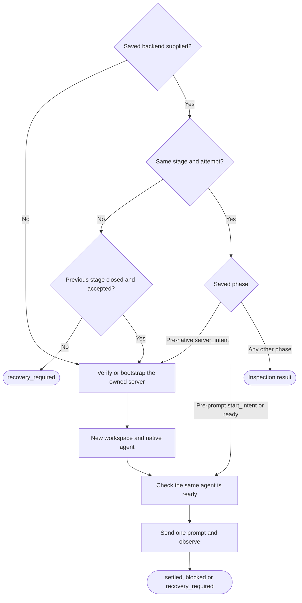

# Background native stage transport

Owns `src/workflow-stage-herdr.mjs`. Exports the async module functions `runHerdrStage(input, ports)`, `inspectHerdrStage({ backend, cwd }, ports)`, `attachHerdrStage({ backend }, ports)` and `closeHerdrStage({ backend, acceptance }, ports)`. The [workflow runner](workflow-runner.prompt.md) calls them through ports that [CLI dispatch](pdd-cli.prompt.md) binds.

The runner is the foreground **controller**. For each agent stage, this module starts a fresh **native agent** in a background Herdr server that the run owns. It sends one prompt and watches the same agent work and become ready again. The result is a **candidate**: the transport settled, nothing more. The runner validates the handoff, files, revision and tests before **acceptance**. This module also inspects a saved stage, attaches a person to its live agent and closes its workspace after acceptance. It acts only inside a caller's call and starts no PDD daemon, so nothing advances after the controller exits.

Inputs: run, stage and attempt IDs, the agent (`codex` or `claude`), the assigned issue worktree, the full context and stage instructions, an awaited `checkpoint`, the runner's `withStageGuard` and, on later calls, the saved **backend** record. Run, inspect and close return [`{ state, backend, evidence, reason?, detail? }`](#results-and-errors). Attach returns an exit code.

Preservation: behavioral refinement. Keep the exports and their binding kind, input and result shapes, backend fields, phase names, Herdr argv, reason codes, checkpoint order and forbidden effects. Private helpers, polling and check order may vary unless a rule names an order. Herdr 0.9.1 is the inspected capability baseline, not a proven minimum version. `pdd session` is out of scope.

## Routing and phases

What may `runHerdrStage` do with the backend that the caller supplies?

- **Fail closed.** A failed check, a bad Herdr reply or a failed checkpoint returns `recovery_required` at once, with the backend as far as it got. Only the [observation table](#identity-and-observation) polls again; nothing is retried.
- **Same original.** A supplied backend must pass the [backend check](#ports-and-records) and keep the run ID and worktree (`stage_binding_changed`). For the same stage and attempt, the prompt digest and agent must also match (`stage_input_changed`).
- **Pre-native** means phase `server_intent`, `nativeSession` null, empty `evidence`, and only the [start fields](#ports-and-records) plus an optional `server`. It proves that no workspace, agent or prompt effect happened. Recovery keeps the same IDs and digest.
- **Pre-prompt** means phase `start_intent` or `ready`, saved workspace, tab, pane and terminal IDs, no evidence except `readySeq`, and no `acceptanceDigest` or `cleanupConfirmation`. This path checks server status against the saved fingerprint, then the agent. It never bootstraps, creates a workspace or starts an agent.
- **Next stage.** A different stage or attempt needs a previous backend in phase `closed` with an `acceptanceDigest` (`previous_stage_not_released`). It donates its server and seed inventory, never its native conversation.

This table owns the checkpoint order. Each phase is checkpointed before the named effect.

| Phase | Checkpointed before |
| --- | --- |
| `server_intent` | any Herdr call; again with the fingerprint, before the workspace list |
| `workspace_intent` | `workspace create` |
| `start_intent` | `agent start`; again with the start reply's sequence and native session, before the live lookup |
| `ready` | the prompt step, with `readySeq` |
| `prompt_intent` | `agent prompt` |
| `submitted` | observation, after the prompt reply |
| `candidate` | returning `settled` |
| `close_intent` | `workspace close` |
| `closed` | returning `closed` |

## Owned server and workspace

- **Server name.** `pdd-` plus the first 20 hex characters of the SHA-256 of the lowercase run UUID. A name with the full UUID makes the socket path exceed Unix limits. Every Herdr command names this server with `--session`, never the person's focused or default session, so each run has its own server. Run and attempt IDs stay full in the record.
- **Legacy name.** The backend check also accepts `pdd-<lowercase run UUID>`, and inspect, attach and close use it as saved. Only pre-native recovery may switch to the short name, after status reports the legacy server stopped (`legacy_server_not_stopped`). It checkpoints the short name, without a fingerprint, before it touches the new target.
- **Ownership.** A fresh or pre-native stage may bootstrap only when status reports `running: false` for its session. A stopped donated server, or any other non-running reply, is `owned_server_missing`. A running target without a recorded fingerprint is not owned (`unowned_herdr_session`). A recorded fingerprint `{ session, socket, protocol, version }` must match exactly (`herdr_server_changed`). After bootstrap, poll status until the server runs or the startup limit ends; the target must then be [compatible](#herdr-commands) (`herdr_target_incompatible`). Never stop, restart or upgrade a server, or take over a shared one.
- **Environment.** The server child starts in the worktree with the controller's environment unchanged; add no `HERDR_STARTUP_CWD` or other variable. Agents inherit the server environment and shell startup, not a later caller's. Never serialize, forward or log environment values, tokens, credentials or config files. A missing tool, login or setting stays visible in the stage, unrepaired.
- **Capacity.** One active stage workspace per run server, beside its seed inventory. A fresh or recovered stage records the current workspace list as `seedWorkspaceIds`; a next stage uses the donated list. The seed list may be empty or hold one workspace, and the current list must equal it before allocation (`active_stage_capacity_unavailable`). Refuse without closing anything, and never close a seed workspace. Locks across issues belong to the runner and the [issue worktree](workflow-worktree.prompt.md) owner.
- **Workspace.** Create one no-focus workspace in the worktree and record its workspace, tab, root pane and terminal IDs (`invalid_workspace_reply`).

## Native start and the one prompt

**Accepted product decision:** each new stage runs its agent with full access and no approval prompts. After Herdr's `--` boundary, Codex gets `--no-daemon`, `--dangerously-bypass-approvals-and-sandbox`, `-c`, `projects={"<worktree>"={trust_level="trusted"}}`; Claude gets `--dangerously-skip-permissions`.

- `--no-daemon` selects the ordinary interactive Codex process, because the shared Codex daemon can refuse startup and the agent then disappears after the prompt.
- The `-c` value trusts only the worktree, for this invocation only, so Codex does not stop at its folder-trust question. Use the root key `projects` because Codex 0.159.1 splits `-c` override keys on literal dots. The JSON-quoted path keeps dots, spaces, quotes, backslashes and equals signs in one key.
- Forbidden: writing trust, config, auth or permission files; changing model, effort, provider, profile or `HOME`; another mode or a retry with other flags; changing or relaunching an existing agent.

1. **Start reply.** Pin it to the [agent identity](#identity-and-observation) and record its sequence and native session.
2. **Startup needs a person.** If start fails with `agent_not_ready`, look up the exact saved agent and checkpoint what it reports. If it is `blocked` or has `launch_pending`, return `blocked` with reason `native_start_person_action_required`, phase `start_intent` and a `detail` for operation `agent.start` whose message names `pdd workflow attach <runId>`. Otherwise return the refusal. A live lookup that finds this state after a good start returns the same result. Never scrape terminal text, answer a menu, restart the agent or add flags.
3. **Ready** means `agent_status` is `idle` or `done`, `interactive_ready` is true and `launch_pending` is not set. The live lookup must find the agent ready (`native_start_not_ready`); its sequence becomes `readySeq`.
4. **One prompt.** Send exactly `<context>\n\n# Current workflow stage\n<instructions>` as one argv item, never links in place of these bytes. `promptDigest` is its SHA-256 hex. In a nested guard call, look up the agent again and require it ready at `readySeq` (`fresh_agent_changed_before_prompt`), then send one `agent prompt` and pin its reply. A reply that shows `working` at a later sequence sets `workingSeq`. The reply is not a native turn receipt.
5. **No resend.** A failure before `prompt_intent` sends no prompt. After it, a lost reply, timeout, stall or unknown state leaves the original attempt for inspection: no second prompt, other agent, other workspace or new attempt.

## Identity and observation

Each lookup is `agent get <agentName>`. Every lookup and reply keeps the pinned identity:

- A reply on the saved pane and terminal with no agent is `native_agent_unavailable`, not a replacement or a missing account.
- Workspace, tab, pane, terminal, name and agent kind equal the saved values (`stage_identity_changed`). The agent's real cwd (`cwd`, else `foreground_cwd`) is the worktree (`stage_cwd_changed`).
- Once `nativeSession` is set, `agent_session` stays equal (`native_identity_changed`). Record it only when Herdr reports it, else keep null. Never derive a native ID from a pane, name or attempt.
- `state_change_seq` is a safe integer of 0 or more (`invalid_agent_reply`), never below the last recorded value (`stage_sequence_reversed`).

After submission, `runHerdrStage` polls the same agent. Each lookup is its own guard call; the guard is never held across the wait, so that a person can attach.

| Observed | Result |
| --- | --- |
| `blocked` | checkpoint; return `blocked` (`native_person_action_required`) |
| `working` in `prompt_intent` or `submitted`, above `readySeq` | keep the first `workingSeq`; checkpoint; poll again |
| `working` in another phase, or not above `readySeq` | `unexpected_native_activity` or `missing_new_prompt_activity` |
| ready, after `workingSeq`, at a later sequence | set `settledSeq` and phase `candidate`; checkpoint; return `settled` |
| any other ready state | `no_observed_prompt_activity`: poll again; with no work seen when the first-activity window ends, `prompt_activity_stalled` |
| anything else | `native_state_unknown` |

Settled evidence is exactly `{ readySeq, workingSeq, settledSeq }`, each above the one before. A `candidate` whose sequence later differs from `settledSeq` is `candidate_sequence_changed`, never a new candidate. The overall wait ends with `stage_wait_timeout`. Never infer success from idle, terminal prose or a finished turn, and never invent a turn ID or report.

<strong>Stage guard: requirement, reentrance and attach contention</strong>

All four functions require `ports.withStageGuard(backend, action)`. Without it, `runHerdrStage` returns `invalid_stage_input` before any checkpoint or Herdr call, inspect and close return `stage_guard_required`, and attach returns 1. The runner owns the lock, its reentrance and the attachment epoch; this module writes no journal or epoch. One guard call covers the whole `runHerdrStage` startup, from the server check to `submitted`. The guard must be reentrant: close inspects inside its own guard, and the runner may call close inside the same guard.

While a person is attached, the guard throws code `WORKFLOW_STAGE_BUSY`. In `runHerdrStage` observation only, this means "still active": no lookup, checkpoint or settlement, and backend and evidence stay unchanged. Sleep one poll interval and observe the same original again. Paused time does not count toward the first-activity window, but it counts toward the overall wait. Inspection reports this contention as `native_stage_active`. Anywhere else it is a refusal with that code. After detach the runner treats an earlier candidate as stale; this module never resends for it.

## Inspection, attachment and cleanup

**`inspectHerdrStage`** is read only. Its `cwd` (default: the saved one) must resolve to the saved worktree. Phase `closed` returns `stage_archived` and `close_intent` returns `stage_cleanup_unconfirmed`, both with no Herdr call. Otherwise it checks status against the saved fingerprint and makes one observation from the table, without a checkpoint. A row that would poll again is final: active work is `native_stage_active`, and another ready state is `no_observed_prompt_activity`. It never prompts, starts, bootstraps, creates, closes, waits or checkpoints, even in `server_intent`.

**`attachHerdrStage`** returns 2 for phase `closed`, with no effect. Otherwise, under the guard, it verifies the fingerprint and exact agent identity. It runs `herdr --session <session> agent attach <agentName>` in the worktree with inherited stdio and environment and no shell, holds the guard until that process exits and returns its exit code. A refusal, a spawn error or a missing integer code returns 1. It never starts a conversation, resumes closed history, moves panes or changes stage state.

**`closeHerdrStage`** needs phase `candidate` and an acceptance with matching `runId`, `stageId`, `attemptId`, `promptDigest` and `terminalId` and a 64-character lowercase hex `evidenceDigest` (`durable_stage_acceptance_required`). Acceptance is the runner's durable record, not a person's consent. Under the guard it inspects again and requires `settled` at the same `settledSeq` (`stage_not_quiescent`). It sets `acceptanceDigest`, checkpoints `close_intent` through `ports.checkpoint`, closes only the stage workspace and [confirms the close](#cleanup-confirmation). Then it sets `cleanupConfirmation`, checkpoints `closed` and returns `{ state: 'closed', backend, evidence }`. A later failure keeps `close_intent` and returns `recovery_required`. Never repeat the close, send a prompt or claim an unconfirmed close. Never close a working, blocked, unknown, replaced or unrelated workspace, or a seed workspace. A closed stage is archived evidence, not a live conversation.

<strong>Cleanup confirmation: acknowledgement and readback</strong>

Both checks must pass under the same guard, or the reason is `workspace_close_unconfirmed`:

1. The close reply is an object, not an array, with `id` `cli:workspace:close` and `result.type` `ok`.
2. A following `workspace list` reply has `id` `cli:workspace:list`, `result.type` `workspace_list`, an array of objects with unique string `workspace_id` values, and no entry for the closed workspace.

Exit code 0 or parseable JSON alone is not proof. On success, `cleanupConfirmation` is `{ acknowledgement: 'ok', absentWorkspaceId: <workspaceId> }`.

<strong>Herdr commands and required replies</strong>

Each command runs `herdr --session <session> ...` through `execFile` with the worktree as cwd, `shell: false`, no `env` option, UTF-8, a 1 MiB output limit and a 10-second timeout. Each reply must be one JSON object without an `error` field.

| Purpose | Arguments after `--session <session>` | Required reply |
| --- | --- | --- |
| Status | `status server --json` | compatible: `running` true, same `session`, `compatible` and `endpoint_compatible` true, integer `protocol`, string `version`, non-empty `socket` |
| Bootstrap | `server`, spawned detached with `stdio: 'ignore'`, then released | none; poll status |
| Inventory | `workspace list` | `result.workspaces`: objects with string `workspace_id` |
| Workspace | `workspace create --cwd <worktree> --label "PDD <stageId>" --no-focus` | `result.workspace.workspace_id`, `result.tab.tab_id`, `result.root_pane.pane_id` and `terminal_id` |
| Start | `agent start <agentName> --kind <agent> --pane <paneId> --timeout <startupMs> -- <native argv>`, command timeout `startupMs` plus 5 seconds | `result.agent` |
| Lookup | `agent get <agentName>` | `result.agent` |
| Prompt | `agent prompt <agentName> <prompt>` | `result.agent` |
| Close | `workspace close <workspaceId>` | see cleanup confirmation |
| Attach | `agent attach <agentName>`, spawned with `stdio: 'inherit'` | exit code |

<strong>Input check, ports, defaults and backend record</strong>

`runHerdrStage` input: `runId` and `attemptId` are UUIDv4 text in any case, `stageId` matches `^[a-z][a-z0-9-]{0,63}$`, `agent` is `codex` or `claude`, `cwd` resolves to its real path, `context` and `instructions` are non-blank strings, `checkpoint` is a function and `backend` is optional. Other input is `invalid_stage_input`, with no checkpoint and no Herdr call.

`checkpoint(snapshot)` gets a structured clone of the backend and is awaited. If it throws, its error `code` becomes the reason and the next effect does not happen. `closeHerdrStage` takes it from `ports.checkpoint` (`durable_checkpoint_required` if absent).

Optional ports, which tests replace with stand-ins instead of a live server, agent or account: `execFile`, `spawn`, `spawnServer(session, cwd)`, `spawnAttach(session, agentName, cwd)`, `sleep(ms)`, `now()`, and in milliseconds `pollMs` (default 100), `startupMs` (30,000: bootstrap wait and agent start), `activityMs` (5,000: first-activity window) and `timeoutMs` (1,800,000: overall wait).

Backend record, version 1. The start fields are `version`, `runId`, `stageId`, `attemptId`, `agent`, `cwd`, `session`, `agentName` (`pdd-` plus the first 24 hex characters of the SHA-256 of the attempt ID), `promptDigest`, `nativeSession` (object or null), `phase` and `evidence`. Later fields are `server`, `seedWorkspaceIds`, `maxActiveStages` (1), `workspaceId`, `tabId`, `paneId`, `terminalId`, `lastSeq`, `acceptanceDigest` (SHA-256 of the acceptance as JSON with sorted keys) and `cleanupConfirmation`. Once set, identity fields do not change, except in the legacy rename.

The backend check (`invalid_stage_backend`) requires version 1, valid IDs, stage name and agent, a string `cwd`, a `session` that is the short or legacy name of that run, and either a `server` with the same session or a pre-native record.

<strong>Results, reasons and structured error detail</strong>

Run and inspect return `state` `settled`, `blocked` or `recovery_required`. Close returns `closed` or `recovery_required`. None of them rejects for a refused stage. `backend` is a copy of the record as far as it got, or null when input failed before any backend existed. `evidence` copies `backend.evidence`, or is `{}`. `reason` is a stable code: one named in this prompt, a Herdr error code, a Node error code, or a fallback (`stage_transport_uncertain`, `stage_inspection_unavailable`, `stage_cleanup_uncertain`).

When a Herdr command fails, the code comes from its JSON `error.code` (letters, digits, `_` or `-`, at most 100 characters), else from a text process error code, else `herdr_command_failed`. Output that is not JSON is `herdr_invalid_json`. A non-object reply, or an error reply without a usable code, is `invalid_herdr_reply`. `runHerdrStage` adds `detail: { operation, code, message? }`, where `operation` is the command group and verb, such as `workspace.list`. `message` is the Herdr error message cut to 600 characters. It is never kept for `agent.prompt`, because that error can echo the prompt. Never include the Node failure message, the prompt, raw stdout or stderr, or environment values.

## Dependencies

- [Prompting guide](../../docs/prompting-guide.md) — authoring and review method for this prompt.
- [Public boundary](public-boundary.prompt.md) — shared local scope and the full-access decision (authoring, generation). Local consequence: the native argv above is the only permission change, with no private service and no global config rewrite.
- [Workflow runner](workflow-runner.prompt.md) — caller (generation, runtime, testing). It supplies `checkpoint` and `withStageGuard`, journals each snapshot, owns the attachment epoch and acceptance, and decides when to pass the same original again.
- Node built-ins (runtime): `node:child_process` `execFile` and `spawn` run Herdr; `node:util` `promisify`; `node:crypto` `createHash` for SHA-256; `node:fs/promises` `realpath` for worktree paths.
- `herdr` CLI (runtime), 0.9.1 baseline: `status server`, `server`, `workspace list|create|close`, `agent start|get|prompt|attach`.
- `codex` and `claude` (runtime): started only through `herdr agent start`.

Navigation only: [background stages in the workflows guide](../../docs/workflows.md#background-stages-and-attachment).
