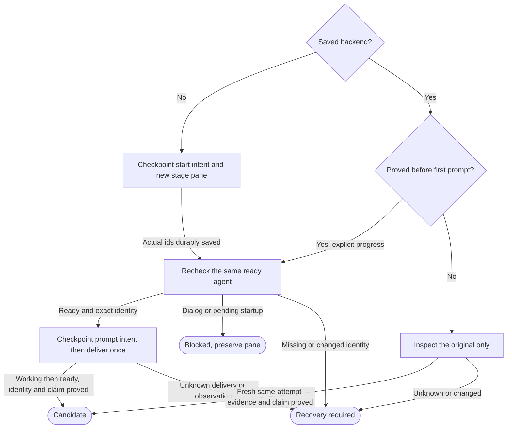

# Background workflow stage in the run tab

Own `src/workflow-stage-herdr.mjs`. Draft for review. It transports one fresh
native stage request and preserves its real identity through observation,
attachment and cleanup. The runner alone accepts results. Preservation:
behavioral refinement of the four existing exports, exact handoffs, actual
native identities and no-repeat guarantees. New runs use the controller's tab
in Herdr `default`; saved hidden-server backends remain inspect-only until
explicit adoption. Never move or close their work during migration.

Module functions retain `runHerdrStage({runId,stageId,attemptId,agent,cwd,
context,instructions,launchSelection,backend?,checkpoint},ports)`, `inspectHerdrStage({backend,
cwd},ports)`, `attachHerdrStage({backend},ports)`, and
`closeHerdrStage({backend,acceptance},ports)`. Return state `settled`, `blocked`
or `recovery_required`, backend, evidence and optional reason. During normal
polling, temporary guarded activity remains active. Settled is only a transport
candidate; idle, exit zero and model prose do not certify stage completion.

Actual backend identity and durable first delivery

The caller supplies the run's saved default session/workspace/tab and an awaited
checkpoint. Allocate only a new pane owned by this stage in that tab, without
focus. If the installed Herdr cannot do that with its documented schema, return
unsupported without falling back to a private server or shared-workspace close.
No server bootstrap, restart, environment overlay or credential/config copy.

Backend retains actual `session`, `workspaceId`, `tabId`, `paneId`, `terminalId`,
agent name/kind, optional `nativeSession`, lifecycle sequence, prompt digest,
phase and cleanup evidence. Add `backendGen`, `attemptId` and the actual `launchSelection`; recovery uses that
backend’s saved validated model/effort pair. Never fabricate a
native id from an attempt, name, pane or process. Hold a provisional claim
until the real id appears. On discovery in any acknowledgement or guarded
observation, checkpoint that identity before promoting through the claims owner's
`promoteWorkflowClaim` module function. Require a positively owned native claim
before further delivery, observation callback, working/candidate progression,
attachment or cleanup. Busy, retired, unknown or failed promotion preserves the
discovered identity, provisional exclusion and original prompt phase, returning
recovery_required without resend or replacement. A later explicit inspection may
reconcile the same claim; it never repeats the prompt. Run and attempt ids are UUIDv4; stage id is the
validated recipe id. Cwd must equal the actual immutable assigned worktree.

Checkpoint before create/start/prompt, after every returned identity, and after
a start acknowledgement before a live lookup. Durability failure fences all
later effects. Save full guide-first context+instructions bytes and their actual
digest. Start with exactly `nativeArgs({agent,cwd,selection:launchSelection})`
after Herdr's supported `--` boundary, including its full-access flags. The
caller supplies the model owner's validated target-machine model/effort pair;
checkpoint it before launch and pass it unchanged. The native-flags owner alone
encodes that pair with the installed CLI's supported arguments; no arbitrary
passthrough, hardcoded model list or global configuration writes. Revalidate
support through `resolveWorkflowLaunchModel` with the saved `frozenSelection` on
recovery; a known unsupported saved pair blocks. Under the model owner's rule 10,
an unavailable list preserves the frozen pair or native-default policy without a
duplicate warning. Only the explicit native-default policy may encode no model
flags; silently dropping a real pair remains unsupported.
Preserve provider, login and HOME. Managed restore consults the current machine/tool
policy and its durable account transition, alongside the actual backend account
and launch record. Saved account observations never override machine Settings.

Immediately before first prompt, under the shared guard, reassert exact actual
pane/terminal/native identity, cwd and ready lifecycle sequence. Require a
fresh pane.process_info matching the stage process/start identity plus its
durable journal checkpoint for the current backendGen, both before first prompt
and after native-history resume. Process proof without the saved generation,
or a generation without process proof, is insufficient. Agent idle alone
is insufficient: startup dialogs or launch_pending are blocked. On startup
refusal, read the exact saved agent and retain any supplied native id/sequence
before returning `native_start_person_action_required` with normal attach
instructions. No terminal scraping, autoanswer or alternate launch.

Explicit progress may continue only the SAME `start_intent` or `ready` backend
when no prompt/submission/working/acceptance/cleanup evidence exists and the
original digest matches. It may recheck readiness and perform the ONE initial
prompt; it cannot create/start another pane or agent. A saved prompt_intent or
later phase is always inspection-only. Lost prompt reply, vanished agent or
unknown identity preserves the phase and ids and never starts again.

Observation, attachment and cleanup

Observe the same agent working after the prompt, then ready/settled at a later
lifecycle sequence. Preserve the initial ready and candidate sequences; never
silently substitute a later sequence for a captured candidate. Inspector never
delivers or repeats a native effect or changes an effect intent. Its one ownership
exception is checkpointing a newly discovered native id using `ports.checkpoint`
and reconciling the same generation's provisional/native claim under the guard.
Missing or failed checkpoint refuses promotion and settlement; a saved id can be
reconciled without rewriting its discovery. Unknown or changed identity gives finite recovery
information, not another process. A complete absent-agent answer means
`native_agent_unavailable`, never successful completion or proof that a prompt
was not sent. Retain bounded structured codes/operations; raw prompt errors,
stdout, stderr and environment must not enter diagnostics.

Require `ports.withStageGuard(backend,action)`; no no-op substitute. Wrap each
identity/ready observation, first delivery, full attachment and cleanup. The
runner holds it across fresh handoff/currentness/tests, durable acceptance and
cleanup. It supplies an attachment epoch; candidates from before an attachment
are invalid. After detach, freshly inspect the original attempt. Hold the guard
through attachment, never across all polling. Ordinary `WORKFLOW_STAGE_BUSY`
during observation is active/stage_temporarily_guarded with unchanged evidence;
do not query/checkpoint/settle outside it or count that interval as first-activity
failure. Poll the same original after detach. A supplied `onStageObservation` callback
receives fresh guarded observations for the runner's idle alarm; a pause request
returns active without cleanup, termination or another prompt. Stage duration has no hard failure
timeout; a stall returns an alarm/uncertainty without killing or repeating work.

Attach the exact saved active session through normal Herdr attach. Archived or
closed history returns finite information and never creates a conversation.
Attachment exit is not stage completion. A new process increments backendGen;
merely observing a relocated same live process does not invent a new generation.

Cleanup needs the runner's durable acceptance bound to run/stage/attempt,
backendGen, prompt and evidence digest. Under the guard, recheck exact identity,
ready sequence and current attachment epoch, then checkpoint close intent.
Close only that stage's own pane. A stage-exclusive tab may close only if the
run created it solely for that stage and a fresh inventory proves it contains
no controller, other stage or person pane. Never close a shared workspace,
controller pane or run tab. Require the documented close acknowledgement and a
complete inventory proving the exact resource absent. Lost/malformed reply or
readback remains cleanup-uncertain; do not repeat close, prompt or progression.
Cleanup-intent inspection never relabels it a new candidate. Preserve archive
ids, handoff and acceptance; uncertain cleanup stops before the next stage.

## Resume a proved stopped native process

Add module function `resumeHerdrStage({backend,cwd,resumeIntent,checkpoint},ports)`
for controller recovery, separate from read-only inspect and ordinary first
prompt delivery. `resumeIntent` is the durable runner record with original
run/stage/attempt, old/current native id, tool/provider/account, old/new generation, machine/tool policy revision, saved launchSelection
and stopped proof. Require complete stable Herdr absence and a free native claim;
unknown absence or a live successor refuses. Consult retirement authority, obtain
new generation/provisional exclusion, then start the SAME native id through its
saved managed launch path with nativeArgs resume. No new conversation, original
stage prompt or recovery continuation is sent by this method. Checkpoint returned
actual ids before any other effect; lost start reply reconciles that exact intent
and never repeats it. Return active/blocked/recovery_required with actual backend.
Readiness after resume requires pane-specific process proof and the new durable
backendGen, not idle. A failed Claude resume returns Needs you; a successor
handoff needs its own intent, permission and stopped-predecessor proof. Never
blindly retry the resume. The controller revalidates frozen context, original prompt history and uncertain
effects before separately admitting any once-only recovery continuation.
A prompt_intent without proved delivery remains uncertain even after native resume.

## Opt-in transport tracing

When `PDD_TRACE=herdr` is selected, send actual Herdr requests and their replies
or failures through the shared trace owner's redacted request/reply/timing
logging. With tracing absent, no trace file is created. Tracing is diagnostic
only: preserve each invocation's arguments, receiver, result/error and call
count, all durable ordering and every identity/lifecycle/refusal gate. Never
retry a request or infer capability, delivery or acceptance from a trace.
Prompts, pane command text, paths, environment and arbitrary error text must not
enter the log; the trace owner defines positive projection and secure bounds.

## Dependencies

- [Herdr trace](herdr-trace.prompt.md): required generation/runtime for the module function `traceHerdrRequest`, opt-in redaction and bounded diagnostics; it grants no transport or controller authority.

- [Story](../../story/cli/WORKFLOW-STAGE-HERDR.md) and [cases](../../vectors/cli/workflow-stage-herdr.json): verification; expected outcomes, not observed results.
- [Native flags](native-flags.prompt.md): required generation/runtime for exact
  native arguments. The adapter cannot redefine the launch policy.
- [Claims](workflow-claims.prompt.md): required generation/runtime for provisional
  and native claims and current-generation fencing.
- [Machine CLI models](workflow-models.prompt.md): required generation/runtime and verification for the accepted selection and support checks. Native-flags selection parameter is an integration change requiring its owner (recorded in lane notes); absence is unsupported, never launch with the wrong pair.
- Caller-supplied durable checkpoint, stage guard, controller tab and acceptance:
  required runtime inputs. The runner supplies actual assignment/currentness.
- Documented installed Herdr CLI schema and argv-only `execFile`: required
  transport context for generation/runtime. Exact pane create/close/process
  methods need the transport spike; unavailable methods are unsupported.
  Tests use capturing stand-ins; no live model, accounts or shared Herdr changes.
