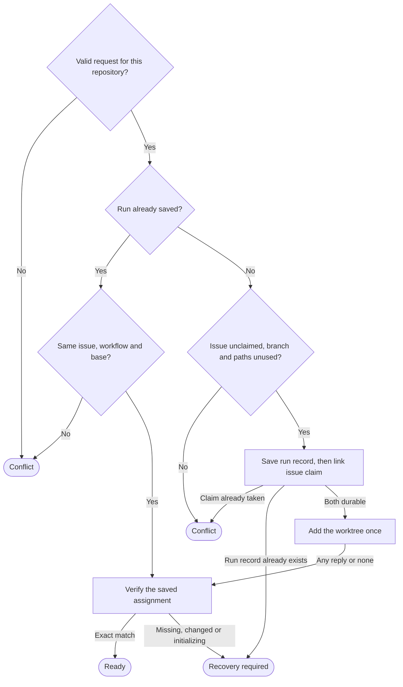

# Issue worktrees

Owns `src/workflow-worktree.mjs`. Exports the module functions `allocateIssueWorktree({ cwd, repository, issueNumber, runId, workflowName, baseRef }, ports)` and `lookupIssueWorktree({ cwd, runId }, ports)`. The [workflow runner](workflow-runner.prompt.md) calls them to start and resume runs.

Each issue run gets its own Git worktree and branch, so one issue's stages cannot change another issue's files or the person's checkout. The module owns the saved assignment, the exclusive issue claim and the single `git worktree add`. The runner owns the journal and the stages. `cwd` is any checkout of the repository. The optional `ports.execFile` replaces Git execution. Inputs are copied at call time.

Both functions resolve to `{ state, assignment, message }` and never reject. `assignment` is the verified run record for `ready`, and `null` otherwise. `message` is short text without raw Git output, and its wording is free.

- `ready`: the saved assignment and the real worktree match exactly.
- `conflict`: the request is invalid, names another repository, or collides with a saved run, an issue claim, a branch or a path. No claim or worktree was added. Lookup never returns it.
- `recovery_required`: the identity is missing, incomplete, changed, unreadable or uncertain. Inspect this same run. Never allocate again.

Forbidden effects: any change to the person's checkout (switch, reset, stash, or its dirty and untracked files); releasing a claim; rewriting or deleting a record; removing, unlocking, repairing or pruning a worktree; a second add; a fetch; any network, GitHub or native agent call.

Preservation: behavioral refinement. Keep the exports, their binding kind and every observable rule here. Messages, private helpers, timeouts, buffer sizes and unstated check order may vary.

## Allocate once, then verify

**Failure rule.** Any Git or filesystem step that fails or answers unexpectedly returns `recovery_required`. Before the run record exists, nothing is claimed. After that, the record and the claim stay as they are.

**Valid request.** A safe name starts with a letter or digit and holds only letters, digits, `.`, `_` and `-`. `repository` is `owner/name`, two safe names. `runId` is a safe name of at most 160 characters, and `workflowName` of at most 80. `issueNumber` is a positive safe integer, not a string. `baseRef` is nonempty, has no control characters and does not start with `-`. Other input returns `conflict` before any Git call. Lookup returns `recovery_required` for an invalid `runId`.

**Repository binding.** Git resolves `cwd` to the canonical real paths of its top level (`sourceRoot`) and its common Git directory (`commonDir`). The `origin` URL must be `https://github.com/owner/name`, `ssh://github.com/owner/name` (optionally with user `git`) or `git@github.com:owner/name`, with an optional `.git` ending and no port, query, fragment or credentials. Any other origin falls under the failure rule. An origin for another repository returns `conflict`. Compare repositories ignoring case, and save the supplied spelling.

**Same request.** A saved run keeps its first issue, workflow and base. The same values only verify. Different values return `conflict`. The saved-run check comes before the claim check, so a run never conflicts with its own claim.

**Exclusive issue claim.** The claim key is `commonDir` plus `issueNumber`, whatever the workflow name. So a second run for the issue gets `conflict` from every linked checkout. Separate clones do not share claims.

**Pinned base.** `baseRef` must be an existing local ref whose full name starts with `refs/`, such as `main` or `refs/remotes/origin/main`. Its commit becomes `baseSha`, 40 lowercase hexadecimal characters. An absent ref or a revision expression such as `main~0` falls under the failure rule. A saved run never moves to a newer commit.

**Fresh identity.** A new allocation generates a lowercase UUIDv4 and derives its [names](#saved-records) from it. An existing branch with that name, or anything at the intended worktree path or Git directory (a symbolic link too), returns `conflict`. Never reuse the current worktree or adopt another worktree, branch or folder.

**Immutable run index.** Each run has its own record file, created exclusively and never rewritten. So parallel allocations for different issues all persist, without a shared index file to read and replace.

**Durable intent before add.** Write the run record, and fsync the file and its folder. Then create the issue claim as a hard link to that file, and fsync the claim folder. The link is atomic, so it serializes a contested issue across processes and linked checkouts. Add only after both read back as one unchanged record. If another run linked the claim first, return `conflict` and keep this run's record. If another call created this run's record first, return `recovery_required`.

**One add only.** Run `git worktree add -b <branch> <worktreePath> <baseSha>` from `sourceRoot` once in the life of a run. Whatever it returns, even a failure or no reply, verify next. The real matching state proves `ready` after a lost reply. No later call adds again, even when the worktree is missing.

**Read-only verify.** Return `ready` only when every [identity check](#identity-checks) passes. Lookup runs only this step, from any checkout that shares the common directory. This step creates or changes no file or folder, not even `pdd`. It runs only the Git subcommands `rev-parse`, `remote get-url`, `symbolic-ref`, `merge-base` and `worktree list`. A partial record or a missing claim stays as found.

**Later work and locks.** Later commits and dirty files in the worktree do not block `ready`. A protective lock with no reason, or with another reason, does not block it either. Git's `initializing` lock means that the checkout may be incomplete, even when the path, branch, HEAD and Git directory match. So that state stays `recovery_required` until the original add finishes.

<strong>Saved records: locations, branch name, fields and file forms</strong>

All items live under the common Git directory, so every linked checkout sees the same ones.

| Item | Location |
| --- | --- |
| Run record | `<commonDir>/pdd/worktree-assignments/runs/<runId>.json` |
| Issue claim | `<commonDir>/pdd/worktree-assignments/issues/<issueNumber>.json` |
| Worktree | `<commonDir>/pdd/worktrees/<UUID>` |
| Its Git directory | `<commonDir>/worktrees/<UUID>` |
| Branch | `pdd/<safeName>-<issueNumber>-<uuidShort>` |

`safeName` is `workflowName` in lowercase, with each character other than `a` to `z`, `0` to `9` and `-` changed to `-`, each run of `-` reduced to one, and only the first 40 characters kept. `uuidShort` is the first 8 characters of the UUID. The branch must pass `git check-ref-format --branch`.

The run record is one JSON object and a final newline. Its fields are exactly `version` (1), `runId`, `repository`, `issueNumber`, `workflowName` and `baseRef` (as supplied), `commonDir`, `sourceRoot` (the allocating checkout), `worktreePath`, `gitDir`, `branch` and `baseSha`. Paths are absolute and canonical. A `ready` assignment equals this record.

The claim is a hard link to the run record: one file with link count 2. The runner reads the claim to find the original `runId` of a claimed issue, so keep its location, content and link count.

The metadata folders `pdd`, `pdd/worktree-assignments`, its `runs` and `issues`, and `pdd/worktrees` must be ordinary folders at canonical paths, never symbolic links. Allocation creates missing ones. A record is read only as an ordinary file with the expected link count, without following a symbolic link.

<strong>Identity checks for a ready result</strong>

- The run record has exactly the fields above, with valid values. Its `runId`, `commonDir` and repository (ignoring case) match the request and the caller's checkout. Its `worktreePath`, `gitDir` and `branch` are the names derived from one UUID.
- The claim is the same file (same device and inode, link count 2) with equal content.
- `sourceRoot` is still a checkout with the same common directory and origin repository.
- `worktreePath`, `gitDir` and `<commonDir>/worktrees` are ordinary canonical folders, and `worktreePath/.git` is an ordinary file with link count 1.
- In `worktreePath`, Git reports it as the top level, `gitDir` as the Git directory, the same `commonDir` and origin repository, and `branch` as the current branch. HEAD is `baseSha` or descends from it.
- `git worktree list` has exactly one entry with that path or that branch. The entry has both and the same HEAD. It is not bare, detached, prunable or locked as `initializing`.
- The record and the claim read back unchanged after these Git reads.

<strong>Command port and default Git execution</strong>

`ports.execFile('git', args, { cwd })` receives an argv array and an options object that holds only `cwd`. It returns or resolves `{ stdout, stderr?, code? }` with a string `stdout` and an optional integer `code`. A missing `code` means exit code 0. A nonzero exit code fails the step, except in the branch check: there, exit code 1 means the branch is absent, and any other code returns `conflict`. A rejection with an integer nonzero `code` counts as that exit code, with the error's `stdout` or empty output. Any other rejection, including one with `code` 0, fails the step and is never success.

The default is Node `execFile` with the argv array, no shell, the inherited environment, the given `cwd`, a finite timeout and bounded output. Never add credentials, environment changes or safety overrides such as `--force`.

## Dependencies

- [Prompting guide](../../docs/prompting-guide.md) — authoring and review method for this prompt.
- [Public boundary](public-boundary.prompt.md) — shared local scope and package policy, for authoring and generation. Local consequence: this module uses only Node built-ins and the installed Git, and makes no network, GitHub or account call.
- Node built-ins — runtime: `node:child_process` `execFile` and `node:util` `promisify` for the default port, `node:crypto` `randomUUID` for the UUID, and `node:fs`, `node:fs/promises` and `node:path` for exclusive files, hard links, fsync and real paths.
- Git, installed — runtime and testing: `rev-parse`, `remote get-url origin`, `check-ref-format --branch`, `show-ref --verify --quiet`, `worktree add -b`, `worktree list --porcelain -z`, `symbolic-ref --quiet --short HEAD` and `merge-base --is-ancestor`.
